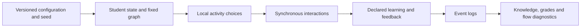

# Classroom Swarm

I developed a reproducible agent-based classroom model to study how independent work, peer discussion, copying and later AI-assistance policies can affect knowledge, grades and answer-sharing networks. My work includes the model engines, experiment configuration, event logs, diagnostics and validation tools.

Developed by [Vavan Farizzaman](https://github.com/VavanZaa).

## Algorithm

1. Generate a seeded classroom with student state, a fixed social graph and separate semantic random-number streams.
2. Compute feasible activity utilities from each model version's local information, time costs, beliefs and observed feedback; sample the resulting activity policy.
3. Route answer requests and peer interactions synchronously. A received answer cannot be forwarded until the following micro-round.
4. Apply only the learning and feedback mechanisms declared by the selected engine. Derive sharing-flow graphs and grade/knowledge gaps from event histories.
5. Compare policies with paired seeds and locked configurations. Later forks add teacher budgets, effortful practice, curricula and separate answer-AI/tutor mechanisms.
6. Validate saved histories and source identities before interpreting aggregate experiments.

## Workflow



## Run

Commands below assume a Windows terminal at the repository root unless stated otherwise.

```powershell
python -m venv .venv
.venv\Scripts\python -m pip install -e . pytest
.venv\Scripts\python -m classroom_swarm.repaired_config validate configs/A34-fitted-star.json
# Run a deliberately sized new configuration into a new output directory:
.venv\Scripts\python -m classroom_swarm.repaired_config run configs/A34-fitted-star.json --output runs/my-study
```

## Code map

`src/classroom_swarm/`: preserved model versions and runners; `configs/`: editable example hypotheses; `scripts/`: experiment tools; `tests/`: regression and history checks; `docs/`: equations and version boundaries.

## Scope and evidence

These are synthetic, assumption-dependent experiments. Numerical preferences and latent traits are not human parameter estimates. V1 has no LLM agents; later AI policies are explicit computational mechanisms. Historical versions are retained for comparison, and bulk run histories are excluded.

This is a focused source snapshot. Installed dependencies, local environments and bulk generated research assets are rebuilt or supplied separately. See [VALIDATION.md](VALIDATION.md) for the checks performed on this export and any remaining setup requirements.

## Optional research assets

The default source-only pytest profile skips checks that require excluded historical campaigns, generated indexes or empirical datasets. Their original assertions are retained. After restoring the matching assets, opt in with `python -m pytest --run-research-assets`. This flag does not download data or rerun a campaign automatically.
