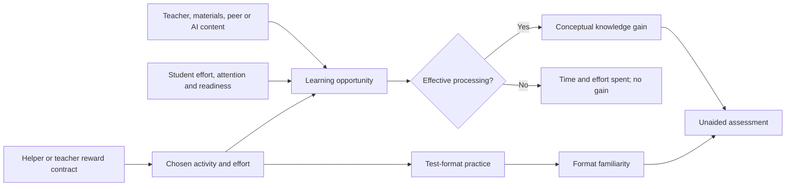

# A32 proposal — Effort, effective learning, helper rewards and test preparation

The user requested review of teacher effort/time, specification of student-helper rewards and test preparation, and learning caused by teaching and effortful study with possible failure to learn. This document defines that revision. **It is a proposal, not an implemented engine or a new study result.** A31 and every E14–E21 result remain immutable. Human calibration remains deferred. The [read-only audit](reports/E21-effort-learning-audit-2026-10-07.json) derives the numerical checks below from saved E21 evidence; no new classroom was simulated.

## 1. What the current model actually assumes

| Current rule | Review finding | Proposed correction |
|---|---|---|
| Learning happens at completed activities, not at each elapsed tick or homework boundary. | There is no general background increase in A31. The problematic guarantee is inside an activity. | Keep activity-linked learning and remove guaranteed base credit from an attempted task. |
| A completed solo attempt receives `(1-K) * min(1, alpha / attempt_learning_divisor)`, plus any hint enhancement. | Merely completing the attempt earns the base gain. It does not require attention, useful reasoning, corrective content or understanding. | Credit only productive dose after the learning-process gates below. |
| Solo attempts cost time and `effort_aversion * attempt_ticks / effort_time_scale` in choice utility. | Studying already costs effort; time and effort are nevertheless treated almost interchangeably. | Add chosen cognitive effort, student fatigue and distinct costs for studying, listening, explaining and copying. |
| Teacher instruction requires attendance and correct, novel, accessible content. | Teacher learning can already be zero because the student is absent, content is unusable, or the material is already known. Attendance defaults to one shared probability. | Separate physical attendance, attention, effort and comprehension. Keep the existing content/readiness checks. |
| Teacher and student learning both use student `alpha` and the attempt divisor. | A learning-efficiency coefficient is still necessary with an explicit teacher. Its interpretation should be conversion of a productive learning opportunity, not education supplied by an unspecified teacher. | Retain heterogeneous efficiency; give each activity a declared dose conversion and log its causal source. |
| Preparation is charged as admin work each episode. | It consumes time without improving or reusing instructional materials. A three-tick budget cannot pay one preparation tick and deliver a three-tick lesson. | Separate teacher work time from student lesson time, represent reusable preparation, and check feasible timetables. |
| The effort planner forecasts immediate knowledge benefit from guidance. | Actual guidance changes confidence and subsequent study choice, with no direct knowledge gain. Its forecast is an explicitly assumed belief, not the actual mechanism. | Forecast guidance through subsequent practice and delayed observed outcomes. |
| The planner forecasts incremental scores, while actual rewards use released score levels, source weights, topic normalization and delay. | The forecast is not a full evaluation of the payment contract or downstream study. | Use one contract evaluator for projected and actual payments and a declared planning horizon. |
| A delivered lesson gives one learning update regardless of its length. | Duration affects opportunity cost, but is not a consistent productive-learning dose. | Convert effective duration to dose; splitting the same dose must not manufacture extra learning. |

The inspected definitions are [A31 completion and attendance](../src/classroom_swarm/v4_mechanisms.py), [student utility](../src/classroom_swarm/declared_settings.py), [teacher planning](../src/classroom_swarm/mechanism_settings.py), [workload and payments](../src/classroom_swarm/mechanism_runtime.py), and [content physics](../src/classroom_swarm/tutoring_settings.py).

Across the 72 saved combined-feature AI classrooms, **all 7,219 bare completed attempts received positive base learning**. Seventeen produced entirely incorrect answer packets and still received positive base learning. Wrong answers alone do not prove that a student learned nothing: reasoning and corrective feedback can produce learning after failure. The issue is that the current base rule observes neither process and grants the gain regardless.

The [ICAP framework](https://education.asu.edu/sites/default/files/lcl/chiwylie2014icap_2.pdf) distinguishes cognitive engagement in learning activities. It motivates examining engagement rather than equating attendance or elapsed work with understanding. The numerical gates proposed here are modeling hypotheses; they are not fitted ICAP categories or empirical conversion rates.

## 2. Why the current AI exam difference is small

These are fresh E21 combined-profile means, not human scores. Practice time is ticks per student per episode; knowledge gain is accumulated mean-topic model percentage points.

| AI arm | Practice time | New knowledge | Assisted homework | Final relevant-topic exam |
|---|---:|---:|---:|---:|
| None | 4.104 | 2.117 | 56.625 | 53.274 |
| Answer | 2.364 | 1.268 | 74.986 | 52.540 |
| Tutor | 3.931 | 2.213 | 59.750 | 53.194 |

Answer AI reduces practice time by **42.41%** and the accumulated knowledge increment by **40.10%**, but the relevant-topic exam falls only **0.734 pp**, or **1.38% relative to its control mean**. New learning is a small fraction of final competence in this four-session setup. Topics split exposure across four initially cloned competence states. Answer AI has at most one direct use per homework, and there is one answer packet for the whole assignment rather than a choice for each problem. These are important restrictions on displacement and dosage. The AI case has no active teacher and no common lecture/answer-review phases.

[Bastani and colleagues](https://doi.org/10.1073/pnas.2422633122) report a 17% relative unaided-grade reduction with unrestricted AI, rather than a 17-percentage-point reduction. Their protocol includes a common lecture, assisted practice with notes/textbooks, common answer review, then a concept-related unaided exam; teachers do not interact with students during practice or the exam. The current simulator does not recreate that full protocol or grading scale.

There is no basis for increasing an AI penalty until it looks large. Pure answer substitution should reduce the learning that would otherwise have occurred. With monotone competence and no misconception/forgetting channel, it cannot directly remove previously acquired knowledge. Conversely, useful tutoring can support effortful study. The proposed revision therefore needs problem-level assistance choices, explicit resources and engagement, meaningful exposure to new concepts, and study-matched measurement. Reducing successful learning in the control can make AI harm **smaller**; adding common teacher learning can dilute it further. These are outcomes to test, not signs to encode.

## 3. Causal boundary and model identity

The proposed implementation is a separate `v4_effort_learning.py` fork with four independently switchable branches: learning process, teacher work/effort, student-helper contracts, and test preparation/participation. Those files and configuration keys do not exist yet. All branches off must reproduce A31 on every shared raw table. Existing JSON declarations continue to run through the frozen A31 entry point.

In the revised model, competence can increase only through a recorded learning opportunity: teacher instruction, self-study, peer/AI-mediated study, or the helper's own explanatory activity. Peer and AI assistance supply content or scaffolding; the recipient still needs a productive learning process. Test coaching may separately improve a declared test-format state. Merely attending, paying a reward, receiving a score, copying, waiting, or advancing the schedule supplies no competence.

Learning efficiency remains an individual parameter. Teaching creates an opportunity; student activity converts that opportunity into learning. Disabling the teacher must still allow independent learning from declared materials or self-generated reasoning. There is no requirement that all students learn only from a teacher.

## 4. Learning process and student effort

### 4.1 Attendance, effort and failure to learn

Each opportunity records source, topic, material/item identity, start/end, attendance, chosen effort, attention, accessible content, processing outcome and resulting gain. Effort levels default to the declared grid `[0, 0.5, 1]`; the grid and all initial distributions must be resolved before a run. Zero effort represents disengagement. Ordinary listening can use positive effort and can produce learning; it is not assumed useless.

For student `i`, action `a`, source `s` and topic `k`:

- `A` is physical attendance/access. Missing an opportunity sets `A=0`.
- `e` is chosen cognitive effort, including the possibility of `e=0`.
- `F_i` is student fatigue, distinct from teacher fatigue.
- Attention probability is `clip(attention_baseline_i + attention_effort_weight * e - fatigue_sensitivity_i * F_i - distraction_shock, 0, 1)`. The shock uses a declared distribution and a private semantic stream.
- Conditional processing probability is `q * readiness`, where `q` is the usable fraction of the supplied or self-generated reasoning/content. The existing readiness band can be retained as a declared comparator. Quality/readiness are used here once, not multiplied into dose again.
- Separate Bernoulli attention and processing draws produce `Z`. Neither a correct answer nor attendance guarantees `Z=1`. A failed answer can still have `Z=1` when useful reasoning or corrective material is available.

For self-study, `q` comes from an explicit material/reasoning trace: textbook/worked-example content, substantive feedback, or self-generated explanation. An attempted answer is not itself a default perfect learning resource. Resource quality, access, content exposure and any self-discovery probability are declared. A score-only grade is not corrective content. If no usable reasoning or material is generated or received, processing probability is zero.

Zero gains receive **multiple recorded flags**, not a fabricated single diagnosis: no attendance/access, no effort, lost attention, no usable content, inaccessible prerequisite level, processing failure, no remaining competence gap, or no completed dose. These flags are simulated causes, not diagnoses of real students. No permanent “nonlearning student” class is assigned.

### 4.2 Dose and efficiency

Productive dose is `D = A * Z * e * duration / reference_ticks`. For each source, define a reference conversion `theta_i,s = min(1, alpha_i / divisor_s)` and an independently declared source multiplier `r_s`. The residual competence gap after the opportunity is multiplied by `(1-theta_i,s) ** (r_s * D)`. A zero dose or zero multiplier leaves the gap unchanged; handle `theta=1` explicitly to avoid a `0**0` ambiguity.

Thus `K_after = 1 - (1-K_before) * residual`. The old attempt divisor 3 and helper divisor 6 supply explicit reference controls. A perfect, fully engaged three-tick solo opportunity with reference duration 3 and multiplier 1 reproduces the old **single-attempt conversion**, without increasing the coefficient to manufacture AI harm. Ordinary revised opportunities may fail or provide less productive dose. Teacher conversion and source multipliers are explicit; they do not add a second legacy base gain.

Multiple simultaneous components use the same frozen pre-completion state and a fixed, declared residual order. The raw ledger must reconstruct the exact update, including topic transfer. Component labels are accounting allocations, not causal mediation. Segmenting a fixed exposure with fixed effort/processing into smaller numerical intervals preserves its total dose. Real extra practice or extra processing checks are new exposures and must be identified as such.

Task responses are generated from pre-learning competence, current assistance and execution effort. For a solved response, use the declared reference `p_response = p_guess + execution(a,e) * (p_supported - p_guess)`, with `execution(solo,0)=0` and `execution(solo,1)=1`; the guess/abstention convention is explicit. Merely choosing a zero-effort attempt cannot deliver the same work as a full-effort solution for free. Packet copying has a separate low-cost execution rule and no conceptual gain. Feedback or reasoning from that response can cause learning afterward. This removes the current sequence in which a baseline gain is applied before that attempt's answer packet is evaluated. Policies cannot inspect hidden correctness, processing outcomes or current true competence; environment physics may use them to generate outcomes.

### 4.3 Costs, motivation and fatigue

Student utility becomes expected observed homework benefit plus any explicitly declared future-test value and contract value, minus cognitive effort and opportunity cost:

`U(a,e) = expected_homework_value(a,e) + future_test_weight_i * predicted_test_value(a,e) + expected_contract_value(a,e) - effort_aversion_i * cognitive_cost_a * (operation_effort_min_a + e) * duration / effort_time_scale - fatigue_cost_i * F_i * (operation_effort_min_a + e) * duration / effort_time_scale`.

The current grade/effort-only objective is the zero-future-test-weight control. Predicted homework performance must depend on effort; it cannot stay constant while only the effort cost changes. During teaching, that prediction includes the announced upcoming practice/homework opportunity within the declared horizon. Future-test stakes are explicit in an exam-preparation protocol, with zero stakes retained as a control. Forecasts use private beliefs and released evidence; true `K`, true content correctness and future scores never enter choice utility. Effort is paid when an activity is undertaken even if learning fails. Activity time also blocks alternative uses. Student fatigue increases with expended cognitive effort and recovers through declared rest; rest gives no knowledge.

Effort aversion, attention, distraction, fatigue sensitivity, future-test valuation, reward preference and learning efficiency are separately declared distributions. Correlations may be declared before outcomes; the reference keeps them independent. Listening, independent problem-solving, explaining, checking a solution and copying have separate cost multipliers and minimum operational effort. Studying and explaining require positive cost coefficients; zero-effort-aversion individuals remain an explicit limiting case and still spend time. Copying can be cheaper than studying, but its low cost does not grant a learning bonus.

## 5. Teacher work time, preparation and effort

### 5.1 Two schedules under one resource declaration

Declare both a student classroom timetable and teacher work periods. A teacher's total available work is allocated among material preparation, administration, grading, classroom instruction, individual guidance, test coaching and participation follow-up. Preparation may occur before class and grading afterward, but **both still consume the declared teacher total**. Extra out-of-class work is an explicit resource treatment available equally to paired arms; it is never introduced as a hidden repair.

STAR-like classes have a declared curricular instruction commitment; incentives choose discretionary guidance/coaching/preparation around that commitment. The minimum instruction is a protocol obligation, not free time or guaranteed student learning. If preparation, mandatory work and instruction cannot fit, validation rejects a nominal teaching setup unless `allow_instruction_crowdout` was explicitly declared for a stress test. Reports show the infeasible workload or lost lesson; they cannot claim teacher adaptation from an exam sign when nothing was taught.

Instruction can be modeled as dose-bearing segments with a declared minimum segment duration. The historical indivisible three-tick lesson remains a comparator. Partial lessons produce only their actually delivered dose. One teacher cannot simultaneously prepare, grade and teach; a broadcast lesson costs teacher time once but occupies every attending student's time. Individual guidance/helper service counts separately and cannot overlap another role's commitments.

E21 supplies the diagnostic cases to retain: STAR teaching effort eight → three ticks under linear/convex incentives, leaving only broadcast instruction; Kenya instruction one → zero episodes under original budget plus preparation, restored by the separate six-tick control. These are assumed effort/budget responses, not estimates of human behavior.

### 5.2 Preparation has a product

Create teacher-owned preparation state `P_k` for each topic/material. Preparation work increases `P_k` by a bounded saturating update with declared productivity. It affects the probability/quality of producing an accessible explanation or the effectiveness of a subsequent lesson, through a declared quality function. Preparation never changes students' competence directly. Materials may be reused with declared expiry/decay; changing topics costs only the declared switch/setup work and does not erase unrelated preparation. Administrative work has no preparation benefit.

Default functional controls set preparation benefit and decay to zero independently. A positive preparation cost with zero benefit remains the E21 tax-only comparator. A positive-benefit comparison must retain the same total teacher resources and disclose displaced classroom activities.

### 5.3 Effort and payment forecasts

Use one explicit contract to evaluate both predicted and realized payments: assessment/form eligibility, source weights, level versus baseline gain, aggregation denominator, missing-score rule, cap, reward curvature, release time and payment delay. Forecasts use observed assessments and estimated attendance/engagement, with a declared planning horizon and discount. They do not use the actual learning ledger or hidden student state.

Forecast curricular teaching through its expected student processing. Forecast guidance through changes in expected subsequent study opportunities, **without an immediate competence increment**. Forecast test coaching and participation follow-up through their distinct states/outcomes below. Beliefs about productivity start as declared priors and may update only from released eligible evidence. The fixed-productivity myopic A31 policy remains a comparator, including its observed failures.

Report whether low effort follows expected benefit, an expensive guidance assumption, a short horizon, missing observation, timetable infeasibility or a tie-breaking rule. Mandatory instruction, discretionary effort and effective student uptake are separate outcomes. Teacher incentives need not universally increase effort, guidance or learning.

## 6. Student-helper reward contract

The [Wu, Zhang and Wang seating study](https://www.aeaweb.org/content/file?id=15848) rewarded upper-track students when their assigned lower-track deskmates ranked in the top 10% for observed score improvement at midterm or final assessment. Monetary awards and certificates were part of that intervention. Its seating-only and rewarded-seating arms differ; a teacher reward cannot represent this contract. The proposed model covers reward-induced helping/learning, while friendship and personality changes remain outside this revision.

### 6.1 Eligibility and payout

Freeze baseline observed assessments, track eligibility and assigned helper–recipient pairs before treatment. Contract fields specify assessment dates/forms, progress relative to baseline, ranking pool, top fraction, prize amount, certificate value, missing-score handling, payment delay and tie/quota rules. Payouts use released **unaided** assessments, never hidden competence or copied homework quality. No payment requires the model to know which helper caused improvement.

For a tournament with `L` eligible recipients and quota `q`, use `floor(q*L)` full winning positions and a predeclared Bernoulli boundary position with probability `q*L-floor(q*L)`. Ties use a separate seeded lottery among tied recipients. This resolves fractional small-class quotas without rounding silently and is a numerical assumption to disclose; an exact study-specific rounding rule can replace it when documented. Prize amount is paid at scheduled release; certificates have a separate utility value and do not change skill or friendships automatically.

### 6.2 Helping choice and burden

Provide explicit ask/offer, accept/refuse, explain/practice and end actions. A helper evaluates expected partner success from available baseline/checkpoint evidence and a declared probability-of-winning belief. The expected payout is discounted and scaled by the helper's reward preference; it enters the offer/acceptance and effort choice. The actual payout uses the contract above. A zero prize and zero certificate value remove this incentive utility exactly.

Helping consumes the helper's time and cognitive effort, may displace their own study and may fail when the recipient is disengaged or cannot use the content. Recipients can refuse or exert zero effort. Helpers may themselves learn from productive explanation, under the same learning ledger. Serving an answer packet remains distinct from explanatory help and grants neither recipient learning nor a fixed helper gain. The model does not improve explanation quality directly because a payment exists; any improvement must follow changed effort/content activity.

Learning, helper workload, offered/accepted sessions, recipient uptake, actual reward, and high-/low-starter outcomes are separate measures. Successful helping does not automatically rewire the frozen graph or create friendship.

### 6.3 Required comparisons

Run the declared seating × helper-contract factorial: random seating/no reward, cross-ability seating/no reward, random seating/reward to its assigned eligible pairs, and cross-ability seating/reward. Baseline eligibility and assignment rules must remain explicit in every cell; different partner-selection rules are part of the interaction. Hold teacher resources and study time fixed. Add matched zero-prize, unrelated/placebo-payment, zero-recipient-engagement and high-helper-cost controls. Preserve unfavorable helper effects and failures of rewarded seating.

## 7. Test preparation and exam participation

[Glewwe, Ilias and Kremer](https://topcat.aeaweb.org/articles?id=10.1257%2Fapp.2.3.205) found improvements on reward-linked exams and increased test preparation, without improvement on unrelated exams or teacher attendance/homework assignment. Exam participation also increased; their reward formula penalized missing exams. A general increase in all competence is therefore insufficient to represent the distinctive pattern. One-teacher classrooms still do not reproduce a full multi-teacher school tournament.

### 7.1 Concepts and format familiarity

Keep topic competence `K_i,k` separate from bounded format familiarity `F_i,f`, where `f` is a declared test form/family. Add conceptual revision, worked-example study, mock-test/format practice and teacher coaching as actual time/effort-bearing activities. They use attendance, attention and processing gates. Passive delivery of a practice sheet adds neither state.

Every preparation activity declares its concept-learning share and format-learning share. Conceptual practice updates `K`; form practice updates `F`; a mixed activity can update both from one recorded dose partition. Their total allocated shares cannot exceed one, so the same dose is not counted twice. Teacher material preparation `P` is distinct from student test preparation `F`.

Concept transfer uses the declared topic matrix. Format transfer uses a separately declared form matrix. A new exam form with no relevant transfer cannot read an unrelated `F`. Repeated exposure may improve format familiarity without broad understanding; robust conceptual practice can improve both reward-linked and novel-format tests. Optional format decay is declared separately and is not retroactive forgetting of `K`.

### 7.2 Measurement and incentives

Each exam declares topic/item weights, difficulty, form identity, format loading, rubric and assistance restrictions. Let `p_core = clip(weighted_topic_K + 0.5 - item_difficulty, 0, 1)` for the proposed simple reference item model. Let `p_item = p_core + (1-p_core) * format_loading * transferred_F`. Both coefficients and weights are frozen before outcomes; the A31 exam mapping remains an explicit comparator. A different partial-credit/multi-skill rubric requires its own declared measurement specification.

Evaluate reward-linked familiar-format exams, novel-format exams on the **same concepts**, and unrelated-topic exams separately. A zero-format-loading diagnostic measures core competence only. Assessment does not grant learning; any deliberate retrieval-learning intervention needs a separate activity and time budget.

Teacher contracts can pay on eligible linked tests only and can penalize nonparticipation under a frozen eligible-cohort denominator. Add a distinct student exam-participation decision using stated stakes, perceived readiness and access/effort cost. Teacher follow-up can change participation information or access cost at a time cost, with no competence gain. Missing participants retain a missing observed score; a contract may assign a zero contribution without overwriting that observation. Report participation rate, conditional participant scores, full-cohort contract score and underlying competence. Keep identical simulated potential item draws for an eligible student across participation arms; do not redraw the test upon attendance.

Observed participation can affect measured aggregate performance independently of learning. This channel and format familiarity are not substitutes for conceptual gains. A pure format intervention with zero concept share and zero format transfer has an encoded zero direct effect on a novel-format/core test; report that as an identity, not an emergent replication of the field study.

## 8. Proposed configuration and raw evidence

These are proposed declaration branches, **not accepted A31 JSON keys**. Each branch has `enabled=false` as its compatibility default. An active run must resolve every scalar, distribution, matrix, schedule, belief prior and contract rule before execution; unspecified fields cannot be inferred from desired results.

| Branch | Required declaration groups |
|---|---|
| `learning_process` | Effort grid; reference durations/divisors; source dose multipliers; attention/effort/fatigue functions; initial attention and fatigue; distractions; material access/quality; self-generated reasoning/feedback rules; student costs/recovery; future-test valuation; processing and stream declarations. |
| `teacher_work` | Classroom and teacher work periods; total resource budget; protected instruction; minimum segment; crowdout policy; grading/admin; preparation stocks/productivity/quality/expiry; feasible actions; planning horizon/discount; observation and productivity priors; exact reward contract. |
| `helper_contract` | Baseline eligibility; pair map; eligible exams; progress rule; ranking pool/quota/tie handling; prize/certificate; missing outcomes/delay; reward preferences and winning beliefs; helping action/time/cost rules. |
| `test_preparation` | Concept/form dose shares; initial format states; form transfer/decay; test item/rubric declarations; conceptual versus familiar/novel tests; reward linkage; exam-participation costs/stakes; teacher follow-up and missing-score contract rule. |

All probabilities, shares and bounded states lie in `[0,1]`; times and budgets are finite and nonnegative, productive activities require positive duration, reference durations/divisors are positive, discount lies in `[0,1]`, and dose/rate/cost coefficients are finite and nonnegative. Topic/item weights are nonnegative and sum to one for each scored item. Material, topic and form transfer must have an explicit bounded combination rule. Distribution feasibility and realized moments are audited. A concept/form share sum above one, unknown form/topic, incompatible schedule, unavailable observation, or unsupported correlation is rejected before outcomes.

Add raw tables for activity/effort choices and forecasts; material/feedback exposure; attendance/attention/processing; productive dose and zero-gain flags; student fatigue and costs; teacher preparation/work commitments; helper eligibility/offers/contracts/payments; form-state learning; assessment design and item outcomes; participation choices and eligible-denominator contributions. Each gain references the event/material that caused it. Teacher/admin and student time ledgers reconcile independently. Topic transfer logs its source gain and target topic.

Use new private semantic streams for attention, distractions, processing, helper tournament ties/boundaries and exam participation, with codes fixed in the new RNG specification before implementation. Random draws are indexed by stable student identity, scheduled opportunity/item and replicate. Reassignment to another section must not silently change that student's item/attention draw; this improves on E21's paired class-local slots. A failed gate cannot shift later random draws. Agent policies cannot inspect those future draws.

## 9. Implementation and comparison gates

Implement in stages under a new source/run identity. Passing a later study-sign comparison is not a unit-test requirement.

1. Learning/effort ledger: all-off raw parity; no opportunity/no dose/no gain; failed learning still costs time/effort; absent versus disengaged distinctions; effort-dependent predicted and actual task performance; no free full-performance zero-effort solve; valid feedback after a wrong answer can enable learning; score-only feedback cannot; known content/zero coefficients; exact bounded reconstruction; no pre-feedback or same-answer gain leakage.
2. Teacher time and planning: protected commitments and infeasible designs; total work conservation across class/nonclass periods; no simultaneous services; reusable preparation versus tax-only control; partial-lesson dose; guidance forecasts have no immediate `K` increment; forecast and actual contract share rules; observed-only belief updates and delayed payments.
3. Helper contract: baseline eligibility frozen; observed progress only; zero and placebo payments; lottery quotas/ties; recipient refusal; scarce helper time and own-study displacement; no direct skill/payment/friendship bonus.
4. Test preparation: concept/form dose partition; zero transfer identities; familiar versus novel same-concept assessments; no diagnostic exam learning; participation/denominator/score separation; frozen potential item draws and observable decisions.

The next scientific design should retain an untouched A31 baseline and every E21 contrary case. Introduce each revised branch separately before the combined profile. Keep student effort/cost changes separate from source-learning-rate changes; keep teacher timetable and productivity-belief changes separate from increased resources. Small-class, tracking, single-session lab, AI and seating contrasts remain paired on exogenous cohorts and stable identities.

For AI, use a declared common lecture → problem-level none/answer/tutor practice → common answer review → unaided concept-matched exam. Include teacher-free continuity and zero/new-lecture controls, equal-time resource controls, material-access and engagement variations, one-use versus problem-level access, and active-topic/broader/core measurements. Record effective study displaced, AI use, successful processing and source-attributed gains. For helper rewards use the factorial above; for teacher rewards cross incentive eligibility with conceptual/format preparation and participation channels. Report all null/opposite results and simultaneous uncertainty for a frozen main comparison family.

Freeze the complete new model specification, tests, experiment matrix, numerical hypotheses, streams/cohorts, expected identities and analyses before outcomes. No numeric effect-size target or guaranteed larger AI effect is imposed. Human calibration and mapping of model ticks/points to human time/test scales remain deferred.

Progress: current learning/effort/time assumptions reviewed and the requested mechanisms specified; no input pending. Next: implement this proposal in a separate fork, then execute its declared functional controls before new study comparisons.
