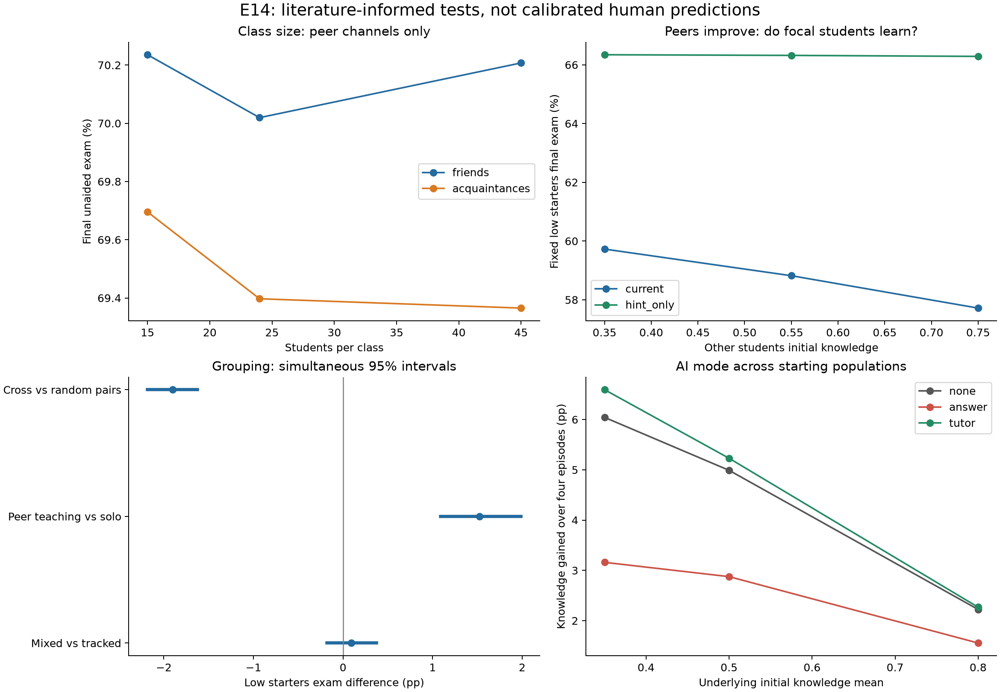

# E14: classroom setup and literature trends

Completed 2026-10-01: **3,300 simulations, 33 conditions, 100 classroom replicates per condition**. All raw-output audits, file/source hash checks and both exact social-channel controls passed. No parameter fitting or tuning was performed. The ten frozen primary comparisons yielded 3 matching directions, 1 opposite direction, 4 inconclusive directions, 1 within the predeclared simulation equivalence band, and 1 outside that classification. Read each comparison below; they test overlapping mechanisms and are not ten independent study replications.

This tests whether the current model can produce literature-compatible directions under declared assumptions. Scores below are synthetic normalized quantities. Agreement does not validate those assumptions or reproduce published human effect sizes.

## Published evidence used

| Study | Classroom setup and empirical result | Boundary of this comparison |
|---|---|---|
| [Krueger / Project STAR](https://www.nber.org/papers/w6051), NBER 1997 / QJE 1999 | Small classes of 13–17 versus regular 22–25; small classes improved standardized test ranks, about four percentile points initially. | Simulate 15 versus 24; teacher attention is absent. Published percentile-rank changes are not our score percentage points. |
| [Kimbrough, McGee and Shigeoka](https://docs.iza.org/dp10783.pdf), 2017 working paper / JHR 2022 | Four-person laboratory groups solving logic problems. Peer teaching benefited low performers; homogeneous ability grouping offset the benefit. | Compare fixed low starters in mixed versus homogeneous four-person groups, and teaching versus solo. Numerical hints abstract from discussion. |
| [Duflo, Dupas and Kremer](https://www.povertyactionlab.org/sites/default/files/research-paper/39%20Peer%20Effects%2C%20Teacher%20Incentives%2C%20and%20the%20Impact%20of%20Tracking%20Project.pdf), AER 2011 | Randomized tracking in 121 Kenyan primary schools; students across ability levels benefited, including through teachers adapting instruction. | The adaptive-instruction channel is absent. Our grouping result cannot reproduce the full intervention. |
| [Wu, Zhang and Wang](https://www.aeaweb.org/content/file?id=15848), AEJ Economic Policy 2023 | Mixed seating alone had no detectable effect; pairing plus helper rewards improved low students' mathematics by about 0.24 SD. | Compare seating alone. No rewards or friendship formation in this model. A nondetection is not proof of an exact human zero. |
| [Bastani et al.](https://www.pnas.org/doi/10.1073/pnas.2422633122), PNAS 2025 | Nearly 1,000 high-school students; four sessions. Base AI improved practice but reduced unaided exam performance; tutor guardrails removed the detectable harm without a detectable exam gain. | Compare answer/tutor/no AI over four numerical episodes. No calibrated time scale, actual GPT conversations or human-data fitting. The published affiliation correction does not change these findings. |

Additional distribution evidence was found after the E14 design was frozen, and is **background, not an added primary comparison**: [Booij, Leuven and Oosterbeek, author manuscript](https://leuven.economists.nl/pdf/ability_final.pdf), Review of Economic Studies 2017, experimentally varied mean and spread of prior ability in university tutorial groups of about 40. Peer effects depended on both moments and own ability. Their regression-based assignment calculations favored three-way tracking for low/middle students; surveys found more positive interactions, without evidence of teacher adjustment. This cautions against assuming that higher peer means or wider distributions have one universal effect. Our spread sensitivity changes students' own starting knowledge too, so it does not isolate that paper's contextual peer-SD effect.

## Frozen primary comparisons

Outcome: final unaided exam, treatment minus reference, in normalized score percentage points (pp). Focal students are all students for size/AI and fixed low starters for peer composition/grouping. Intervals are replicate-level percentile-bootstrap Monte Carlo intervals, adjusted across ten comparisons; nominal simultaneous coverage is 95%, approximate. Human empirical uncertainty is not included. For nondetection targets, the separately chosen equivalence band is ±1 pp.

| Comparison | Expected direction | Exam difference (pp) | Adjusted interval (pp) | Verdict |
| --- | --- | --- | --- | --- |
| STAR: smaller class (friends only) | positive | +0.22 | [-0.37, +0.81] | inconclusive |
| STAR: smaller class (weak acquaintance access) | positive | +0.30 | [-0.24, +0.85] | inconclusive |
| Higher-knowledge peers: current model | positive | -2.01 | [-2.32, -1.71] | opposite direction |
| Higher-knowledge peers: hint channel | positive | -0.06 | [-0.17, +0.06] | inconclusive |
| Kimbrough et al.: mixed groups help low starters | positive | +0.09 | [-0.18, +0.37] | inconclusive |
| Kimbrough et al.: peer teaching benefit | positive | +1.53 | [+1.09, +1.99] | same direction |
| Wu et al.: seating without rewards | zero | -1.90 | [-2.18, -1.63] | not established as equivalent |
| Bastani et al.: unrestricted AI harms unaided test | negative | -2.16 | [-2.37, -1.98] | same direction |
| Bastani et al.: tutor no detectable test benefit | zero | +0.26 | [+0.13, +0.38] | within declared equivalence band |
| Bastani et al.: guardrails reduce harm | positive | +2.42 | [+2.23, +2.61] | same direction |

## What the runs show

The model reproduced the peer-teaching benefit over solo work (+1.53 pp) and the answer-AI tradeoff: middle-population homework increased 22.11 pp while unaided exams fell 2.16 pp. Tutor AI exceeded answer AI by 2.42 exam pp. Tutor versus no AI was a small positive +0.26 pp, with its interval excluding zero; it qualifies under our ±1 pp simulation equivalence criterion, but does **not** reproduce the human study's statistical nondetection literally.

Two important expected patterns did not appear clearly: smaller classes and mixed versus homogeneous teaching groups. Teaching still benefited homogeneous low groups (+1.43 exam pp, exploratory pointwise interval [1.11,1.78]); tracking did not remove the teaching benefit as it did in the laboratory study. The model therefore captures a teaching benefit but misses that study's composition interaction.

Stronger peers under the current hint/copy rules improved low starters' homework by 9.01 pp, increased their final copied share by 15.53 pp, reduced attempts by 0.124 per episode, and lowered exams by 2.01 pp. This is consistent with copied answers displacing practice. With copying disabled, stronger peers produced nearly no exam change (−0.06 pp, inconclusive). It is not evidence that stronger peers generally harm real students. Likewise, cross-ability desk pairing produced −1.90 exam pp while raising homework 3.58 pp and copying 11.13 pp; that does not recover the published seating-only nondetection.

The exploratory wider initial distribution lowered four-episode knowledge gain by 0.25 pp and exam scores by 0.71 pp, while raising homework by 4.91 pp. Its realized mean also differed by chance; those effects include changes in students' own traits and interactions, so they cannot be read as an isolated peer-spread effect. High-starting populations had higher score levels but less knowledge gain, partly reflecting the encoded remaining-knowledge headroom.

These discrepancies identify limits worth testing in a future separately declared experiment: the effect of provider ability on teaching needs an isolated sensitivity test, and teacher attention or instruction would provide additional classroom-size mechanisms. Adaptive teaching, helper incentives and ability-dependent engagement require explicit mechanisms before testing the corresponding field results. Do not adjust the present coefficients until an apparent match emerges.

## Shared numerical assumptions

Class-size, peer-composition and grouping scenarios run 20 homework episodes; AI/spread scenarios run four. Each episode has 12 ticks and ten homework items; exams have 30 items, every five episodes in the 20-episode setups and every episode in the AI setups. Learning-efficiency and effort-aversion distributions are lognormal with arithmetic means 0.0584 and 0.15, respectively, and log SD 0.25. The learning coefficient comes from the existing chosen model trajectory, not empirical estimation. Confidence and all five benefit priors start at 0.5, grade target is 0.75, and the existing recalibration feedback rule is retained. Every remaining numerical assumption is recorded explicitly in the four resolved locks.

## Class size

ER graphs have expected friend degree six across sizes. Acquaintance weight is zero or 0.1. Thus size does not dilute teacher time, and larger classes can change weak-contact opportunities. N=45 is exploratory and outside STAR's main regular-class range. The size-change pairing preserves stream identities, not identical classroom-sized random tensors.

| Condition | N | Initial K (%) | Final K (%) | Final exam (%) | Final homework (%) |
| --- | --- | --- | --- | --- | --- |
| small_friends | 15 | 49.91 | 70.19 | 70.24 | 73.38 |
| regular_friends | 24 | 49.99 | 70.03 | 70.02 | 72.42 |
| large_friends | 45 | 49.84 | 70.09 | 70.21 | 72.56 |
| small_acquaintances | 15 | 49.91 | 69.76 | 69.70 | 73.37 |
| regular_acquaintances | 24 | 49.99 | 69.46 | 69.40 | 73.55 |
| large_acquaintances | 45 | 49.84 | 69.26 | 69.37 | 72.39 |

## Knowledge of peers

The first 15 students always start at 0.35; only the other 15 students change. Confidence and benefit priors remain fixed at 0.5. Higher-peer-knowledge comparisons are mechanism probes motivated by peer-teaching evidence. Successful hints are measured as deliveries per focal student per episode; copying is the share of final homework packets marked copied.

| Condition | Focal final K (%) | Focal exam (%) | Focal homework (%) | Final copied (%) | Hints/student/episode |
| --- | --- | --- | --- | --- | --- |
| low_current | 59.82 | 59.73 | 61.15 | 42.20 | 0.064 |
| middle_current | 58.90 | 58.82 | 64.41 | 49.13 | 0.068 |
| high_current | 57.80 | 57.72 | 70.16 | 57.73 | 0.067 |
| low_hint_only | 66.42 | 66.34 | 67.23 | 0.00 | 0.184 |
| middle_hint_only | 66.40 | 66.32 | 67.07 | 0.00 | 0.191 |
| high_hint_only | 66.40 | 66.29 | 67.33 | 0.00 | 0.194 |
| low_no_peer | 64.91 | 64.81 | 64.87 | 0.00 | 0.000 |
| high_no_peer | 64.91 | 64.81 | 64.87 | 0.00 | 0.000 |

## Ability grouping and seating

The four-person conditions share the same eight students and alter only allowed contacts. Copying is disabled. The paired-deskmate conditions have 32 students and permit both hints and copying. These are different mechanisms; comparisons are within each setup. The random seating graph was drawn once before outcomes, so the seating contrast is conditional on that declared graph.

| Condition | Low starters final K (%) | Low starters exam (%) | Low starters homework (%) | Hints/student/episode |
| --- | --- | --- | --- | --- |
| mixed_teaching | 66.24 | 65.72 | 69.35 | 0.193 |
| tracked_teaching | 66.18 | 65.63 | 69.08 | 0.175 |
| mixed_no_teaching | 64.85 | 64.20 | 66.28 | 0.000 |
| tracked_no_teaching | 64.85 | 64.20 | 66.28 | 0.000 |
| random_pairs | 62.45 | 62.60 | 67.79 | 0.133 |
| cross_pairs | 60.43 | 60.70 | 71.37 | 0.132 |

## AI, population mean and spread

Means/SD parameters describe an underlying normal truncated to [0,1]. The table reports realized initial means and within-class SD averaged across replicates, plus final within-class SD. Narrow/wide rows change the underlying SD from the middle baseline 0.10 to 0.05/0.20. This changes own traits and peers jointly; a mean-zero distribution change is not a fixed-student peer-only effect.

Default answer AI accuracy is 0.90 per item. The `answer51` sensitivity changes both availability and accuracy versus no AI and is declared bundled. The paper's 51% whole-problem correctness is not a calibrated per-item probability. Tutor learning follows the model's assumed hint-learning rule; gains are not independent evidence that real tutoring necessarily improves knowledge.

| Condition | Initial K (%) | Initial SD | K gained (pp) | Final SD | Exam (%) | Homework (%) | AI uses/student/episode |
| --- | --- | --- | --- | --- | --- | --- | --- |
| low_none | 34.59 | 0.098 | 6.04 | 0.095 | 40.68 | 43.34 | 0.000 |
| low_answer | 34.59 | 0.098 | 3.16 | 0.098 | 37.86 | 82.16 | 0.826 |
| low_tutor | 34.59 | 0.098 | 6.59 | 0.092 | 41.18 | 51.09 | 0.569 |
| middle_none | 49.58 | 0.098 | 4.99 | 0.092 | 54.62 | 57.86 | 0.000 |
| middle_answer | 49.58 | 0.098 | 2.88 | 0.096 | 52.45 | 79.98 | 0.776 |
| middle_tutor | 49.58 | 0.098 | 5.23 | 0.090 | 54.87 | 61.97 | 0.514 |
| high_none | 79.04 | 0.092 | 2.22 | 0.083 | 81.63 | 83.96 | 0.000 |
| high_answer | 79.04 | 0.092 | 1.56 | 0.087 | 80.95 | 86.46 | 0.627 |
| high_tutor | 79.04 | 0.092 | 2.27 | 0.083 | 81.66 | 84.71 | 0.399 |
| low_answer51 | 34.59 | 0.098 | 3.33 | 0.098 | 37.99 | 48.88 | 0.860 |
| middle_answer51 | 49.58 | 0.098 | 2.99 | 0.096 | 52.58 | 55.64 | 0.800 |
| narrow_none | 49.79 | 0.049 | 5.04 | 0.048 | 54.91 | 55.21 | 0.000 |
| wide_none | 49.19 | 0.187 | 4.74 | 0.174 | 53.91 | 62.77 | 0.000 |

## Audit and reproducibility

- All 3,300 runs completed; every raw table was reloaded, checked against its SHA-256 file hash, and passed `validate_declared_log`.
- Both disabled-social-channel controls passed exact equality of focal final knowledge, final exam and final homework in all 100 paired replicates.
- Source/configuration hashes still match the E14 preregistration. All 58 source entries across the E9r1/E10/E11/E12r1/E13 historical locks were checked with zero mismatches.
- 112 targeted configuration, engine and measurement tests passed, including reference raw-table parity and the E14 measurement tests. No engine change was made for E14.
- Inherited identities include zero direct knowledge from copied answers, nonnegative practice gain and knowledge headroom. They are not discoveries. Conditional uptake and displaced practice determine intervention outcomes.

Artifacts: [preregistered design](E14-preregistration.md); `runs/E14/preregistration-lock.json`; four complete JSON declarations and runtime locks; `runs/E14/derived/analysis_manifest.json`; all-replicate metrics, condition estimates, effect intervals, comparison verdicts and raw inventory CSVs in `runs/E14/derived/`. Raw student/action/initial-state tables remain under each group's `raw/` directory. The analysis manifest hashes all derived artifacts. In the effect CSV, the `simultaneous_lo/hi` fields apply simultaneous adjustment only where `primary=True`; other rows repeat exploratory pointwise intervals.

To reproduce into a fresh root: run `scripts/e14_classroom_trends.py prepare --root runs/E14_new`, execute the four generated files with `python -m classroom_swarm.experiment_config run ... --output ...`, then run `scripts/e14_classroom_trends.py analyze --root runs/E14_new`. A frozen root cannot be reused or overwritten.

The two line panels and AI gain panel display averages for the declared scenarios, not fitted response curves. The class-size vertical axis magnifies small differences that are inconclusive in the primary comparisons. The grouping panel shows the adjusted primary intervals. Secondary metrics and contrasts are exploratory; their pointwise intervals are available in the CSVs.

