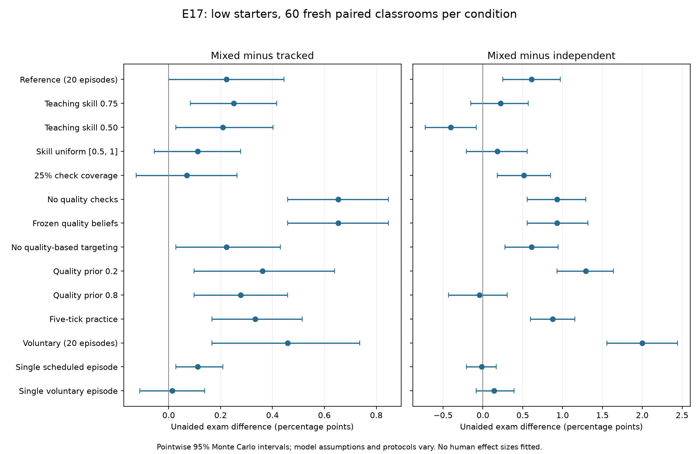

# E17 results: tutoring robustness and study-pattern comparison

Completed 3,360 simulations: 840 development and 2,520 untouched-seed confirmation. All saved raw hashes and numerical audits passed. No learning coefficients or engine rules were changed after outcomes.

**Result:** 11/14 declared variants reproduce both positive low-starter mean directions (mixed–tracked and mixed–independent) in both unaided exam and competence gain. 6/14 have all four pointwise intervals above zero. This count describes this declared sensitivity grid, not a probability that the model is valid. The complete behavioral/protocol pattern must be assessed separately below.

**The complete study pattern is not reproduced.** The reference mixed–tracked exam difference is +0.222 pp, but its simultaneous interval includes zero. Mixed–independent is +0.611 pp with a positive simultaneous interval. At teaching skill .5, mixed tutoring instead lowers low-starter exams by 0.403 pp versus independent practice. In the single voluntary episode, both exam contrasts include zero, and the low mixed–tracked competence contrast is also uncertain. Scheduled teaching frequency cannot respond to tracking; voluntary frequency and ability-group results vary with the schedule.

## What was tested

Existing A29 features: teaching-skill distributions, check coverage, quality priors/updating/targeting, practice duration and scheduled/voluntary tutoring. All initial competence and preferences were paired across arms. The schedule was also adjusted from 20 episodes to one, declared before outcomes. Noisy or delayed worksheet checks, persistent topics, teachers, rewards and evolving relationships remain planned features.

The [peer-teaching study](https://www.crepe.e.u-tokyo.ac.jp/events/20190325_shigeoka.pdf) used one practice block with optional communication and public prior-performance information. Its Sudoku results linked tracking to weaker teaching benefits and less teaching; gains were concentrated among lower performers. Here the final test measures numerical competence, and a guided session is only a teaching proxy. Our one-episode variants improve schedule correspondence but do not implement the full human protocol.

## Low-starter results on fresh seeds

All entries are model percentage points with pointwise 95% Monte Carlo bootstrap intervals. Competence gain is latent model state, not a measured human outcome. Interval endpoints within 1e-9 pp of zero are treated as zero when counting positive intervals; this avoids interpreting floating-point roundoff as evidence.

| Variant | Mixed–tracked exam | Mixed–independent exam | Mixed–tracked competence gain | Tracked–independent exam |
|---|---|---|---|---|
| Reference (20 episodes) | +0.222 [+0.000, +0.444] | +0.611 [+0.250, +0.972] | +0.209 [+0.077, +0.336] | +0.389 [+0.028, +0.736] |
| Teaching skill 0.75 | +0.250 [+0.083, +0.417] | +0.222 [-0.153, +0.569] | +0.212 [+0.107, +0.312] | -0.028 [-0.375, +0.319] |
| Teaching skill 0.50 | +0.208 [+0.028, +0.403] | -0.403 [-0.723, -0.083] | +0.192 [+0.109, +0.283] | -0.611 [-0.958, -0.291] |
| Skill uniform [0.5, 1] | +0.111 [-0.056, +0.278] | +0.181 [-0.208, +0.556] | +0.182 [+0.071, +0.288] | +0.069 [-0.306, +0.417] |
| 25% check coverage | +0.069 [-0.125, +0.264] | +0.514 [+0.181, +0.847] | +0.194 [+0.066, +0.317] | +0.444 [+0.056, +0.819] |
| No quality checks | +0.653 [+0.458, +0.847] | +0.931 [+0.556, +1.292] | +0.676 [+0.592, +0.766] | +0.278 [-0.111, +0.653] |
| Frozen quality beliefs | +0.653 [+0.458, +0.847] | +0.931 [+0.556, +1.319] | +0.676 [+0.592, +0.765] | +0.278 [-0.111, +0.667] |
| No quality-based targeting | +0.222 [+0.027, +0.431] | +0.611 [+0.278, +0.944] | +0.256 [+0.150, +0.358] | +0.389 [+0.014, +0.764] |
| Quality prior 0.2 | +0.361 [+0.097, +0.639] | +1.292 [+0.931, +1.639] | +0.233 [+0.088, +0.374] | +0.931 [+0.569, +1.306] |
| Quality prior 0.8 | +0.278 [+0.097, +0.458] | -0.042 [-0.431, +0.306] | +0.289 [+0.171, +0.412] | -0.319 [-0.681, +0.042] |
| Five-tick practice | +0.333 [+0.167, +0.514] | +0.875 [+0.597, +1.153] | +0.287 [+0.183, +0.388] | +0.542 [+0.264, +0.819] |
| Voluntary (20 episodes) | +0.458 [+0.167, +0.736] | +2.000 [+1.556, +2.444] | +0.341 [+0.154, +0.534] | +1.542 [+1.139, +1.931] |
| Single scheduled episode | +0.111 [+0.028, +0.208] | -0.014 [-0.208, +0.167] | +0.072 [+0.054, +0.090] | -0.125 [-0.292, +0.028] |
| Single voluntary episode | +0.014 [-0.111, +0.139] | +0.139 [-0.083, +0.389] | +0.060 [-0.015, +0.142] | +0.125 [-0.139, +0.375] |

Nine prespecified low-starter exam comparisons also receive simultaneous 95% intervals across the family. These wider intervals address multiplicity within that family; all other sensitivity comparisons remain exploratory.

| Prespecified variant | Mixed–tracked | Mixed–independent | Tracked–independent |
|---|---|---|---|
| Reference (20 episodes) | +0.222 [-0.093, +0.528] | +0.611 [+0.083, +1.107] | +0.389 [-0.107, +0.861] |
| Single scheduled episode | +0.111 [+0.000, +0.250] | -0.014 [-0.278, +0.245] | -0.125 [-0.370, +0.083] |
| Single voluntary episode | +0.014 [-0.153, +0.194] | +0.139 [-0.162, +0.482] | +0.125 [-0.194, +0.523] |

## Teaching activity and ability groups

Scheduled tutoring has equal explanation frequency across mixed and tracked groups by construction. Any scheduled outcome agreement cannot explain the study’s endogenous teaching-frequency change. Voluntary sessions provide a more relevant behavioral probe but still lack the study’s public baseline ranks and task/payment structure.

| Protocol | Mixed–tracked low exam | Mixed–tracked high exam | High-minus-low exam effect | Mixed low sessions/episode | Tracked low sessions/episode | Mixed high sessions/episode | Tracked high sessions/episode |
|---|---|---|---|---|---|---|---|
| Reference (20 episodes) | +0.222 [+0.000, +0.444] | +0.056 [-0.042, +0.167] | -0.167 [-0.417, +0.083] | 1.000 | 1.000 | 1.000 | 1.000 |
| Voluntary (20 episodes) | +0.458 [+0.167, +0.736] | +0.056 [-0.083, +0.194] | -0.403 [-0.694, -0.097] | 0.277 | 0.259 | 0.185 | 0.199 |
| Single scheduled episode | +0.111 [+0.028, +0.208] | +0.000 [-0.083, +0.069] | -0.111 [-0.236, +0.014] | 1.000 | 1.000 | 1.000 | 1.000 |
| Single voluntary episode | +0.014 [-0.111, +0.139] | +0.111 [+0.028, +0.208] | +0.097 [-0.042, +0.250] | 0.258 | 0.237 | 0.275 | 0.217 |

Differences above compare exogenous initial-ability groups. Low versus high treatment heterogeneity is evaluated as a paired effect difference; a nonsignificant high-group result alone does not demonstrate a smaller high-group effect. Model session counts are not the human coded teaching statements.

## Assumption diagnostics and adjustments

| Diagnostic | Fresh-seed change in low mixed-group exam versus matched reference | Interpretation |
|---|---|---|
| Teaching skill 0.75 | -0.389 [-0.611, -0.181] | Delivery reliability, with content and practice held fixed. |
| Teaching skill 0.50 | -1.014 [-1.264, -0.778] | Larger loss of conditional explanation delivery. |
| Skill uniform [0.5, 1] | -0.431 [-0.639, -0.236] | Delivery heterogeneity changes family/support together; not a pure mean contrast. |
| 25% check coverage | -0.097 [-0.278, +0.069] | Partial observed feedback, still accurate and immediate. |
| No quality checks | +0.319 [+0.139, +0.528] | No quality learning from worksheet checks. |
| Frozen quality beliefs | +0.319 [+0.153, +0.514] | Checks arrive but cannot update quality beliefs. |
| No quality-based targeting | +0.000 [-0.125, +0.111] | Removes targeting weight; perceived homework value still uses quality. |
| Quality prior 0.2 | +0.681 [+0.444, +0.931] | Initial private source-quality assumption. |
| Quality prior 0.8 | -0.653 [-0.889, -0.431] | Initial private source-quality assumption. |
| Five-tick practice | -0.972 [-1.361, -0.583] | Longer exposure has the old base-learning rule and greater time cost. |
| Voluntary (20 episodes) | +1.431 [+0.958, +1.889] | Optional commitment changes opportunity and helper costs. |
| Single scheduled episode | -27.417 [-29.014, -25.903] | One episode plus final-exam scheduling is an inseparable schedule bundle. |
| Single voluntary episode | +0.153 [-0.111, +0.444] | Voluntary versus scheduled within the one-episode schedule. |

**Adjustments completed:** the predeclared experiment changes explanation reliability and feedback availability, examines alternative private priors, and uses voluntary and single-episode schedules. These are declared controls and protocol probes, not coefficients chosen because they produced a favorable outcome. Original defaults are retained.

Removing checks increases the low mixed-group exam by +0.319 pp [0.139, 0.528] versus the reference. Own practice increases by +0.093 ticks per student per episode [0.066, 0.122]. The competence-gain difference is +0.379 pp: practice contributes +0.401 pp, content -0.077 pp and helper learning +0.054 pp, up to rounding. This is a raw-log accounting decomposition, not independent causal mediation. More accurate private source judgments are not guaranteed to improve learning when decisions primarily value homework grades and effort; they can also change how much additional practice occurs. These diagnostics do not justify removing real-world feedback.

**What these tests cannot fix:** partial coverage does not test noisy/delayed signals. A single scalar retrieval draw does not represent persistent Sudoku strategy mastery. Guaranteed sessions cannot generate less conversation under tracking. If those mismatches persist, the next model revision should implement F02 optional explanatory activity and F03 topic/helper consolidation, with F01 feedback realism. Raising a peer-benefit coefficient would not repair the missing behavioral mechanisms.

A mechanical explanation for tracked-group gains is already visible in the content rule. At starting learner competence .35, skill 1 and uniform difficulty [0,1], independent learner/provider retrieval gives an expected usable-content fraction of about .1253 from another .35 provider, versus .2302 from a .75 provider (numerical integration of the declared retrieval/readiness rule). Thus two equally weak students still have complementary item knowledge. These are model expectations at the initial state, not human measurements or a causal estimate from the treatment comparison. Persistent shared gaps in strategy knowledge could behave differently; that is a hypothesis for F03.

Teacher-capacity/class-size, instructional tracking, rewarded seating, university peer mean–spread interactions and the AI learning objective were not rerun in E17. Their feature gaps remain separate; this experiment provides no new claims of agreement with those studies.

## Reproducibility and claim boundaries

Raw logs reconstruct all gains and outcomes. No-check/frozen-quality arms had exactly zero quality updates; independent arms had zero tutoring content and content/helper gains. All scheduled mixed–tracked session-frequency contrasts were exactly zero, as encoded. Historical E16 source hashes were verified unchanged.

Development and confirmation used the same locked 42-condition design, different predeclared seeds, and paired replicate-level bootstrap intervals (3,000 resamples). The development review was saved before confirmation began. These intervals describe simulation variability; they do not include uncertainty about assumed coefficients, missing mechanisms or the human study.

Any claim of qualitative agreement must specify the variant, subgroup and outcome and acknowledge the protocol and behavioral mismatches. Matching a sign does not identify the human causal mechanism or independently validate the simulator. Equal scheduled base practice plus nonnegative bonuses partly encodes a teaching benefit; it is not an empirical discovery.

Project files: [preregistration](E17-preregistration.md), [feature backlog](../19-feature-backlog.md), [previous study review](../reports/Classroom-study-comparison-and-assumption-review-2026-10-01.md), [editable single-practice configuration](../../configs/E17-single-practice-example.json). The editable example has a new seed and has not been run; the reported single-practice evidence comes from the locked E17 stages.

Saved data: `runs/E17-tutoring-robustness-r1/design-lock.json`, stage configs and reviews, raw run folders, and `development_derived` / `confirmation_derived` effects, replicate metrics, raw inventories and analysis manifests.

Progress: E17 experiments and evidence report complete; no input pending. Next: specify the remaining behavioral and feedback mechanisms rather than tune to a desired sign.
