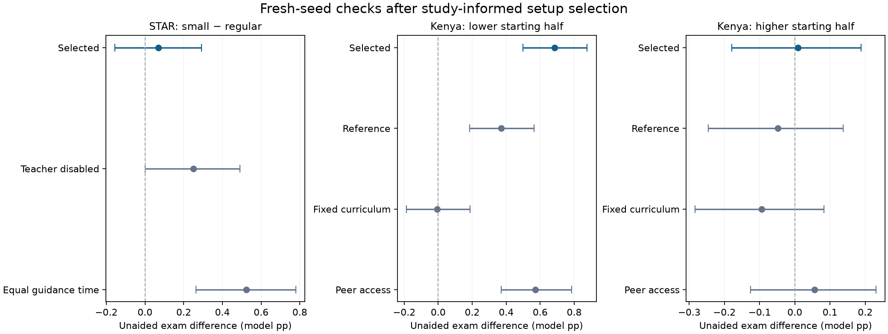

# E18 — Teacher studies, adjusted setups and fresh-seed checks

The selected setups did not reproduce the complete target pattern on fresh seeds. **1/3** selected exam intervals are above zero pointwise; **1/3** remain above zero under the simultaneous three-comparison criterion. The underlying A30 engine was unchanged. These are study-informed setup fits and Monte Carlo checks, not independent empirical validation.

The experiment completed **1,848 classroom simulations**: 528 development runs covering eight class-size and seven tracking candidates, followed by 1,320 confirmation runs on 60 fresh paired replicates. Every saved classroom was re-read and audited. **508 tests pass**, including 12 experiment-integrity tests added for this design. **274 historical source entries** matched their locks.

## Studies and what was represented

[Project STAR](https://www.nber.org/papers/w6051) compared smaller and regular classes and found improved test outcomes in smaller classes. Here, 15 versus 24 students share one teacher budget; baseline knowledge has the same realized mean and spread. The simulated comparison addresses attention/instruction capacity, omitting disruption, aides and demographic mechanisms.

[The Kenyan tracking study](https://www.povertyactionlab.org/sites/default/files/research-paper/39%20Peer%20Effects%2C%20Teacher%20Incentives%2C%20and%20the%20Impact%20of%20Tracking%20Project.pdf) reports benefits across starting achievement levels. Here, the same 84 measured students enter either two randomly mixed 42-student classes or two baseline-assessment tracks, each with a separate teacher and the same school resource total. Teachers use recorded baseline assessments and released exam signals. The full incentive, teacher-effort and topic-learning mechanisms of the field study remain absent.

The [plan](E18-teacher-study-plan.md), recipe/analysis script, teacher sources, seeds, cohort pools and selection rule were locked before outcomes. Lower/higher groups were defined using baseline-assessment ranks before the experiment. Neither teacher decisions nor tracking assignment can read current hidden competence. Simulation percentage points are not human percentile-rank points or standardized effect sizes.

## What was nudged

Class size selected **reference**: the reference teacher setup. Tracking selected **learning_2**: teacher-content learning multiplier **1 → 2**, with the other reference settings retained.

Selection used development knowledge and exam differences, requiring both starting halves to improve for tracking. It preferred the fewest changed settings, then the largest minimum exam mean. The [development review](../../runs/E18-teacher-study-r1/development-review.md) and selection record were hashed before confirmation began. Results from the fresh pool were not used to reselect parameters.

The selected tracking adjustment increases the teacher-content learning multiplier from **1 to 2**. This doubles the completed usable-content fraction in that channel before its cap; it does not double total student learning or bypass lesson time, attendance, retrieval, correctness or readiness. A structured explanation being more productive than the original conservative channel is plausible, but the value two was chosen using the known target direction. It is an exploratory fit and needs independent data to establish its numerical plausibility. The class-size reference required no added coefficient adjustment; its study-specific population, attention policy and observed curriculum already differ from the earlier network-only model.

## Fresh-seed outcomes

Effects are differences in model percentage points. Brackets are paired Monte Carlo intervals over 60 replicates. STAR is small minus regular; Kenya is tracked minus mixed.

| Comparison | Exam effect, pointwise 95% | Exam effect, simultaneous 95% | Knowledge/gain effect, pointwise 95% |
|---|---:|---:|---:|
| STAR: all students | +0.07 [-0.16, +0.29] | +0.07 [-0.21, +0.34] | -0.02 [-0.12, +0.08] |
| Kenya: lower starting half | +0.68 [+0.50, +0.88] | +0.68 [+0.45, +0.93] | +0.67 [+0.59, +0.74] |
| Kenya: higher starting half | +0.01 [-0.18, +0.19] | +0.01 [-0.22, +0.23] | +0.11 [+0.05, +0.17] |

The simultaneous criterion covers the three selected exam contrasts only. Knowledge and all reference/control/sensitivity intervals are descriptive pointwise checks. Positive means with intervals spanning zero are directional agreement with unresolved Monte Carlo uncertainty, not a supported positive effect.

## Reference setups, controls and sensitivity

| Setup | STAR overall exam effect | Kenya lower-half exam effect | Kenya higher-half exam effect |
|---|---:|---:|---:|
| Study reference | +0.07 [-0.16, +0.29] | +0.37 [+0.18, +0.56] | -0.05 [-0.25, +0.14] |
| Selected setup | +0.07 [-0.16, +0.29] | +0.68 [+0.50, +0.88] | +0.01 [-0.18, +0.19] |
| No teacher / fixed curriculum | +0.25 [+0.00, +0.49] | -0.01 [-0.19, +0.19] | -0.09 [-0.28, +0.08] |
| Equal guidance time per student / peer access | +0.52 [+0.26, +0.78] | +0.57 [+0.37, +0.78] | +0.06 [-0.13, +0.23] |

Teacher-disabled and fixed-curriculum controls test the represented mechanisms. The STAR resource control gives 5 guidance ticks to 15 students and 8 to 24, keeping average guidance time per student equal; appointment positions can still fragment practice differently. The tracking peer sensitivity permits voluntary peer practice in static degree-six ER graphs, with copying still disabled. It adds a substantive interaction channel and is not an independent study replication.

## What produced the outcome

The following are cumulative per-student quantities over 12 episodes. Teacher gain is the raw content component, not the net treatment effect. Practice time excludes teacher sessions.

| Selected comparison/arm | Exam score | Knowledge gained | Independent/peer practice ticks | Teacher ticks received | Guidance appointments | Teacher content gain | Mean lesson difficulty |
|---|---:|---:|---:|---:|---:|---:|---:|
| star/all/small | 64.78 | 19.63 | 52.29 | 40.00 | 4.00 | 4.46 | 0.53 |
| star/all/regular | 64.71 | 19.65 | 52.29 | 38.50 | 2.50 | 4.48 | 0.53 |
| kenya/low/mixed | 62.16 | 26.75 | 52.74 | 36.00 | 0.00 | 9.54 | 0.59 |
| kenya/low/tracked | 62.84 | 27.42 | 52.61 | 36.00 | 0.00 | 10.40 | 0.47 |
| kenya/high/mixed | 78.49 | 13.57 | 50.17 | 36.00 | 0.00 | 4.45 | 0.59 |
| kenya/high/tracked | 78.50 | 13.68 | 50.16 | 36.00 | 0.00 | 4.59 | 0.71 |

Smaller classes received +1.50 additional teacher ticks per student and changed independent/peer practice time by +0.00 ticks. In the tracking comparison, both arms receive the same broadcast duration; differences arise through observed instructional targets, usable content and subsequent choices, rather than additional school teacher resources.

Peer access retained positive exam means in both tracking halves, though its intervals and magnitudes must still be assessed separately.

## Every development candidate

These are exploratory development means over 12 replicates, retained including opposite signs. A direction in this table was used for setup selection; it must not be treated as independent confirmation. Parent changes and their exact settings are available in the design lock and recipe.

| STAR candidate | Changed settings from reference | Exam small-minus-regular | Knowledge/gain difference |
|---|---|---:|---:|
| reference | `{}` | +0.294 | +0.107 |
| guidance_02 | `{"teacher": {"guidance_strength": 0.2}}` | +0.494 | +0.266 |
| guidance_03 | `{"teacher": {"guidance_strength": 0.3}}` | +0.562 | +0.305 |
| confidence_off | `{"teacher": {"guidance_confidence_rate": 0.0}}` | +0.289 | +0.097 |
| guidance_only | `{"teacher": {"actions": ["guidance"]}}` | +0.135 | +0.157 |
| explanation_only | `{"teacher": {"actions": ["explanation"]}}` | +0.467 | +0.275 |
| short_explanations | `{"teacher": {"actions": ["explanation"], "explanation_ticks": 2}}` | +0.231 | +0.158 |
| budget_12 | `{"teacher": {"time_budget": 12}}` | +0.199 | +0.016 |

| Kenya candidate | Changed settings from reference | Lower-half exam | Higher-half exam | Lower-half knowledge/gain | Higher-half knowledge/gain |
|---|---|---:|---:|---:|---:|
| reference | `{}` | -0.006 | -0.022 | +0.446 | +0.067 |
| readiness_03 | `{"params": {"readiness_band": 0.3}}` | +0.688 | -0.127 | +1.180 | -0.058 |
| readiness_08 | `{"params": {"readiness_band": 0.8}}` | -0.433 | +0.058 | +0.059 | +0.135 |
| target_offset_01 | `{"teacher": {"difficulty_offset": 0.1}}` | +0.587 | -0.294 | +1.101 | -0.242 |
| learning_2 | `{"teacher": {"learning_multiplier": 2.0}}` | +0.395 | +0.135 | +0.751 | +0.095 |
| narrow_population | `{"population": {"span": 0.4}}` | -0.274 | +0.194 | +0.162 | +0.106 |
| homework_signal | `{"teacher": {"observation_sources": ["exam", "homework"]}}` | +0.030 | -0.038 | +0.502 | +0.043 |

## Do the assumptions make sense?

| Assumption | Assessment |
|---|---|
| One fixed teacher resource pool per class | Fits the resource interpretation of a class-size intervention; the selected tick budget is illustrative. More attention is partly built into capacity arithmetic, while net learning remains an outcome. |
| Separate teachers and baseline-test assignment for tracking | Represents the school comparison more faithfully than merely changing edges in one eight-student graph. Tracking follows measured achievement; the true scalar knowledge distribution is an illustrative input. |
| Adaptive target based on observed class scores | A plausible teacher-information boundary. The paper also considers teacher incentives/effort; mean-based adaptation does not reproduce that whole theory. |
| Teacher-content multiplier 2 | An openly selected learning-productivity hypothesis. Its average usable-content gain can be compared with independent-practice gains, but the coefficient is not identified by reproducing a sign. |
| Perfect attendance, high teacher skill and frequent assessment | Optimistic controlled conditions. Noisy baseline scores exist, but later coverage/skill are optimistic and need further sensitivity or measured calibration. |
| Peer access disabled in the main mechanism comparison | Isolates teacher representation. The fresh-seed peer sensitivity must be considered before claiming resemblance to a full classroom intervention. |
| Scalar knowledge and monotone learning, alpha 0.0584 | Simplifies topics, forgetting, misconceptions and test practice. Alpha is an assumed trajectory rate, not human data. |
| Fresh seed confirmation | Checks numerical repeatability after setup selection. It does not validate human mechanisms or independently held-out human evidence. |

## Reproducibility and usable settings

Raw outputs, exact per-class JSON settings, student membership and baseline observations are under `runs/E18-teacher-study-r1/development` and `confirmation`. Both derived directories contain all run metrics, effects, inventories and source-linked analysis manifests. The development selection record states every rejected candidate. All historical engines and the A30 functional results remain unchanged.

Editable one-class examples with fresh, unused seeds are [STAR selected class](../../configs/E18-STAR-selected-class-example.json) and [Kenya selected lower class](../../configs/E18-Kenya-selected-class-example.json). They expose the selected parameters for review. Use the E18 pipeline for the complete paired school/class-size comparisons; an isolated example is not itself a study replication.

Progress: study-specific comparisons, declared setup search and fresh-seed checks completed; no input pending. Remaining work: independent human calibration and missing teacher-incentive, topic, attendance and peer-interaction mechanisms.
