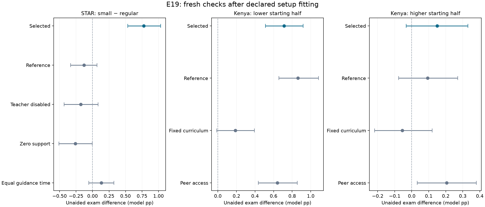

# Teacher study comparisons — setup adjustments and fresh checks

**All three selected exam and knowledge mean directions match the target studies.** In E19, **2/3** target exam contrasts have pointwise 95% intervals above zero; **2/3** have simultaneous intervals above zero. This is conditional agreement after fitting to known study directions, not independent human validation.

E19 completed **3,200 classroom runs**, after the preserved **1,848 E18 runs**. Its development panel used 20 paired replicates; confirmation used 80 fresh replicates per comparison. All raw outputs were re-read, hash-checked and audited. **521 tests pass**, including deterministic raw-table parity for the confirmation transport. **329 historical source entries** matched. The A30 teacher engine and every previous experiment remain unchanged.

## Human comparisons and model counterparts

| Study | Reported direction | Model comparison | What is missing |
|---|---|---|---|
| [Project STAR / Krueger](https://www.nber.org/papers/w6051) | Smaller classes improve test outcomes | 15 versus 24 students, one teacher with the same total budget, equal realized initial knowledge mean 0.45 and SD 0.10 | Disruption, aides, demographic mechanisms, measured teacher workload and human time scale |
| [Duflo, Dupas and Kremer: Kenyan tracking](https://www.povertyactionlab.org/sites/default/files/research-paper/39%20Peer%20Effects%2C%20Teacher%20Incentives%2C%20and%20the%20Impact%20of%20Tracking%20Project.pdf) | Tracking benefits students across initial achievement levels | Same 84 students in two mixed or two baseline-test tracks of 42; teachers adapt to observed scores; equal school resources | Full teacher incentives/effort mechanism, topics, measured peer behavior and demographic calibration |

Lower/higher groups are defined by noisy baseline-assessment ranks before assignment. Teachers use recorded baseline priors and released assessment signals, without access to current hidden competence. Mean-based instructional adaptation is an inferred mechanism proxy. These model percentage points are not the papers’ standardized effects or percentile ranks.

## What the first attempt showed

The [E18 report](E18-teacher-study-results.md) is preserved with every tested setup. Its selection preferred the fewest changed settings among positive development means. That selected a nearly null STAR reference and a tracking teacher-content multiplier of two. Fresh seeds did not confirm the complete pattern. E19 was declared after seeing this limitation, so the entire second round is exploratory, including its new seed pool.

| Target | E18 fresh exam effect | E19 fresh exam effect | E19 fresh knowledge/gain effect | E19 simultaneous exam interval |
|---|---:|---:|---:|---:|
| Small class: overall | +0.070 [-0.155, +0.292] | +0.777 [+0.535, +1.032] | +1.015 [+0.845, +1.182] | +0.777 [+0.482, +1.084] |
| Tracking: lower starting half | +0.685 [+0.498, +0.876] | +0.712 [+0.512, +0.918] | +0.620 [+0.557, +0.681] | +0.712 [+0.457, +0.962] |
| Tracking: higher starting half | +0.009 [-0.179, +0.188] | +0.149 [-0.032, +0.330] | +0.177 [+0.125, +0.227] | +0.149 [-0.068, +0.373] |

Brackets are paired Monte Carlo intervals. Simultaneous intervals cover the three selected exam contrasts only. Knowledge, controls and development intervals are pointwise descriptive checks. Fresh seeds evaluate simulator repeatability after selection; they do not supply held-out human evidence.

## Selected setup changes

The [E19 plan](E19-teacher-study-plan.md) froze eight class-size and ten tracking candidates before its outcomes. Selection required all relevant knowledge and exam lower bounds above zero and exam means at least +0.15 model points; it then preferred fewer changes. A failed development gate remains explicitly marked. Confirmation did not reselect.

| Study | Selected profile | Development gate met | Exact changes from E19 reference |
|---|---|---|---|
| star | guidance_03_longer_day | True | `{"params": {"ticks": 18}, "teacher": {"guidance_strength": 0.3}}` |
| kenya | population_mean_045 | False | `{"population": {"mean": 0.45}}` |

The selected class-size setup changes guidance strength **0.10 → 0.30** and the student session **12 → 18 model ticks** in both class sizes. The teacher budget stays **8 ticks** in both. There is no established conversion from these ticks to classroom minutes; this is an opportunity/productivity hypothesis, not a claim that STAR lengthened the smaller class’s day.

The selected tracking population changes mean initial knowledge **0.50 → 0.45**, keeping the same **0.60 span** and realized SD (about **0.175**). The range becomes **0.15–0.75** rather than 0.20–0.80. Both assignment arms use exactly the same shifted students. The lower starting level shifts observed instructional targets and remaining learning capacity while preserving heterogeneity. In this engine, lower difficulty can improve teacher-content correctness; novelty depends on the difficulty–student-knowledge gap, so shifting both does not automatically make lessons more novel. The study does not identify this scalar mean.

**Tracking missed the declared development confidence gate.** The rule selected the best tentative candidate by its minimum exam lower bound. Fresh outcomes are reported without changing that status; a positive fresh result cannot retroactively turn the development gate into a pass.

E19’s STAR reference is the original instruction/guidance setup. Its Kenyan reference already includes E18’s teacher-content multiplier **2**, compared with the original A30 default **1**. A selected multiplier **4**, if present above, is therefore 2 → 4 within E19 and 1 → 4 against the original default. This coefficient scales completed usable teacher content; it does not multiply all learning or bypass attendance, time, correctness, novelty or readiness.

Population mean shifts, wider readiness, stronger guidance and shorter/more productive explanations are hypotheses selected using known target directions. They are exposed in the configuration and not established properties of either human sample. Action-list/duration/productivity bundles cannot attribute their effect to one component. Scalar knowledge and alpha 0.0584 remain assumed numerical trajectories, not human estimates.

## Mechanism and protocol controls

| Comparison | Exam effect, pointwise 95% | Interpretation |
|---|---:|---|
| STAR: selected | +0.777 [+0.535, +1.032] | Same total teacher resources across sizes. |
| STAR: reference | -0.130 [-0.332, +0.068] | Original observed instruction/guidance protocol. |
| STAR: selected teacher disabled | -0.177 [-0.431, +0.083] | Same student setup and day length; teacher removed. |
| STAR: selected calendar with zero support | -0.259 [-0.511, -0.004] | Same durations/calendar, all teacher benefit channels zero. |
| STAR: equal guidance time per student | +0.133 [-0.056, +0.322] | Different guidance-only protocol; appointment fragmentation remains. |
| Kenya low: reference | +0.863 [+0.658, +1.083] | Multiplier 2, original readiness band. |
| Kenya low: fixed curriculum | +0.190 [-0.013, +0.394] | Selected settings; difficulty fixed at 0.5. |
| Kenya low: peer access | +0.641 [+0.435, +0.856] | Selected settings plus voluntary static-network peer practice. |
| Kenya high: reference | +0.094 [-0.077, +0.270] | Multiplier 2, original readiness band. |
| Kenya high: fixed curriculum | -0.055 [-0.219, +0.120] | Selected settings; difficulty fixed at 0.5. |
| Kenya high: peer access | +0.205 [+0.032, +0.379] | Selected settings plus voluntary static-network peer practice. |

A nonzero control can arise from finite samples, slot-specific draws, population composition or scheduling. Equal average guidance time does not guarantee equal usable practice opportunities. The zero-support calendar can reduce practice without teaching anything. Positive selected effects should therefore be read alongside teacher-induced contrasts, rather than credited to class size alone.

| Paired difference between treatment contrasts | Exam difference, pointwise 95% |
|---|---:|---:|
| STAR selected minus corresponding teacher-disabled size contrast | +0.954 [+0.685, +1.218] |
| STAR selected minus corresponding zero-support size contrast | +1.036 [+0.798, +1.272] |
| Kenya lower: adaptive minus fixed-curriculum tracking contrast | +0.522 [+0.456, +0.589] |
| Kenya higher: adaptive minus fixed-curriculum tracking contrast | +0.204 [+0.150, +0.259] |

These differences are conditional intervention diagnostics. Fixed 0.5 is one comparator, not the field study’s untreated instruction. Peer sensitivity changes an additional interaction channel and must be reported even if it reverses a match.

## Time and learning evidence

Cumulative means per student across 12 episodes. Content gain is the recorded teacher component, not net treatment gain. Practice time excludes teacher appointments.

| Selected arm/group | Exam | Knowledge gained | Practice ticks | Teacher ticks | Guidance appointments | Teacher content gain | Lesson difficulty | Usable content fraction |
|---|---:|---:|---:|---:|---:|---:|---:|---:|
| star/small/all | 68.640 | 23.653 | 72.330 | 40.000 | 4.000 | 4.145 | 0.555 | 0.405 |
| star/regular/all | 67.863 | 22.638 | 67.000 | 38.500 | 2.500 | 4.227 | 0.550 | 0.408 |
| kenya/mixed/low | 59.460 | 29.232 | 52.962 | 36.000 | 0.000 | 10.703 | 0.547 | 0.419 |
| kenya/tracked/low | 60.172 | 29.853 | 53.016 | 36.000 | 0.000 | 11.435 | 0.433 | 0.443 |
| kenya/mixed/high | 75.406 | 15.693 | 50.494 | 36.000 | 0.000 | 5.271 | 0.550 | 0.333 |
| kenya/tracked/high | 75.555 | 15.870 | 50.446 | 36.000 | 0.000 | 5.484 | 0.668 | 0.357 |

Tracking holds broadcast duration and student membership fixed. Observed curriculum targets, content usefulness and subsequent practice choices can vary. Smaller classes change per-student appointments under a fixed total teacher budget; appointment costs can cancel learning gains. Neither positive net sign is guaranteed by the engine.

## Every E19 development candidate

Intervals below cover 20 exploratory replicates. They were used for selection, have search multiplicity and are not independent support. All failed and opposite candidates are retained. Exact parent patches are in the locked script/design.

| STAR candidate | Changes from reference | Exam difference | Knowledge/gain difference |
|---|---|---:|---:|
| reference | `{}` | +0.208 [-0.277, +0.684] | +0.134 [-0.068, +0.334] |
| guidance_03 | `{"teacher": {"guidance_strength": 0.3}}` | +0.356 [-0.120, +0.813] | +0.290 [+0.126, +0.454] |
| guidance_05 | `{"teacher": {"guidance_strength": 0.5}}` | +0.478 [-0.000, +0.925] | +0.358 [+0.176, +0.537] |
| guidance_03_no_confidence | `{"teacher": {"guidance_confidence_rate": 0.0, "guidance_strength": 0.3}}` | +0.359 [-0.118, +0.816] | +0.295 [+0.133, +0.459] |
| guidance_03_persistent | `{"teacher": {"guidance_decay": 0.8, "guidance_strength": 0.3}}` | +0.442 [-0.035, +0.878] | +0.363 [+0.189, +0.530] |
| guidance_03_longer_day | `{"params": {"ticks": 18}, "teacher": {"guidance_strength": 0.3}}` | +1.288 [+0.886, +1.691] | +1.072 [+0.804, +1.329] |
| brief_explanations_2 | `{"teacher": {"actions": ["explanation"], "explanation_ticks": 2, "learning_multiplier": 2.0}}` | +0.472 [+0.005, +0.904] | +0.397 [+0.226, +0.587] |
| brief_explanations_4 | `{"teacher": {"actions": ["explanation"], "explanation_ticks": 2, "learning_multiplier": 4.0}}` | +1.183 [+0.758, +1.587] | +1.082 [+0.919, +1.261] |

| Kenya candidate | Changes from reference | Lower exam | Higher exam | Lower knowledge/gain | Higher knowledge/gain |
|---|---|---:|---:|---:|---:|
| reference | `{}` | +0.517 [+0.217, +0.820] | +0.120 [-0.217, +0.436] | +0.693 [+0.559, +0.832] | +0.176 [+0.093, +0.265] |
| readiness_08 | `{"params": {"readiness_band": 0.8}}` | -0.189 [-0.475, +0.110] | +0.221 [-0.117, +0.543] | -0.003 [-0.119, +0.122] | +0.274 [+0.192, +0.361] |
| readiness_10 | `{"params": {"readiness_band": 1.0}}` | -0.375 [-0.671, -0.067] | +0.261 [-0.079, +0.579] | -0.201 [-0.318, -0.078] | +0.309 [+0.227, +0.396] |
| learning_4 | `{"teacher": {"learning_multiplier": 4.0}}` | +0.785 [+0.520, +1.042] | +0.287 [-0.019, +0.588] | +0.951 [+0.840, +1.062] | +0.253 [+0.148, +0.359] |
| readiness_08_learning_4 | `{"params": {"readiness_band": 0.8}, "teacher": {"learning_multiplier": 4.0}}` | -0.152 [-0.410, +0.099] | +0.426 [+0.114, +0.731] | -0.028 [-0.124, +0.076] | +0.406 [+0.298, +0.516] |
| readiness_10_learning_4 | `{"params": {"readiness_band": 1.0}, "teacher": {"learning_multiplier": 4.0}}` | -0.400 [-0.669, -0.140] | +0.473 [+0.159, +0.781] | -0.294 [-0.388, -0.194] | +0.455 [+0.348, +0.562] |
| teacher_knowledge_1 | `{"teacher": {"knowledge": 1.0}}` | +0.312 [+0.008, +0.612] | +0.137 [-0.201, +0.461] | +0.512 [+0.386, +0.650] | +0.224 [+0.148, +0.306] |
| target_offset_minus_005 | `{"teacher": {"difficulty_offset": -0.05}}` | -0.377 [-0.667, -0.096] | +0.401 [+0.058, +0.723] | -0.170 [-0.280, -0.054] | +0.476 [+0.403, +0.554] |
| population_mean_045 | `{"population": {"mean": 0.45}}` | +0.345 [-0.011, +0.711] | +0.461 [+0.210, +0.721] | +0.473 [+0.366, +0.591] | +0.257 [+0.182, +0.330] |
| population_mean_04 | `{"population": {"mean": 0.4}}` | +0.043 [-0.317, +0.404] | +0.667 [+0.385, +0.952] | +0.297 [+0.192, +0.414] | +0.404 [+0.315, +0.493] |

## Are the fitted assumptions sensible?

| Assumption | Assessment and practical limit |
|---|---|
| One teacher with a finite class budget | Plausible resource constraint; workload/tick quantities need field measurements. It creates more potential attention in smaller classes, not a guaranteed outcome gain. |
| More effective brief individual explanation | Individual diagnosis and explanation can plausibly improve productivity. A multiplier or two-tick lesson selected for the sign is not evidence of that real productivity or duration. |
| Stronger guidance | Plausible support for voluntary practice; its utility scale/decay are numerical assumptions and require behavior data. |
| Wider readiness band | Can represent scaffolding or curriculum accessibility. It must be assessed against observed gains from above-level material, not accepted because tracking becomes positive. |
| Adaptive observed-score curriculum | Respects teacher information limits and represents targeting. Mean-based targets omit the paper’s incentive/effort model and topic-specific instruction. |
| Population mean/spread | Initial heterogeneity is relevant, but these scalar moments lack a study-test mapping. A mean shift can be illustrative; it is not empirical calibration. |
| High skill, full attendance and frequent assessment | Optimistic controlled settings. Real attendance, observation noise/coverage and teacher workload may change the signs. |
| Scalar monotone knowledge | Omits forgetting, misconceptions, topic transfer and rich dialogue. Agreement of two final signs cannot identify these missing mechanisms. |
| Fresh confirmation and control contrasts | Useful numerical checks after fitting. Independent participant data or a held-out human protocol is needed for external validation. |

A defensible claim is: “Under explicitly stated, study-informed setup assumptions, the simulation shows similar mean directions to both selected studies; uncertainty and mechanism controls are reported.” Avoid claiming an empirically validated classroom model or reproduction of the papers’ numerical effect sizes.

## Saved settings and reproducibility

Raw data and class JSON declarations are in `runs/E19-teacher-study-r1/development` and `confirmation`; paired run metrics/effects, source-linked audit manifests, selection review and both cohort pools are retained alongside them. E18’s earlier null/incomplete results remain available. The [execution addendum](E19-execution-addendum.md) records equivalent parallel confirmation execution; its source lock was written before confirmation outcomes.

The following editable examples have fresh unused seeds and passed configuration validation. Each file is a single class; it does not alone reproduce the paired school comparison.
- [E19-star-small-s0-example.json](../../configs/E19-star-small-s0-example.json)
- [E19-star-regular-s0-example.json](../../configs/E19-star-regular-s0-example.json)
- [E19-kenya-mixed-s0-example.json](../../configs/E19-kenya-mixed-s0-example.json)
- [E19-kenya-mixed-s1-example.json](../../configs/E19-kenya-mixed-s1-example.json)
- [E19-kenya-tracked-s0-example.json](../../configs/E19-kenya-tracked-s0-example.json)
- [E19-kenya-tracked-s1-example.json](../../configs/E19-kenya-tracked-s1-example.json)

The full comparison is reproducible with `scripts/e19_teacher_studies.py` (`prepare`, `run`, `analyze`, `select`, `verify`) against a new output root; confirmation may use the parallel driver. Preserve existing roots and source locks.

Progress: study comparisons, bounded setup adjustments, fresh checks and assumption assessment completed; no input pending. Next: independent human calibration and remaining teacher-incentive, workload, topic and peer-observation mechanisms.
