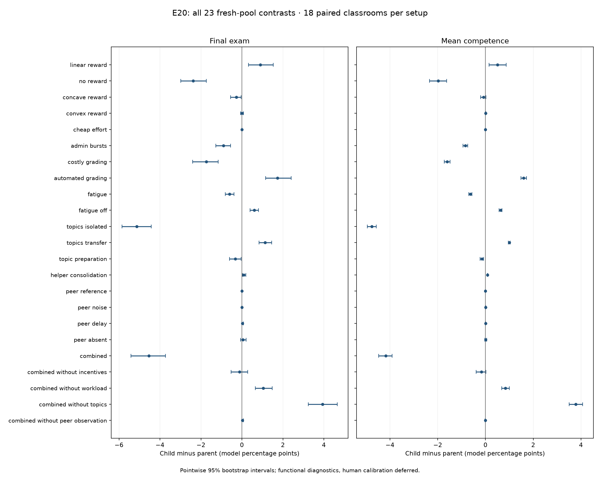

# E20 — Teacher incentives, workload, topics and peer observations

**All four mechanisms are implemented and configurable in A31.** Human calibration is deferred, as requested. All **576 classroom runs** and saved-log audits passed; the full suite passes **560 tests**, including 39 new mechanism tests. The 24 fixed setups were run on six development replicates and 18 fresh replicates, with no setup selection or parameter tuning between pools.

The teacher changes effort and lesson targets in response to declared reward rules and observed scores. Grading, administration and preparation consume the same finite budget; fatigue can reduce teaching quality. Knowledge persists separately by topic, with explicit transfer and helper consolidation. Peer-quality beliefs update only after private checked signals arrive, with configurable coverage, error and delay. Turning all four branches off reproduces A30 exactly.

## What the fresh runs show

| Change relative to its declared parent | Final exam difference, model pp [95%] | Mean knowledge difference, model pp [95%] | Teaching time difference, ticks/class |
|---|---:|---:|---:|
| No reward, with intrinsic motivation fixed at zero | -2.384 [-2.986, -1.736] | -1.981 [-2.349, -1.630] | -18.000 |
| Admin bursts | -0.903 [-1.273, -0.556] | -0.838 [-0.944, -0.744] | -16.000 |
| Positive-cost grading added to admin bursts | -1.736 [-2.407, -1.157] | -1.600 [-1.721, -1.478] | -30.000 |
| Grading automation restored | +1.736 [+1.157, +2.407] | +1.600 [+1.482, +1.716] | +30.000 |
| Fatigue added at unchanged teacher time | -0.602 [-0.810, -0.394] | -0.633 [-0.697, -0.569] | +0.000 |
| Cross-topic transfer 0 → 0.2 | +1.134 [+0.833, +1.458] | +0.995 [+0.955, +1.035] | +0.000 |
| Helper consolidation 0 → 0.2 | +0.093 [+0.023, +0.185] | +0.089 [+0.083, +0.094] | +0.000 |
| Noisy peer signals | +0.000 [+0.000, +0.000] | +0.008 [-0.001, +0.020] | +0.000 |
| Peer signals delayed by 14 ticks | +0.023 [+0.000, +0.069] | +0.003 [-0.002, +0.009] | +0.000 |
| All four mechanisms combined | -4.537 [-5.417, -3.727] | -4.179 [-4.469, -3.907] | -40.667 |

The zero-reward teacher chooses **0.0 teaching ticks**, versus **18.0** with linear rewards. Intrinsic motivation is deliberately zero in both, so this is a limiting control rather than a prediction that unrewarded human teachers stop teaching. Linear rewards also change the decision rule relative to A30's fixed allocation; the corresponding contrast is a bundle of effort selection and targeting.

Grading automation raises teaching time from **2.0 to 32.0 ticks/class** in the admin-burst setup. It restores that setup's declared zero-cost grading behavior. This is a resource/time control. Its net outcome depends on teaching quality, available practice slots and actual feedback timing.

Fatigue leaves teaching time at **48.0 ticks** in the non-incentive setup while reducing mean effective skill to **0.662**. The quality penalty is encoded; the resulting exam difference is measured. In the combined setup, fatigue also enters perceived effort cost, so teaching effort can change.

Cross-topic transfer and helper consolidation grant nonnegative direct learning fractions by construction. Their downstream exam and activity effects remain stochastic. Splitting a fixed session across two independent topics lowers average topic exposure relative to a single scalar skill; that contrast changes the representation and measurement, so it is not evidence that adding subject detail harms human learning.

Delayed peer signals produce **40.0 received updates** and **8.0 pending signals/class**, compared with **48.0** immediate updates. Absent checks produce **0.0** updates. Net score effects are small here: scheduled shared practice still delivers an episode, while private quality chiefly affects partner selection and perceived usefulness. These results do not establish that observations are irrelevant in optional-dialogue or longer-horizon settings.

## Mechanism evidence from raw logs

Fresh-pool means across six episodes. Teacher and mandatory ticks are per classroom; practice ticks are per student. Difficulty averages delivered instruction only; no instruction is shown as a dash. Direct gains sum logged active-topic components per student in model points; they are not treatment effects or mean-across-topic gains.

| Setup | Teaching ticks | Mandatory ticks | Practice ticks/student | Instruction difficulty | Effective skill | Direct teacher gain | Direct helper gain |
|---|---:|---:|---:|---:|---:|---:|---:|
| reference | 48.000 | 0.000 | 24.312 | 0.536 | 1.000 | 2.199 | 0.266 |
| linear_reward | 18.000 | 0.000 | 26.438 | 0.518 | 1.000 | 2.185 | 0.265 |
| no_reward | 0.000 | 0.000 | 26.000 | — | 1.000 | 0.000 | 0.279 |
| concave_reward | 16.000 | 0.000 | 26.750 | 0.507 | 1.000 | 1.993 | 0.267 |
| convex_reward | 18.000 | 0.000 | 26.438 | 0.530 | 1.000 | 2.195 | 0.265 |
| cheap_effort | 18.000 | 0.000 | 26.438 | 0.518 | 1.000 | 2.185 | 0.265 |
| admin_bursts | 32.000 | 16.000 | 23.688 | 0.535 | 1.000 | 1.464 | 0.269 |
| costly_grading | 2.000 | 46.000 | 22.688 | — | 1.000 | 0.000 | 0.275 |
| automated_grading | 32.000 | 16.000 | 23.688 | 0.535 | 1.000 | 1.464 | 0.269 |
| fatigue | 48.000 | 0.000 | 24.333 | 0.535 | 0.662 | 1.510 | 0.268 |
| fatigue_off | 48.000 | 0.000 | 24.312 | 0.536 | 1.000 | 2.199 | 0.266 |
| topics_isolated | 48.000 | 0.000 | 24.583 | 0.518 | 1.000 | 2.366 | 0.279 |
| topics_transfer | 48.000 | 0.000 | 24.521 | 0.522 | 1.000 | 2.327 | 0.277 |
| topic_preparation | 32.000 | 16.000 | 23.521 | 0.518 | 1.000 | 2.383 | 0.282 |
| helper_consolidation | 48.000 | 0.000 | 24.583 | 0.518 | 1.000 | 2.365 | 0.465 |
| peer_reference | 48.000 | 0.000 | 24.312 | 0.536 | 1.000 | 2.199 | 0.266 |
| peer_noise | 48.000 | 0.000 | 24.333 | 0.536 | 1.000 | 2.199 | 0.270 |
| peer_delay | 48.000 | 0.000 | 24.312 | 0.536 | 1.000 | 2.199 | 0.267 |
| peer_absent | 48.000 | 0.000 | 24.333 | 0.536 | 1.000 | 2.199 | 0.268 |
| combined | 7.333 | 16.000 | 26.292 | 0.495 | 0.739 | 0.916 | 0.453 |
| combined_without_incentives | 32.000 | 16.000 | 23.500 | 0.521 | 0.587 | 1.428 | 0.470 |
| combined_without_workload | 18.000 | 0.000 | 26.583 | 0.501 | 1.000 | 2.319 | 0.452 |
| combined_without_topics | 11.167 | 6.000 | 26.083 | 0.505 | 0.817 | 1.277 | 0.269 |
| combined_without_peer_observation | 7.333 | 16.000 | 26.250 | 0.495 | 0.739 | 0.916 | 0.450 |

| Setup | Grades returned by class end | Grades returned including closing | Mean grade return lag, episodes | Grading backlog after closing | Paid reward units | Pending reward units | Final fatigue | Peer updates / pending |
|---|---:|---:|---:|---:|---:|---:|---:|---|
| reference | 40.000 | 48.000 | 1.000 | 0.000 | 0.000 | 0.000 | 0.000 | 48.0 / 0.0 |
| linear_reward | 40.000 | 48.000 | 1.000 | 0.000 | 2.808 | 0.607 | 0.000 | 48.0 / 0.0 |
| concave_reward | 40.000 | 48.000 | 1.000 | 0.000 | 3.720 | 0.774 | 0.000 | 48.0 / 0.0 |
| convex_reward | 40.000 | 48.000 | 1.000 | 0.000 | 1.661 | 0.380 | 0.000 | 48.0 / 0.0 |
| no_reward | 40.000 | 48.000 | 1.000 | 0.000 | 0.000 | 0.000 | 0.000 | 48.0 / 0.0 |
| costly_grading | 30.000 | 38.000 | 1.684 | 10.000 | 0.000 | 0.000 | 0.000 | 48.0 / 0.0 |
| automated_grading | 40.000 | 48.000 | 1.000 | 0.000 | 0.000 | 0.000 | 0.000 | 48.0 / 0.0 |
| fatigue | 40.000 | 48.000 | 1.000 | 0.000 | 0.000 | 0.000 | 1.000 | 48.0 / 0.0 |
| peer_delay | 40.000 | 48.000 | 1.000 | 0.000 | 0.000 | 0.000 | 0.000 | 40.0 / 8.0 |
| peer_absent | 40.000 | 48.000 | 1.000 | 0.000 | 0.000 | 0.000 | 0.000 | 0.0 / 0.0 |
| combined | 40.000 | 48.000 | 1.000 | 0.000 | 2.691 | 0.553 | 0.534 | 48.0 / 0.0 |

The H+1 closing pass processes already queued feedback and payments within the teacher budget, with no new teaching or preparation. Final fatigue includes that closing work. Payments due later remain pending; rewards never add student knowledge. Positive-cost grading can leave a backlog after closing. Observation and feedback delays are reconstructed using actual completion/release times.

## Every declared contrast

Child minus parent; brackets are pointwise paired bootstrap 95% intervals using 3,000 resamples and seed 10062099. The same paired replicate indices are used across metrics within a contrast. These descriptive intervals quantify simulator sampling variability, with 23 correlated contrasts and no multiplicity correction. Fresh seeds test numerical repeatability; they are not independent human evidence.

| Child | Parent | Development exam pp [95%] | Fresh exam pp [95%] | Fresh knowledge pp [95%] | Fresh teaching ticks [95%] |
|---|---|---:|---:|---:|---:|
| linear_reward | reference | +0.417 [+0.139, +0.694] | +0.903 [+0.324, +1.528] | +0.501 [+0.156, +0.871] | -30.000 [-30.000, -30.000] |
| no_reward | linear_reward | -2.569 [-3.611, -1.667] | -2.384 [-2.986, -1.736] | -1.981 [-2.349, -1.630] | -18.000 [-18.000, -18.000] |
| concave_reward | linear_reward | -0.069 [-0.208, +0.000] | -0.278 [-0.556, -0.046] | -0.082 [-0.204, +0.016] | -2.000 [-3.333, -0.833] |
| convex_reward | linear_reward | +0.069 [+0.000, +0.208] | -0.000 [-0.069, +0.069] | +0.009 [-0.003, +0.021] | +0.000 [+0.000, +0.000] |
| cheap_effort | linear_reward | +0.000 [+0.000, +0.000] | +0.000 [+0.000, +0.000] | +0.000 [+0.000, +0.000] | +0.000 [+0.000, +0.000] |
| admin_bursts | reference | -1.042 [-1.736, -0.347] | -0.903 [-1.273, -0.556] | -0.838 [-0.944, -0.744] | -16.000 [-16.000, -16.000] |
| costly_grading | admin_bursts | -2.222 [-3.056, -1.250] | -1.736 [-2.407, -1.157] | -1.600 [-1.721, -1.478] | -30.000 [-30.000, -30.000] |
| automated_grading | costly_grading | +2.222 [+1.389, +3.056] | +1.736 [+1.157, +2.407] | +1.600 [+1.482, +1.716] | +30.000 [+30.000, +30.000] |
| fatigue | reference | -1.181 [-1.389, -0.972] | -0.602 [-0.810, -0.394] | -0.633 [-0.697, -0.569] | +0.000 [+0.000, +0.000] |
| fatigue_off | fatigue | +1.181 [+0.972, +1.389] | +0.602 [+0.394, +0.810] | +0.633 [+0.572, +0.696] | +0.000 [+0.000, +0.000] |
| topics_isolated | reference | -5.833 [-6.597, -5.000] | -5.139 [-5.856, -4.421] | -4.762 [-4.945, -4.576] | +0.000 [+0.000, +0.000] |
| topics_transfer | topics_isolated | +1.042 [+0.694, +1.389] | +1.134 [+0.833, +1.458] | +0.995 [+0.955, +1.035] | +0.000 [+0.000, +0.000] |
| topic_preparation | topics_isolated | -0.139 [-0.486, +0.139] | -0.324 [-0.602, -0.046] | -0.153 [-0.225, -0.083] | -16.000 [-16.000, -16.000] |
| helper_consolidation | topics_isolated | +0.069 [+0.000, +0.208] | +0.093 [+0.023, +0.185] | +0.089 [+0.083, +0.094] | +0.000 [+0.000, +0.000] |
| peer_reference | reference | +0.000 [+0.000, +0.000] | +0.000 [+0.000, +0.000] | +0.000 [+0.000, +0.000] | +0.000 [+0.000, +0.000] |
| peer_noise | peer_reference | +0.000 [+0.000, +0.000] | +0.000 [+0.000, +0.000] | +0.008 [-0.001, +0.020] | +0.000 [+0.000, +0.000] |
| peer_delay | peer_reference | +0.000 [+0.000, +0.000] | +0.023 [+0.000, +0.069] | +0.003 [-0.002, +0.009] | +0.000 [+0.000, +0.000] |
| peer_absent | peer_reference | -0.069 [-0.417, +0.208] | +0.046 [-0.069, +0.208] | +0.006 [-0.023, +0.045] | +0.000 [+0.000, +0.000] |
| combined | reference | -5.000 [-5.833, -4.167] | -4.537 [-5.417, -3.727] | -4.179 [-4.469, -3.907] | -40.667 [-41.333, -40.000] |
| combined_without_incentives | combined | -0.486 [-0.903, +0.000] | -0.116 [-0.533, +0.278] | -0.174 [-0.386, +0.021] | +24.667 [+24.000, +25.333] |
| combined_without_workload | combined | +0.903 [+0.208, +1.667] | +1.042 [+0.648, +1.481] | +0.835 [+0.675, +0.999] | +10.667 [+10.000, +11.333] |
| combined_without_topics | combined | +4.236 [+3.472, +5.000] | +3.935 [+3.241, +4.653] | +3.786 [+3.508, +4.073] | +3.833 [+3.333, +4.500] |
| combined_without_peer_observation | combined | +0.000 [+0.000, +0.000] | +0.023 [+0.000, +0.069] | -0.009 [-0.019, -0.002] | +0.000 [+0.000, +0.000] |



All candidates are retained, including null, contrary and uncertain outcomes. The four combined-module removals are conditional sensitivity contrasts. In particular, removing topics also removes transfer/consolidation and changes the skill representation; it cannot identify one content coefficient. Other multi-setting bundles are marked in the frozen declarations.

## Assumptions and what remains unresolved

| Mechanism | Why the channel is useful | Assumption and practical limit |
|---|---|---|
| Teacher incentives | Effort and lesson targets can respond to observable outcomes rather than being fixed appointments. Reward curvature has an explicit role. | A myopic teacher enumerates feasible plans using observed estimates and assumed productivity. It has no long-horizon planning, discounting, strategic test preparation or learned response to payment. Forecast utility is defined on active-topic predicted gains; actual payouts normalize received scores across students/topics. It is a declared behavioral proxy, not exact optimization of future cash flows. |
| Workload | Administration, preparation and grading can crowd out instruction or delay feedback. Fatigue can affect quality as well as quantity. | Tick costs, fatigue/recovery rates and quality loss are uncalibrated. Quality is constant within each episode after mandatory work; teaching accumulates fatigue for later episodes. No occupational or medical interpretation is claimed. |
| Topics and helper consolidation | Later tasks can use persistent relevant knowledge; explicit transfer connects topics. Helpers can consolidate even when the recipient already knows the material. | One active topic per homework; initial topics are cloned in E20, though arbitrary initial matrices are configurable. Student confidence and benefit beliefs remain pooled. There is no forgetting, misconception acquisition or language assessment. The consolidation rate is assumed. |
| Peer observation | Private evidence can be incomplete, noisy or late, and beliefs cannot use future or hidden correctness. | Signals are recipients’ direct item checks with a fixed tick delay and independent binary error. Third-party observation, public reputation, dialogue, and friendship development are absent. |

The [Duflo–Dupas–Kremer tracking paper](https://www.povertyactionlab.org/sites/default/files/research-paper/39%20Peer%20Effects%2C%20Teacher%20Incentives%2C%20and%20the%20Impact%20of%20Tracking%20Project.pdf) motivates separating teacher effort, instructional level and reward curvature. The current rules are hypotheses inspired by that theoretical framing; the paper does not provide these simulator coefficients. E20 is a functional mechanism comparison, not a rerun of the tracking field protocol. Existing [E18](E18-teacher-study-results.md) and [E19](E19-teacher-study-results.md) results retain their original A30 identity and uncertainty.

Human calibration is deferred. The next comparison should use separately declared study protocols with fixed teacher resources, topic exposure and observable incentive criteria. Optional tutoring/dialogue and test-specific preparation are remaining mechanisms; current sign agreement cannot substitute for those channels.

## Configuration, preservation and audit

Edit [the fresh, unrun A31 example](../../configs/A31-four-mechanisms-example.json). Root settings are authoritative; condition overrides can change individual branches. Validate before running, and use a new output directory:

```text
python -m classroom_swarm.mechanism_config validate configs/A31-four-mechanisms-example.json
python -m classroom_swarm.mechanism_config run configs/A31-four-mechanisms-example.json --output runs/NEW_ID
```

The [A31 specification](../21-v4-classroom-mechanisms.md) defines the equations and private information boundary. The [E20 plan](E20-mechanism-plan.md) froze both seed pools, 24 setups, parent contrasts and analysis before outcomes. Run evidence is in `runs/E20-mechanisms-r1/`: `design-lock.json`, both configuration/complete locks, raw tables, both saved-log audits, original metrics, and `reported/` derived metrics/effects/inventory. No locked engine, test, specification or historical report was altered after freezing.

The report verifies **391 historical source entries**, the current design sources, stage completions, audit/metric hashes, every raw file hash and graph reuse across conditions. Validators replay topic learning, exam measurement, grade/provenance/time accounting, teacher estimates/choices/content/fatigue, rewards, peer signals and received beliefs. Supplemental time/content measures are exploratory descriptions computed after runs, with their exact raw inventory and hashes retained.

Tests cover all-off parity, bounded declarations, isolated/transfer topics, state-neutral exams, helper consolidation with knowledgeable recipients, absent/noisy/delayed evidence, observed-only teacher policy, effort/payment controls, preparation/fatigue, grading delay, serialization and deliberately corrupted logs. Passing these checks establishes the declared implementation, not human validity.

Progress: all four mechanisms implemented; 560 tests and 576 audited runs complete; no input pending. Next: study-specific comparisons using these channels, with human calibration deferred.
