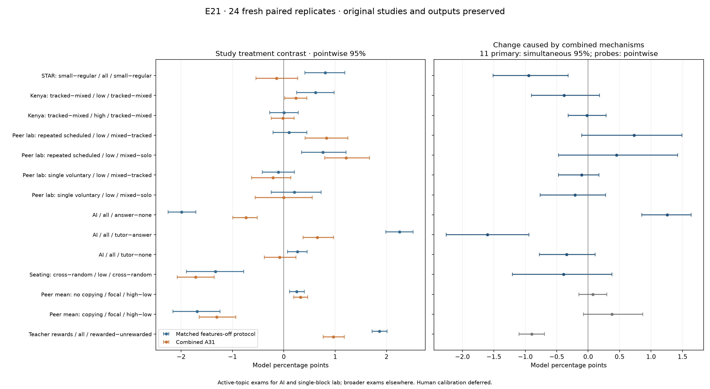

# E21 — Do A31 mechanisms change the study comparisons?

**E21 completed 3,864 new classrooms across 24 fresh paired replicates, plus thirteen exact historical replays.** The full suite passes **571 tests**. Human calibration remains deferred. Six previously tested paper families were revisited, and a seventh teacher-reward paper was assessed as a mechanism probe. No engine changed, no coefficient was adjusted after outcomes, no setup was selected from outcomes, and every declared comparison is retained.

The combined mechanisms change **3 of the eleven main exam contrasts** with simultaneous 95% Monte Carlo intervals excluding zero. **3 of fourteen comparison means** reverse sign relative to their matched mechanism-off context; small or uncertain means are not proof of a reversal. The tables below separate the earlier saved result, the fresh old-protocol result, any necessary protocol bridge, and the A31 feature effect.

## Previous results versus new comparisons

Effects are treatment minus control in model percentage points, with pointwise paired 95% intervals. Historical intervals retain their original samples. The fresh old-protocol column uses 24 new replicates under the earlier assumptions; differences from old numbers are sampling variability, not engine changes. AI and single-block lab A31 headlines measure the active-topic exam; all-topic exams and mean competence are reported separately.

| Case / group / contrast | Previous saved result | Fresh old protocol, features off | Matched active protocol, features off | Combined A31 | A31 minus matched contrast [95%] |
|---|---:|---:|---:|---:|---:|
| STAR: small−regular / all / small−regular | +0.777 [+0.535, +1.032] | +0.806 [+0.411, +1.190] | +0.806 [+0.411, +1.190] | -0.138 [-0.544, +0.272] | -0.944 [-1.333, -0.514] |
| Kenya: tracked−mixed / low / tracked−mixed | +0.712 [+0.512, +0.918] | +0.619 [+0.252, +0.982] | +0.619 [+0.252, +0.982] | +0.236 [+0.018, +0.451] | -0.383 [-0.749, -0.001] |
| Kenya: tracked−mixed / high / tracked−mixed | +0.149 [-0.032, +0.330] | +0.003 [-0.275, +0.283] | +0.003 [-0.275, +0.283] | -0.015 [-0.242, +0.203] | -0.018 [-0.231, +0.195] |
| Peer lab: repeated scheduled / low / mixed−tracked | +0.222 [+0.000, +0.444] | +0.104 [-0.208, +0.451] | +0.104 [-0.208, +0.451] | +0.833 [+0.417, +1.250] | +0.729 [+0.174, +1.286] |
| Peer lab: repeated scheduled / low / mixed−solo | +0.611 [+0.250, +0.972] | +0.764 [+0.347, +1.215] | +0.764 [+0.347, +1.215] | +1.215 [+0.799, +1.668] | +0.451 [-0.174, +1.111] |
| Peer lab: single voluntary / low / mixed−tracked | +0.014 [-0.111, +0.139] | -0.104 [-0.417, +0.208] | -0.104 [-0.417, +0.208] | -0.208 [-0.625, +0.139] | -0.104 [-0.347, +0.104] |
| Peer lab: single voluntary / low / mixed−solo | +0.139 [-0.083, +0.389] | +0.208 [-0.243, +0.729] | +0.208 [-0.243, +0.729] | +0.000 [-0.556, +0.556] | -0.208 [-0.590, +0.139] |
| AI / all / answer−none | -2.162 [-2.296, -2.030] | -1.963 [-2.241, -1.662] | -1.991 [-2.250, -1.713] | -0.734 [-0.992, -0.516] | +1.257 [+0.976, +1.522] |
| AI / all / tutor−answer | +2.419 [+2.289, +2.553] | +2.176 [+1.880, +2.458] | +2.255 [+1.986, +2.519] | +0.655 [+0.377, +0.972] | -1.600 [-2.027, -1.155] |
| AI / all / tutor−none | +0.257 [+0.168, +0.341] | +0.213 [+0.088, +0.347] | +0.264 [+0.074, +0.454] | -0.079 [-0.377, +0.238] | -0.343 [-0.647, -0.033] |
| Seating: cross−random / low / cross−random | -1.900 [-2.098, -1.708] | -1.979 [-2.344, -1.606] | -1.328 [-1.892, -0.781] | -1.719 [-2.075, -1.354] | -0.391 [-0.946, +0.148] |
| Peer mean: no copying / focal / high−low | +0.482 [+0.378, +0.589] | +0.250 [+0.111, +0.398] | +0.250 [+0.111, +0.398] | +0.324 [+0.194, +0.463] | +0.074 [-0.148, +0.296] |
| Peer mean: copying / focal / high−low | -1.520 [-1.751, -1.282] | -1.685 [-2.157, -1.241] | -1.685 [-2.157, -1.241] | -1.306 [-1.648, -0.935] | +0.380 [-0.074, +0.870] |
| Teacher rewards / all / rewarded−unrewarded | New mechanism probe | +1.864 [+1.721, +2.012] | +1.864 [+1.721, +2.012] | +0.965 [+0.767, +1.179] | -0.899 [-1.100, -0.694] |

The paired change compares the same treatment contrast under two mechanism profiles on the same fresh replicate, rather than subtracting independent historical estimates. For AI and seating, the matched baseline is a separate joint-practice bridge with A31 features off; their legacy-hint result remains visible. Teacher-reward reference means only the additional workload/topics/peer branches are off: reward strength is already the declared treatment.

## Which earlier conclusions are sensitive?

| Case / group / contrast | Combined A31 assessment against stated target | Change from matched baseline, simultaneous 95% where primary |
|---|---|---:|
| star / all / small−regular | Opposite mean; interval uncertain | -0.944 [-1.514, -0.318] |
| kenya / low / tracked−mixed | Target direction; pointwise support | -0.383 [-0.902, +0.180] |
| kenya / high / tracked−mixed | Opposite mean; interval uncertain | -0.018 [-0.318, +0.284] |
| lab_repeated / low / mixed−tracked | Target direction; pointwise support | +0.729 [-0.104, +1.493] |
| lab_repeated / low / mixed−solo | Target direction; pointwise support | +0.451 [-0.474, +1.424] |
| lab_single / low / mixed−tracked | Opposite mean; interval uncertain | -0.104 [-0.474, +0.174] |
| lab_single / low / mixed−solo | Zero mean; interval uncertain | -0.208 [-0.764, +0.278] |
| ai / all / answer−none | Target direction; pointwise support | +1.257 [+0.853, +1.640] |
| ai / all / tutor−answer | Target direction; pointwise support | -1.600 [-2.256, -0.940] |
| ai / all / tutor−none | Within declared ±1 pp model band | -0.343 [-0.776, +0.111] |
| seating / low / cross−random | Near-zero diagnostic not established | -0.391 [-1.207, +0.379] |
| composition / focal / high−low | Positive | +0.074 [-0.148, +0.296] |
| composition_copy / focal / high−low | Negative | +0.380 [-0.074, +0.870] |
| teacher_rewards / all / rewarded−unrewarded | Positive | -0.899 [-1.100, -0.694] |

Only the eleven predeclared main combined-versus-baseline exam changes receive family-adjusted intervals. Outcome intervals, other profiles, composition and teacher-reward probes remain descriptive and pointwise. A paper’s nonsignificant difference is not proof of equivalence; the ±1 pp band is only the prespecified simulator diagnostic. No model points are converted to human standard deviations, percentile ranks or puzzle-solving times.

## Study-specific interpretation

**Class size.** [STAR / Krueger](https://www.nber.org/papers/w6051) motivates the smaller-class direction. E21 retains the E19 setup: 15 versus 24 students, equal realized population mean/spread, one teacher with the same total budget, guidance 0.3 and student ticks 18. Incentives replace fixed discretionary allocation with observed-score effort/target choice; workload and grading can remove the appointments that generated the earlier size effect. These assumptions have no established conversion to human minutes. Disruption, aides and demographic channels remain missing.

**Instructional tracking.** [Duflo, Dupas and Kremer](https://www.povertyactionlab.org/sites/default/files/research-paper/39%20Peer%20Effects%2C%20Teacher%20Incentives%2C%20and%20the%20Impact%20of%20Tracking%20Project.pdf) motivates joint assessment of learning across starting groups, teacher effort and instructional targeting. The retained E19 mean 0.45 and teacher-content multiplier 2 were earlier direction fits, not field estimates. Adding one preparation tick to the three-tick budget can make a three-tick lesson infeasible. Resource and peer-access contexts below test that limitation separately. Convex rewards are a theoretical sensitivity, not an observed Kenyan pay schedule. A31’s content/readiness geometry is different from the paper’s abstract instructional-distance model, so its analytical effort/target rankings need not follow. Two numerical topic labels are not measurements of human basic/advanced skill.

**Peer-teaching lab.** [Kimbrough, McGee and Shigeoka](https://www.crepe.e.u-tokyo.ac.jp/events/20190325_shigeoka.pdf) used one shared-puzzle practice block with audio and public ranks, followed by individual evaluation. The repeated scheduled probe tests the previous E17 result; the single voluntary probe is a closer duration/choice counterpart. Scheduled frequency is fixed, so it cannot explain a field decrease in spontaneous teaching. Consolidation and noisy/delayed evidence can alter helper gains and choices, but audio explanations, puzzle strategies, public ranks and individual tournament incentives remain absent.

**AI use.** [Bastani and colleagues](https://www.pnas.org/doi/10.1073/pnas.2422633122) motivates assisted practice versus unaided, concept-related evaluation and a separate safeguarded tutor. E21 retains the four-session none/answer/tutor comparison and then introduces four persistent session topics. The main A31 exam uses the final active topic; the all-topic result tests broader accumulated competence. A31 still lacks the study’s common lecture/review stages, conversational assistance and explicit future-test stakes. Pure copying continues to grant zero direct skill; that assumption remains relevant to any matching direction.

**Seating and peer composition.** [Wu, Zhang and Wang](https://www.aeaweb.org/content/file?id=15848) separates seating alone from financial rewards to student helpers. E21 retests seating only; teacher rewards cannot stand in for its rewarded-seating treatment, and friendship changes remain absent. [Booij, Leuven and Oosterbeek](https://leuven.economists.nl/pdf/ability_final.pdf) finds own-ability-dependent mean/spread interactions. E21 retests the earlier fixed-low-focal mean comparison with and without copying. It does not reproduce that full distributional regression, engagement or dropout result.

**Teacher rewards.** [Glewwe, Ilias and Kremer](https://scholar.harvard.edu/files/kremer/files/teacher_incentives_aej_july_2010_sunday.pdf) reports gains concentrated in reward-linked tests and increased preparation, with weaker unrelated-test evidence. E21 changes reward strength 0 → 1 while retaining intrinsic motivation 0.2 and the same teacher budget. A31 can change general teaching effort and knowledge, but it has no separate test-specific preparation state, unrelated assessment or exam participation choice. A positive general exam effect would therefore match only a broad direction; it cannot reproduce the study’s distinguishing test-specific pattern.

**A concrete capacity check:** in the lower tracked section, the original three-tick budget delivers 1.000 instruction episodes per homework. The combined model delivers 0.000; its separately declared six-tick control delivers 1.000. Preparation competes with a discrete three-tick lesson. This identifies a feasibility problem in the assumed budget, not a real-world estimate of necessary preparation time.

**Why the smaller-class match weakens.** In the linear and convex incentive profiles, average teaching effort falls from eight to three ticks per class per episode. Both class sizes receive the same three-tick broadcast lesson and no individual guidance. The earlier size-sensitive guidance pathway disappears. This is a consequence of the assumed effort objective and productivity belief; it shows that the earlier class-size agreement depends on how guidance is supplied.

**Why the remaining tracking sign is insufficient.** With the combined mechanisms and original budget, the lower-starter exam contrast is +0.236 pp, but no instruction is delivered and the knowledge-gain interval spans zero. That result cannot support reproduction of a teacher-adaptation mechanism. The six-tick resource control restores lessons and yields +0.408 pp for lower starters; its +0.196 pp higher-starter effect remains uncertain. Allowing peer access under the original three-tick budget instead yields a lower-starter contrast of -0.235 pp, with a pointwise interval below zero. Resource and peer-access controls are separate contexts; a full resource-by-peer interaction was not tested. The joint study pattern remains unresolved.

## Capacity, targeting and activity evidence

Means across fresh replicates and episodes. Teaching effort and mandatory work are ticks per class per episode; teacher attention/practice are ticks per student per episode. Lesson difficulty is conditional on delivered instruction, shown as a dash when instruction count is zero. Direct component gains later in the report are active-topic accounting, not causal mediation.

| Teacher case / profile / arm / group | Teaching effort | Mandatory work | Teacher attention | Practice ticks | Instruction episodes | Lesson difficulty | Effective skill | Returned grade fraction |
|---|---:|---:|---:|---:|---:|---:|---:|---:|
| star / reference / small / all | 8.000 | 0.000 | 3.333 | 6.008 | 1.000 | 0.555 | 1.000 | 1.000 |
| star / reference / regular / all | 8.000 | 0.000 | 3.208 | 5.625 | 1.000 | 0.550 | 1.000 | 1.000 |
| star / topics / small / all | 8.000 | 0.000 | 3.333 | 6.203 | 1.000 | 0.517 | 1.000 | 1.000 |
| star / topics / regular / all | 8.000 | 0.000 | 3.208 | 5.828 | 1.000 | 0.514 | 1.000 | 1.000 |
| star / linear_incentives / small / all | 3.000 | 0.000 | 3.000 | 4.822 | 1.000 | 0.529 | 1.000 | 1.000 |
| star / linear_incentives / regular / all | 3.000 | 0.000 | 3.000 | 4.887 | 1.000 | 0.529 | 1.000 | 1.000 |
| star / convex_incentives / small / all | 3.000 | 0.000 | 3.000 | 4.821 | 1.000 | 0.535 | 1.000 | 1.000 |
| star / convex_incentives / regular / all | 3.000 | 0.000 | 3.000 | 4.888 | 1.000 | 0.534 | 1.000 | 1.000 |
| star / workload / small / all | 6.750 | 1.250 | 3.250 | 5.678 | 1.000 | 0.550 | 0.921 | 1.000 |
| star / workload / regular / all | 6.750 | 1.250 | 3.156 | 5.430 | 1.000 | 0.547 | 0.921 | 1.000 |
| star / peer_observation / small / all | 8.000 | 0.000 | 3.333 | 6.008 | 1.000 | 0.555 | 1.000 | 1.000 |
| star / peer_observation / regular / all | 8.000 | 0.000 | 3.208 | 5.625 | 1.000 | 0.550 | 1.000 | 1.000 |
| star / combined / small / all | 3.000 | 2.167 | 3.000 | 4.867 | 1.000 | 0.489 | 0.936 | 1.000 |
| star / combined / regular / all | 3.000 | 2.167 | 3.000 | 4.894 | 1.000 | 0.488 | 0.936 | 1.000 |
| star / combined_without_incentives / small / all | 5.833 | 2.167 | 3.189 | 5.553 | 1.000 | 0.511 | 0.912 | 1.000 |
| star / combined_without_incentives / regular / all | 5.833 | 2.167 | 3.118 | 5.315 | 1.000 | 0.510 | 0.912 | 1.000 |
| star / combined_without_workload / small / all | 3.000 | 0.000 | 3.000 | 4.924 | 1.000 | 0.490 | 1.000 | 1.000 |
| star / combined_without_workload / regular / all | 3.000 | 0.000 | 3.000 | 5.010 | 1.000 | 0.489 | 1.000 | 1.000 |
| star / grading_reference / small / all | 0.667 | 7.333 | 0.278 | 4.913 | 0.083 | 0.452 | 1.000 | 0.533 |
| star / grading_reference / regular / all | 0.667 | 7.333 | 0.267 | 4.921 | 0.083 | 0.450 | 1.000 | 0.333 |
| star / grading_combined / small / all | 0.250 | 7.417 | 0.250 | 4.947 | 0.083 | 0.452 | 0.862 | 0.394 |
| star / grading_combined / regular / all | 0.250 | 7.417 | 0.250 | 5.033 | 0.083 | 0.450 | 0.862 | 0.247 |
| star / automated_combined / small / all | 3.000 | 2.167 | 3.000 | 4.867 | 1.000 | 0.489 | 0.936 | 1.000 |
| star / automated_combined / regular / all | 3.000 | 2.167 | 3.000 | 4.894 | 1.000 | 0.488 | 0.936 | 1.000 |
| kenya / reference / mixed / low | 3.000 | 0.000 | 3.000 | 4.414 | 1.000 | 0.546 | 1.000 | 1.000 |
| kenya / reference / tracked / low | 3.000 | 0.000 | 3.000 | 4.411 | 1.000 | 0.432 | 1.000 | 1.000 |
| kenya / reference / mixed / high | 3.000 | 0.000 | 3.000 | 4.206 | 1.000 | 0.549 | 1.000 | 1.000 |
| kenya / reference / tracked / high | 3.000 | 0.000 | 3.000 | 4.203 | 1.000 | 0.667 | 1.000 | 1.000 |
| kenya / topics / mixed / low | 3.000 | 0.000 | 3.000 | 4.508 | 1.000 | 0.510 | 1.000 | 1.000 |
| kenya / topics / tracked / low | 3.000 | 0.000 | 3.000 | 4.511 | 1.000 | 0.383 | 1.000 | 1.000 |
| kenya / topics / mixed / high | 3.000 | 0.000 | 3.000 | 4.250 | 1.000 | 0.513 | 1.000 | 1.000 |
| kenya / topics / tracked / high | 3.000 | 0.000 | 3.000 | 4.241 | 1.000 | 0.642 | 1.000 | 1.000 |
| kenya / linear_incentives / mixed / low | 3.000 | 0.000 | 3.000 | 4.408 | 1.000 | 0.500 | 1.000 | 1.000 |
| kenya / linear_incentives / tracked / low | 3.000 | 0.000 | 3.000 | 4.411 | 1.000 | 0.428 | 1.000 | 1.000 |
| kenya / linear_incentives / mixed / high | 3.000 | 0.000 | 3.000 | 4.207 | 1.000 | 0.502 | 1.000 | 1.000 |
| kenya / linear_incentives / tracked / high | 3.000 | 0.000 | 3.000 | 4.203 | 1.000 | 0.661 | 1.000 | 1.000 |
| kenya / convex_incentives / mixed / low | 3.000 | 0.000 | 3.000 | 4.409 | 1.000 | 0.518 | 1.000 | 1.000 |
| kenya / convex_incentives / tracked / low | 3.000 | 0.000 | 3.000 | 4.411 | 1.000 | 0.430 | 1.000 | 1.000 |
| kenya / convex_incentives / mixed / high | 3.000 | 0.000 | 3.000 | 4.206 | 1.000 | 0.522 | 1.000 | 1.000 |
| kenya / convex_incentives / tracked / high | 3.000 | 0.000 | 3.000 | 4.203 | 1.000 | 0.661 | 1.000 | 1.000 |
| kenya / workload / mixed / low | 0.000 | 1.250 | 0.000 | 4.858 | 0.000 | — | 0.978 | 1.000 |
| kenya / workload / tracked / low | 0.000 | 1.250 | 0.000 | 4.874 | 0.000 | — | 0.978 | 1.000 |
| kenya / workload / mixed / high | 0.000 | 1.250 | 0.000 | 4.530 | 0.000 | — | 0.978 | 1.000 |
| kenya / workload / tracked / high | 0.000 | 1.250 | 0.000 | 4.516 | 0.000 | — | 0.978 | 1.000 |
| kenya / peer_observation / mixed / low | 3.000 | 0.000 | 3.000 | 4.414 | 1.000 | 0.546 | 1.000 | 1.000 |
| kenya / peer_observation / tracked / low | 3.000 | 0.000 | 3.000 | 4.411 | 1.000 | 0.432 | 1.000 | 1.000 |
| kenya / peer_observation / mixed / high | 3.000 | 0.000 | 3.000 | 4.206 | 1.000 | 0.549 | 1.000 | 1.000 |
| kenya / peer_observation / tracked / high | 3.000 | 0.000 | 3.000 | 4.203 | 1.000 | 0.667 | 1.000 | 1.000 |
| kenya / combined / mixed / low | 0.000 | 2.167 | 0.000 | 4.953 | 0.000 | — | 0.961 | 1.000 |
| kenya / combined / tracked / low | 0.000 | 2.167 | 0.000 | 4.986 | 0.000 | — | 0.961 | 1.000 |
| kenya / combined / mixed / high | 0.000 | 2.167 | 0.000 | 4.584 | 0.000 | — | 0.961 | 1.000 |
| kenya / combined / tracked / high | 0.000 | 2.167 | 0.000 | 4.559 | 0.000 | — | 0.961 | 1.000 |
| kenya / combined_without_incentives / mixed / low | 0.000 | 2.167 | 0.000 | 4.953 | 0.000 | — | 0.961 | 1.000 |
| kenya / combined_without_incentives / tracked / low | 0.000 | 2.167 | 0.000 | 4.986 | 0.000 | — | 0.961 | 1.000 |
| kenya / combined_without_incentives / mixed / high | 0.000 | 2.167 | 0.000 | 4.584 | 0.000 | — | 0.961 | 1.000 |
| kenya / combined_without_incentives / tracked / high | 0.000 | 2.167 | 0.000 | 4.559 | 0.000 | — | 0.961 | 1.000 |
| kenya / combined_without_workload / mixed / low | 3.000 | 0.000 | 3.000 | 4.507 | 1.000 | 0.485 | 1.000 | 1.000 |
| kenya / combined_without_workload / tracked / low | 3.000 | 0.000 | 3.000 | 4.512 | 1.000 | 0.384 | 1.000 | 1.000 |
| kenya / combined_without_workload / mixed / high | 3.000 | 0.000 | 3.000 | 4.250 | 1.000 | 0.487 | 1.000 | 1.000 |
| kenya / combined_without_workload / tracked / high | 3.000 | 0.000 | 3.000 | 4.241 | 1.000 | 0.641 | 1.000 | 1.000 |
| kenya / grading_reference / mixed / low | 0.250 | 2.750 | 0.250 | 5.077 | 0.083 | 0.447 | 1.000 | 0.072 |
| kenya / grading_reference / tracked / low | 0.250 | 2.750 | 0.250 | 5.104 | 0.083 | 0.293 | 1.000 | 0.071 |
| kenya / grading_reference / mixed / high | 0.250 | 2.750 | 0.250 | 4.120 | 0.083 | 0.451 | 1.000 | 0.071 |
| kenya / grading_reference / tracked / high | 0.250 | 2.750 | 0.250 | 4.109 | 0.083 | 0.605 | 1.000 | 0.071 |
| kenya / grading_combined / mixed / low | 0.000 | 2.833 | 0.000 | 5.529 | 0.000 | — | 0.948 | 0.023 |
| kenya / grading_combined / tracked / low | 0.000 | 2.833 | 0.000 | 5.549 | 0.000 | — | 0.948 | 0.022 |
| kenya / grading_combined / mixed / high | 0.000 | 2.833 | 0.000 | 4.219 | 0.000 | — | 0.948 | 0.021 |
| kenya / grading_combined / tracked / high | 0.000 | 2.833 | 0.000 | 4.202 | 0.000 | — | 0.948 | 0.022 |
| kenya / automated_combined / mixed / low | 0.000 | 2.167 | 0.000 | 4.953 | 0.000 | — | 0.961 | 1.000 |
| kenya / automated_combined / tracked / low | 0.000 | 2.167 | 0.000 | 4.986 | 0.000 | — | 0.961 | 1.000 |
| kenya / automated_combined / mixed / high | 0.000 | 2.167 | 0.000 | 4.584 | 0.000 | — | 0.961 | 1.000 |
| kenya / automated_combined / tracked / high | 0.000 | 2.167 | 0.000 | 4.559 | 0.000 | — | 0.961 | 1.000 |
| kenya / resourced_reference / mixed / low | 3.000 | 0.000 | 3.000 | 4.414 | 1.000 | 0.546 | 1.000 | 1.000 |
| kenya / resourced_reference / tracked / low | 3.000 | 0.000 | 3.000 | 4.411 | 1.000 | 0.432 | 1.000 | 1.000 |
| kenya / resourced_reference / mixed / high | 3.000 | 0.000 | 3.000 | 4.206 | 1.000 | 0.549 | 1.000 | 1.000 |
| kenya / resourced_reference / tracked / high | 3.000 | 0.000 | 3.000 | 4.203 | 1.000 | 0.667 | 1.000 | 1.000 |
| kenya / resourced_combined / mixed / low | 3.000 | 2.167 | 3.000 | 4.235 | 1.000 | 0.484 | 0.936 | 1.000 |
| kenya / resourced_combined / tracked / low | 3.000 | 2.167 | 3.000 | 4.242 | 1.000 | 0.379 | 0.936 | 1.000 |
| kenya / resourced_combined / mixed / high | 3.000 | 2.167 | 3.000 | 4.050 | 1.000 | 0.486 | 0.936 | 1.000 |
| kenya / resourced_combined / tracked / high | 3.000 | 2.167 | 3.000 | 4.030 | 1.000 | 0.639 | 0.936 | 1.000 |
| kenya / peer_context / mixed / low | 3.000 | 0.000 | 3.000 | 4.344 | 1.000 | 0.546 | 1.000 | 1.000 |
| kenya / peer_context / tracked / low | 3.000 | 0.000 | 3.000 | 4.317 | 1.000 | 0.431 | 1.000 | 1.000 |
| kenya / peer_context / mixed / high | 3.000 | 0.000 | 3.000 | 4.217 | 1.000 | 0.550 | 1.000 | 1.000 |
| kenya / peer_context / tracked / high | 3.000 | 0.000 | 3.000 | 4.248 | 1.000 | 0.668 | 1.000 | 1.000 |
| kenya / peer_combined / mixed / low | 0.000 | 2.167 | 0.000 | 5.143 | 0.000 | — | 0.961 | 1.000 |
| kenya / peer_combined / tracked / low | 0.000 | 2.167 | 0.000 | 5.032 | 0.000 | — | 0.961 | 1.000 |
| kenya / peer_combined / mixed / high | 0.000 | 2.167 | 0.000 | 4.801 | 0.000 | — | 0.961 | 1.000 |
| kenya / peer_combined / tracked / high | 0.000 | 2.167 | 0.000 | 4.866 | 0.000 | — | 0.961 | 1.000 |
| teacher_rewards / reference / unrewarded / all | 0.000 | 0.000 | 0.000 | 5.587 | 0.000 | — | 1.000 | 1.000 |
| teacher_rewards / reference / rewarded / all | 3.000 | 0.000 | 3.000 | 5.265 | 1.000 | 0.581 | 1.000 | 1.000 |
| teacher_rewards / workload / unrewarded / all | 0.000 | 1.250 | 0.000 | 5.587 | 0.000 | — | 0.978 | 1.000 |
| teacher_rewards / workload / rewarded / all | 2.990 | 1.250 | 2.990 | 5.124 | 0.997 | 0.577 | 0.953 | 1.000 |
| teacher_rewards / topics / unrewarded / all | 0.000 | 0.000 | 0.000 | 5.697 | 0.000 | — | 1.000 | 1.000 |
| teacher_rewards / topics / rewarded / all | 3.000 | 0.000 | 3.000 | 5.364 | 1.000 | 0.533 | 1.000 | 1.000 |
| teacher_rewards / combined / unrewarded / all | 0.000 | 2.167 | 0.000 | 5.701 | 0.000 | — | 0.961 | 1.000 |
| teacher_rewards / combined / rewarded / all | 3.000 | 2.167 | 3.000 | 5.172 | 1.000 | 0.531 | 0.936 | 1.000 |

Grading is charged per student and can leave a backlog after the H+1 closing pass. Administrative arrivals carry forward rather than disappearing. Resource controls change teacher budget in both assignment arms; they are new resource assumptions. The automated grading comparison removes declared time cost, not grading error. Teacher-disabled student cases have no teaching actions; their unused runtime skill setting is not an intervention or teacher outcome.

| Teacher comparison | Exam effect [95%] | Interpretation |
|---|---:|---|
| star / all / grading_reference | -0.004 [-0.407, +0.439] | Same grading context; automation is an additional declared intervention. |
| star / all / grading_combined | -0.353 [-0.885, +0.199] | Same grading context; automation is an additional declared intervention. |
| star / all / automated_combined | -0.138 [-0.544, +0.272] | Same grading context; automation is an additional declared intervention. |
| kenya / low / grading_reference | +0.284 [+0.047, +0.553] | Same grading context; automation is an additional declared intervention. |
| kenya / low / grading_combined | +0.239 [+0.030, +0.436] | Same grading context; automation is an additional declared intervention. |
| kenya / low / automated_combined | +0.236 [+0.018, +0.451] | Same grading context; automation is an additional declared intervention. |
| kenya / low / resourced_reference | +0.619 [+0.252, +0.982] | Matched budget-six or peer-access context; not a coefficient fit. |
| kenya / low / resourced_combined | +0.408 [+0.246, +0.569] | Matched budget-six or peer-access context; not a coefficient fit. |
| kenya / low / peer_context | +0.613 [+0.247, +0.983] | Matched budget-six or peer-access context; not a coefficient fit. |
| kenya / low / peer_combined | -0.235 [-0.434, -0.031] | Matched budget-six or peer-access context; not a coefficient fit. |
| kenya / high / grading_reference | -0.080 [-0.307, +0.159] | Same grading context; automation is an additional declared intervention. |
| kenya / high / grading_combined | +0.043 [-0.206, +0.279] | Same grading context; automation is an additional declared intervention. |
| kenya / high / automated_combined | -0.015 [-0.242, +0.203] | Same grading context; automation is an additional declared intervention. |
| kenya / high / resourced_reference | +0.003 [-0.275, +0.283] | Matched budget-six or peer-access context; not a coefficient fit. |
| kenya / high / resourced_combined | +0.196 [-0.072, +0.468] | Matched budget-six or peer-access context; not a coefficient fit. |
| kenya / high / peer_context | +0.035 [-0.275, +0.333] | Matched budget-six or peer-access context; not a coefficient fit. |
| kenya / high / peer_combined | +0.096 [-0.166, +0.339] | Matched budget-six or peer-access context; not a coefficient fit. |

## Student mechanisms and measurement sensitivity

| Case / contrast | Combined all-topic exam [95%] | Combined active-topic exam [95%] | Combined mean competence gain difference [95%] | Homework difference [95%] |
|---|---:|---:|---:|---:|
| star / all / small−regular | -0.138 [-0.544, +0.272] | +0.202 [-0.423, +0.892] | -0.082 [-0.250, +0.095] | +0.709 [-0.784, +2.069] |
| kenya / low / tracked−mixed | +0.236 [+0.018, +0.451] | +0.131 [-0.196, +0.446] | +0.089 [-0.041, +0.211] | -0.017 [-0.926, +0.942] |
| kenya / high / tracked−mixed | -0.015 [-0.242, +0.203] | +0.276 [-0.097, +0.671] | -0.028 [-0.096, +0.034] | -0.182 [-1.298, +0.885] |
| lab_repeated / low / mixed−tracked | +0.833 [+0.417, +1.250] | +0.556 [+0.278, +0.903] | +0.583 [+0.432, +0.738] | +1.146 [-0.104, +2.396] |
| lab_repeated / low / mixed−solo | +1.215 [+0.799, +1.668] | +1.181 [+0.764, +1.597] | +1.228 [+0.970, +1.495] | +8.125 [+5.833, +10.417] |
| lab_single / low / mixed−tracked | -0.139 [-0.347, +0.069] | -0.208 [-0.625, +0.139] | +0.026 [-0.052, +0.105] | +1.146 [-3.125, +5.417] |
| lab_single / low / mixed−solo | +0.035 [-0.278, +0.347] | +0.000 [-0.556, +0.556] | +0.124 [-0.021, +0.280] | +1.667 [-2.188, +5.729] |
| ai / all / answer−none | -0.944 [-1.106, -0.773] | -0.734 [-0.992, -0.516] | -0.849 [-0.923, -0.777] | +18.361 [+15.875, +20.778] |
| ai / all / tutor−answer | +0.898 [+0.722, +1.079] | +0.655 [+0.377, +0.972] | +0.945 [+0.884, +1.007] | -15.236 [-18.292, -12.333] |
| ai / all / tutor−none | -0.046 [-0.176, +0.093] | -0.079 [-0.377, +0.238] | +0.096 [+0.049, +0.145] | +3.125 [+0.389, +5.764] |
| seating / low / cross−random | -1.719 [-2.075, -1.354] | -1.858 [-2.396, -1.319] | -1.311 [-1.559, -1.054] | +6.068 [+3.542, +8.932] |
| composition / focal / high−low | +0.324 [+0.194, +0.463] | +0.407 [+0.185, +0.611] | +0.197 [+0.130, +0.265] | +0.972 [-0.028, +2.000] |
| composition_copy / focal / high−low | -1.306 [-1.648, -0.935] | -1.685 [-2.093, -1.259] | -1.597 [-1.810, -1.392] | +11.639 [+7.860, +15.667] |
| teacher_rewards / all / rewarded−unrewarded | +0.965 [+0.767, +1.179] | +1.042 [+0.783, +1.314] | +0.915 [+0.748, +1.083] | +1.620 [+0.243, +3.183] |

Splitting fixed exposure across independent topics changes the competence representation. Report the relevant-topic and broad exam separately rather than attributing dilution to worse human learning. Initial topics are clones with no hidden starting advantage; transfer and consolidation are declared nonnegative additions. Exams themselves grant no learning.

| Case / combined arm / group | Guided episodes/student | Helper episodes/student | Practice ticks/student/episode | Direct helper gain | Received peer updates/student/episode | Pending signals/student/episode | AI uses/student/episode |
|---|---:|---:|---:|---:|---:|---:|---:|
| lab_repeated / mixed / low | 1.0000 | 0.9745 | 4.3484 | 1.2563 | 1.0000 | 0.0000 | 0.0000 |
| lab_repeated / tracked / low | 1.0000 | 1.0000 | 4.2906 | 1.8819 | 1.0000 | 0.0000 | 0.0000 |
| lab_repeated / solo / low | 0.0000 | 0.0000 | 4.7828 | 0.0000 | 0.0000 | 0.0000 | 0.0000 |
| lab_single / mixed / low | 0.2500 | 0.2396 | 5.2812 | 0.0235 | 0.1146 | 0.1354 | 0.0000 |
| lab_single / tracked / low | 0.2396 | 0.2396 | 5.2188 | 0.0333 | 0.1042 | 0.1354 | 0.0000 |
| lab_single / solo / low | 0.0000 | 0.0000 | 5.0000 | 0.0000 | 0.0000 | 0.0000 | 0.0000 |
| ai / none / all | 0.1438 | 0.1438 | 4.1042 | 0.0728 | 0.1219 | 0.0219 | 0.0000 |
| ai / answer / all | 0.2326 | 0.2326 | 2.3635 | 0.1144 | 0.2122 | 0.0205 | 0.7677 |
| ai / tutor / all | 0.1573 | 0.1573 | 3.9312 | 0.0761 | 0.1399 | 0.0174 | 0.5003 |
| seating / random / low | 0.1936 | 0.1702 | 4.2953 | 0.3897 | 0.1879 | 0.0057 | 0.0000 |
| seating / cross / low | 0.2077 | 0.1301 | 3.9055 | 0.1839 | 0.2021 | 0.0056 | 0.0000 |
| composition / low / focal | 0.2644 | 0.2564 | 4.9696 | 0.6907 | 0.2574 | 0.0071 | 0.0000 |
| composition / high / focal | 0.2764 | 0.2126 | 5.0167 | 0.4509 | 0.2699 | 0.0065 | 0.0000 |
| composition_copy / low / focal | 0.1000 | 0.1008 | 3.5967 | 0.2932 | 0.0961 | 0.0039 | 0.0000 |
| composition_copy / high / focal | 0.1078 | 0.1007 | 3.1854 | 0.2018 | 0.1044 | 0.0033 | 0.0000 |

Session counts are numerical completed interactions, not coded human teaching statements. Direct helper gains sum logged active-topic components in model points per student, not net effects. Private observation covers direct checked recipients only; no third-party reputation is inferred. Current student confidence and benefit beliefs remain pooled across topics.

## Every profile and paired change

All headline contrasts, including legacy bridges and matched grading/resource/peer contexts. Pointwise intervals are descriptive. Combined mechanisms include different channels in teacher-free cases; adding a classroom teacher to the Sudoku lab would change its protocol and is not done.

| Case / group / contrast / profile | Exam effect [95%] | Matched profile | Change in contrast [95%] | Knowledge-gain contrast [95%] |
|---|---:|---|---:|---:|
| star / all / small−regular / reference | +0.806 [+0.411, +1.190] | reference | +0.000 [+0.000, +0.000] | +0.819 [+0.520, +1.093] |
| star / all / small−regular / topics | +0.628 [+0.204, +1.063] | reference | -0.178 [-0.475, +0.109] | +0.626 [+0.416, +0.818] |
| star / all / small−regular / linear_incentives | -0.242 [-0.613, +0.119] | reference | -1.048 [-1.335, -0.772] | -0.194 [-0.419, +0.017] |
| star / all / small−regular / convex_incentives | -0.230 [-0.601, +0.131] | reference | -1.036 [-1.318, -0.766] | -0.202 [-0.433, +0.012] |
| star / all / small−regular / workload | +0.544 [+0.148, +0.926] | reference | -0.261 [-0.668, +0.151] | +0.565 [+0.306, +0.804] |
| star / all / small−regular / peer_observation | +0.806 [+0.411, +1.190] | reference | +0.000 [+0.000, +0.000] | +0.819 [+0.520, +1.093] |
| star / all / small−regular / combined | -0.138 [-0.544, +0.272] | reference | -0.944 [-1.333, -0.514] | -0.082 [-0.250, +0.095] |
| star / all / small−regular / combined_without_incentives | +0.359 [-0.076, +0.792] | reference | -0.447 [-0.836, -0.015] | +0.384 [+0.195, +0.571] |
| star / all / small−regular / combined_without_workload | -0.248 [-0.664, +0.140] | reference | -1.053 [-1.421, -0.693] | -0.192 [-0.375, -0.016] |
| star / all / small−regular / grading_reference | -0.004 [-0.407, +0.439] | reference | -0.810 [-1.167, -0.445] | -0.107 [-0.380, +0.176] |
| star / all / small−regular / grading_combined | -0.353 [-0.885, +0.199] | grading_reference | -0.349 [-0.621, -0.062] | -0.232 [-0.484, +0.031] |
| star / all / small−regular / automated_combined | -0.138 [-0.544, +0.272] | grading_reference | -0.134 [-0.472, +0.194] | -0.082 [-0.250, +0.095] |
| kenya / low / tracked−mixed / reference | +0.619 [+0.252, +0.982] | reference | +0.000 [+0.000, +0.000] | +0.642 [+0.486, +0.797] |
| kenya / low / tracked−mixed / topics | +0.554 [+0.297, +0.819] | reference | -0.065 [-0.377, +0.242] | +0.550 [+0.443, +0.656] |
| kenya / low / tracked−mixed / linear_incentives | +0.336 [-0.010, +0.676] | reference | -0.283 [-0.349, -0.217] | +0.306 [+0.162, +0.453] |
| kenya / low / tracked−mixed / convex_incentives | +0.372 [+0.011, +0.727] | reference | -0.247 [-0.299, -0.194] | +0.384 [+0.234, +0.535] |
| kenya / low / tracked−mixed / workload | +0.178 [-0.054, +0.441] | reference | -0.441 [-0.779, -0.101] | +0.060 [-0.107, +0.224] |
| kenya / low / tracked−mixed / peer_observation | +0.619 [+0.252, +0.982] | reference | +0.000 [+0.000, +0.000] | +0.642 [+0.486, +0.797] |
| kenya / low / tracked−mixed / combined | +0.236 [+0.018, +0.451] | reference | -0.383 [-0.749, -0.001] | +0.089 [-0.041, +0.211] |
| kenya / low / tracked−mixed / combined_without_incentives | +0.236 [+0.018, +0.451] | reference | -0.383 [-0.749, -0.001] | +0.089 [-0.041, +0.211] |
| kenya / low / tracked−mixed / combined_without_workload | +0.330 [+0.094, +0.584] | reference | -0.289 [-0.592, +0.022] | +0.327 [+0.221, +0.438] |
| kenya / low / tracked−mixed / grading_reference | +0.284 [+0.047, +0.553] | reference | -0.335 [-0.645, -0.026] | +0.141 [-0.025, +0.302] |
| kenya / low / tracked−mixed / grading_combined | +0.239 [+0.030, +0.436] | grading_reference | -0.045 [-0.273, +0.181] | +0.055 [-0.062, +0.169] |
| kenya / low / tracked−mixed / automated_combined | +0.236 [+0.018, +0.451] | grading_reference | -0.048 [-0.257, +0.156] | +0.089 [-0.041, +0.211] |
| kenya / low / tracked−mixed / resourced_reference | +0.619 [+0.252, +0.982] | reference | +0.000 [+0.000, +0.000] | +0.642 [+0.486, +0.797] |
| kenya / low / tracked−mixed / resourced_combined | +0.408 [+0.246, +0.569] | resourced_reference | -0.211 [-0.522, +0.098] | +0.306 [+0.232, +0.376] |
| kenya / low / tracked−mixed / peer_context | +0.613 [+0.247, +0.983] | reference | -0.006 [-0.151, +0.139] | +0.547 [+0.424, +0.679] |
| kenya / low / tracked−mixed / peer_combined | -0.235 [-0.434, -0.031] | peer_context | -0.848 [-1.185, -0.527] | -0.348 [-0.450, -0.251] |
| kenya / high / tracked−mixed / reference | +0.003 [-0.275, +0.283] | reference | +0.000 [+0.000, +0.000] | +0.139 [+0.035, +0.241] |
| kenya / high / tracked−mixed / topics | +0.062 [-0.215, +0.338] | reference | +0.059 [-0.138, +0.260] | +0.080 [+0.012, +0.147] |
| kenya / high / tracked−mixed / linear_incentives | +0.305 [+0.029, +0.581] | reference | +0.302 [+0.270, +0.332] | +0.433 [+0.340, +0.526] |
| kenya / high / tracked−mixed / convex_incentives | +0.210 [-0.071, +0.498] | reference | +0.207 [+0.167, +0.244] | +0.317 [+0.222, +0.415] |
| kenya / high / tracked−mixed / workload | -0.111 [-0.318, +0.114] | reference | -0.114 [-0.311, +0.081] | -0.011 [-0.120, +0.091] |
| kenya / high / tracked−mixed / peer_observation | +0.003 [-0.275, +0.283] | reference | +0.000 [+0.000, +0.000] | +0.139 [+0.035, +0.241] |
| kenya / high / tracked−mixed / combined | -0.015 [-0.242, +0.203] | reference | -0.018 [-0.231, +0.195] | -0.028 [-0.096, +0.034] |
| kenya / high / tracked−mixed / combined_without_incentives | -0.015 [-0.242, +0.203] | reference | -0.018 [-0.231, +0.195] | -0.028 [-0.096, +0.034] |
| kenya / high / tracked−mixed / combined_without_workload | +0.209 [-0.060, +0.489] | reference | +0.206 [+0.018, +0.399] | +0.196 [+0.129, +0.261] |
| kenya / high / tracked−mixed / grading_reference | -0.080 [-0.307, +0.159] | reference | -0.083 [-0.284, +0.112] | -0.004 [-0.090, +0.084] |
| kenya / high / tracked−mixed / grading_combined | +0.043 [-0.206, +0.279] | grading_reference | +0.123 [-0.037, +0.275] | -0.025 [-0.082, +0.033] |
| kenya / high / tracked−mixed / automated_combined | -0.015 [-0.242, +0.203] | grading_reference | +0.065 [-0.113, +0.233] | -0.028 [-0.096, +0.034] |
| kenya / high / tracked−mixed / resourced_reference | +0.003 [-0.275, +0.283] | reference | +0.000 [+0.000, +0.000] | +0.139 [+0.035, +0.241] |
| kenya / high / tracked−mixed / resourced_combined | +0.196 [-0.072, +0.468] | resourced_reference | +0.193 [-0.024, +0.421] | +0.210 [+0.146, +0.277] |
| kenya / high / tracked−mixed / peer_context | +0.035 [-0.275, +0.333] | reference | +0.032 [-0.084, +0.136] | +0.197 [+0.093, +0.300] |
| kenya / high / tracked−mixed / peer_combined | +0.096 [-0.166, +0.339] | peer_context | +0.062 [-0.139, +0.257] | +0.081 [+0.023, +0.137] |
| lab_repeated / low / mixed−tracked / reference | +0.104 [-0.208, +0.451] | reference | +0.000 [+0.000, +0.000] | +0.173 [+0.011, +0.338] |
| lab_repeated / low / mixed−tracked / topics | +0.174 [-0.312, +0.625] | reference | +0.069 [-0.521, +0.625] | +0.015 [-0.138, +0.163] |
| lab_repeated / low / mixed−tracked / peer_observation | +0.451 [+0.174, +0.764] | reference | +0.347 [+0.139, +0.590] | +0.526 [+0.402, +0.645] |
| lab_repeated / low / mixed−tracked / combined | +0.833 [+0.417, +1.250] | reference | +0.729 [+0.174, +1.286] | +0.583 [+0.432, +0.738] |
| lab_repeated / low / mixed−solo / reference | +0.764 [+0.347, +1.215] | reference | +0.000 [+0.000, +0.000] | +0.652 [+0.357, +0.934] |
| lab_repeated / low / mixed−solo / topics | +0.799 [+0.347, +1.250] | reference | +0.035 [-0.590, +0.660] | +0.839 [+0.545, +1.117] |
| lab_repeated / low / mixed−solo / peer_observation | +1.111 [+0.660, +1.597] | reference | +0.347 [+0.139, +0.556] | +0.981 [+0.674, +1.293] |
| lab_repeated / low / mixed−solo / combined | +1.215 [+0.799, +1.668] | reference | +0.451 [-0.174, +1.111] | +1.228 [+0.970, +1.495] |
| lab_single / low / mixed−tracked / reference | -0.104 [-0.417, +0.208] | reference | +0.000 [+0.000, +0.000] | +0.044 [-0.086, +0.177] |
| lab_single / low / mixed−tracked / topics | -0.208 [-0.625, +0.139] | reference | -0.104 [-0.347, +0.104] | +0.026 [-0.052, +0.105] |
| lab_single / low / mixed−tracked / peer_observation | -0.104 [-0.417, +0.208] | reference | +0.000 [+0.000, +0.000] | +0.044 [-0.086, +0.177] |
| lab_single / low / mixed−tracked / combined | -0.208 [-0.625, +0.139] | reference | -0.104 [-0.347, +0.104] | +0.026 [-0.052, +0.105] |
| lab_single / low / mixed−solo / reference | +0.208 [-0.243, +0.729] | reference | +0.000 [+0.000, +0.000] | +0.196 [-0.044, +0.456] |
| lab_single / low / mixed−solo / topics | +0.000 [-0.556, +0.556] | reference | -0.208 [-0.590, +0.139] | +0.124 [-0.021, +0.280] |
| lab_single / low / mixed−solo / peer_observation | +0.208 [-0.243, +0.729] | reference | +0.000 [+0.000, +0.000] | +0.196 [-0.044, +0.456] |
| lab_single / low / mixed−solo / combined | +0.000 [-0.556, +0.556] | reference | -0.208 [-0.590, +0.139] | +0.124 [-0.021, +0.280] |
| ai / all / answer−none / reference | -1.963 [-2.241, -1.662] | bridge | +0.028 [-0.185, +0.255] | -2.008 [-2.200, -1.820] |
| ai / all / answer−none / bridge | -1.991 [-2.250, -1.713] | bridge | +0.000 [+0.000, +0.000] | -2.003 [-2.153, -1.855] |
| ai / all / answer−none / topics | -0.754 [-0.992, -0.536] | bridge | +1.237 [+0.965, +1.501] | -0.850 [-0.915, -0.784] |
| ai / all / answer−none / peer_observation | -2.009 [-2.287, -1.718] | bridge | -0.019 [-0.079, +0.046] | -2.031 [-2.198, -1.875] |
| ai / all / answer−none / combined | -0.734 [-0.992, -0.516] | bridge | +1.257 [+0.976, +1.522] | -0.849 [-0.923, -0.777] |
| ai / all / tutor−answer / reference | +2.176 [+1.880, +2.458] | bridge | -0.079 [-0.338, +0.157] | +2.294 [+2.150, +2.443] |
| ai / all / tutor−answer / bridge | +2.255 [+1.986, +2.519] | bridge | +0.000 [+0.000, +0.000] | +2.249 [+2.109, +2.394] |
| ai / all / tutor−answer / topics | +0.615 [+0.337, +0.913] | bridge | -1.640 [-2.054, -1.216] | +0.948 [+0.891, +1.008] |
| ai / all / tutor−answer / peer_observation | +2.236 [+1.954, +2.509] | bridge | -0.019 [-0.074, +0.032] | +2.272 [+2.138, +2.415] |
| ai / all / tutor−answer / combined | +0.655 [+0.377, +0.972] | bridge | -1.600 [-2.027, -1.155] | +0.945 [+0.884, +1.007] |
| ai / all / tutor−none / reference | +0.213 [+0.088, +0.347] | bridge | -0.051 [-0.287, +0.171] | +0.286 [+0.200, +0.380] |
| ai / all / tutor−none / bridge | +0.264 [+0.074, +0.454] | bridge | +0.000 [+0.000, +0.000] | +0.247 [+0.134, +0.363] |
| ai / all / tutor−none / topics | -0.139 [-0.437, +0.198] | bridge | -0.403 [-0.722, -0.075] | +0.099 [+0.053, +0.145] |
| ai / all / tutor−none / peer_observation | +0.227 [+0.037, +0.417] | bridge | -0.037 [-0.083, +0.000] | +0.240 [+0.126, +0.355] |
| ai / all / tutor−none / combined | -0.079 [-0.377, +0.238] | bridge | -0.343 [-0.647, -0.033] | +0.096 [+0.049, +0.145] |
| seating / low / cross−random / reference | -1.979 [-2.344, -1.606] | bridge | -0.651 [-1.337, -0.043] | -1.904 [-2.185, -1.628] |
| seating / low / cross−random / bridge | -1.328 [-1.892, -0.781] | bridge | +0.000 [+0.000, +0.000] | -1.392 [-1.759, -1.015] |
| seating / low / cross−random / topics | -1.623 [-1.979, -1.241] | bridge | -0.295 [-0.868, +0.269] | -1.263 [-1.523, -1.005] |
| seating / low / cross−random / peer_observation | -1.372 [-1.936, -0.851] | bridge | -0.043 [-0.226, +0.148] | -1.435 [-1.799, -1.066] |
| seating / low / cross−random / combined | -1.719 [-2.075, -1.354] | bridge | -0.391 [-0.946, +0.148] | -1.311 [-1.559, -1.054] |
| composition / focal / high−low / reference | +0.250 [+0.111, +0.398] | reference | +0.000 [+0.000, +0.000] | +0.302 [+0.201, +0.404] |
| composition / focal / high−low / topics | +0.231 [+0.074, +0.407] | reference | -0.019 [-0.231, +0.204] | +0.237 [+0.157, +0.319] |
| composition / focal / high−low / peer_observation | +0.176 [+0.000, +0.324] | reference | -0.074 [-0.250, +0.102] | +0.274 [+0.181, +0.369] |
| composition / focal / high−low / combined | +0.324 [+0.194, +0.463] | reference | +0.074 [-0.148, +0.296] | +0.197 [+0.130, +0.265] |
| composition_copy / focal / high−low / reference | -1.685 [-2.157, -1.241] | reference | +0.000 [+0.000, +0.000] | -1.767 [-2.060, -1.485] |
| composition_copy / focal / high−low / topics | -1.444 [-1.870, -1.028] | reference | +0.241 [-0.361, +0.852] | -1.522 [-1.812, -1.230] |
| composition_copy / focal / high−low / peer_observation | -1.704 [-2.148, -1.278] | reference | -0.019 [-0.435, +0.472] | -1.734 [-2.075, -1.378] |
| composition_copy / focal / high−low / combined | -1.306 [-1.648, -0.935] | reference | +0.380 [-0.074, +0.870] | -1.597 [-1.810, -1.392] |
| teacher_rewards / all / rewarded−unrewarded / reference | +1.864 [+1.721, +2.012] | reference | +0.000 [+0.000, +0.000] | +1.916 [+1.786, +2.045] |
| teacher_rewards / all / rewarded−unrewarded / workload | +1.368 [+1.221, +1.519] | reference | -0.496 [-0.671, -0.322] | +1.423 [+1.273, +1.561] |
| teacher_rewards / all / rewarded−unrewarded / topics | +1.393 [+1.225, +1.563] | reference | -0.471 [-0.642, -0.312] | +1.414 [+1.280, +1.544] |
| teacher_rewards / all / rewarded−unrewarded / combined | +0.965 [+0.767, +1.179] | reference | -0.899 [-1.100, -0.694] | +0.915 [+0.748, +1.083] |

## Preservation, uncertainty and remaining work

The [E21 plan](E21-study-mechanism-plan.md), source hashes, resolved declarations and all 24 cohort/job files were frozen before new study outcomes. Preparation was corrected before freezing to check each declaration once instead of inheriting a 100-replicate runner default. No study outcome was produced by that preflight. All subsequent simulations used the frozen A31 sources and exact declarations.

All 3,864 saved outputs passed hash checks, declaration identity checks and the full topic/exam/teacher/grade/provenance/time/reward/peer-belief validators. Thirteen original-seed historical classrooms matched every original raw table. All older source locks and E20 report evidence remain unchanged. Tests cover paired cohort membership, separate protocol bridges, fixed resource treatment, focal-state invariance, active-topic measurement declarations, weighted school aggregation, bootstrap cancellation, parallel-versus-serial raw parity, corrupt/mismatched resume rejection and partial-output preservation.

Evidence lives in `runs/E21-study-mechanisms-r1/`: `design-lock.json`, `cases.json`, `comparisons.json`, 24 resolved replicate job files, `historical-replay.json`, saved raw class declarations/tables, `raw-inventory.json`, `run-complete.json`, and `derived/` metrics/effects/paired changes/analysis manifest. The report source manifest records the exact analysis, historical effect files and figure. No prior report, engine or default was rewritten to improve signs.

An editorial review clarified that declared coefficients stayed fixed after outcomes and made the teacher-effort and zero-instruction limitations explicit. The first report, report script and source manifest are preserved byte-for-byte in `.tmp/E21-report-review-first-draft/`; this report’s source manifest records their hashes and the revision. No experiment settings, raw data, analysis or figure changed.

These are study-informed conditional mechanism comparisons with uncalibrated coefficients and coarse time/content proxies. They establish numerical sensitivity and continuity. They do not independently validate the human processes, exact effect sizes or the missing dialogue, student rewards, strategic cramming, relationships and engagement channels. Human calibration stays deferred; future changes need a new model/run identity and controls for the mechanism they add.

Progress: study comparisons and prior-result sensitivity tests complete; no input pending. Next: address the specific unsupported mechanisms revealed by these comparisons under a separately declared design.
