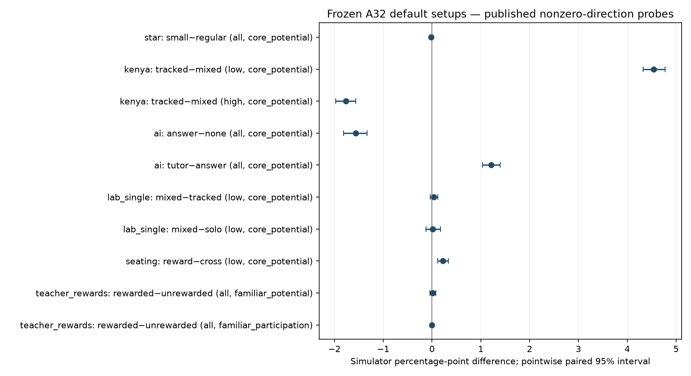

# E22 — Does A32 support the published trends?

**Teacher-study protocol clarification:** this preserved E22 teacher setup charged total exam access cost 1.2, because the intended .6 was entered twice. For the intended .6 setup use [the separately frozen E22b comparison](E22b-teacher-access-results.md). Every E22 result below remains unchanged; its teacher conditions are the retained high-cost control. The original generated report/source manifest is preserved, and [the editorial note](E22-editorial-note.md) documents this clarification. Read [the combined study assessment](../reports/A32-paper-trend-assessment-2026-10-07.md) for conclusions across both designs.

**Completed 1,824 new classrooms across 24 paired school/cohort replicates. Every raw audit passed and 136,800 saved-file hashes were verified.** The engine and all settings were frozen before outcomes; no parameters were adjusted after results. Human calibration remains deferred. Historical locked sources and reports passed their preservation checks.

Across fourteen default primary contrasts, simultaneous intervals classify: {'Paper direction supported': 4, 'Opposite direction supported': 1, 'Uncertain direction': 5, 'Within model ±1 pp band': 4, 'Near-zero not established': 0}. Near-zero bands are model diagnostics, not replication of a human null. Repeated teaching and peer composition are additional probes. Study-direction agreement remains conditional on the declared assumptions, not proof that the causal model is correct.

## Paper comparisons under the default setup

Effects are treatment minus control in simulator percentage points. Intervals resample whole paired schools/cohorts. Pointwise and family-adjusted intervals measure simulation randomness under fixed assumptions; they exclude structural/model uncertainty. Potential scores are unaided performance with everybody evaluated; actual participation and enrolled-cohort scores are separate.

| Study / group / contrast / outcome | Effect [pointwise 95%] | Simultaneous 95% | Assessment |
|---|---:|---:|---|
| [Krueger / STAR](https://www.nber.org/papers/w6051) / all / small−regular / core_potential | -0.016 [-0.043, +0.015] | -0.016 [-0.056, +0.032] | Uncertain direction |
| [Duflo, Dupas and Kremer](https://www.aeaweb.org/articles?id=10.1257/aer.101.5.1739) / low / tracked−mixed / core_potential | +4.542 [+4.322, +4.775] | +4.542 [+4.227, +4.894] | Paper direction supported |
| [Duflo, Dupas and Kremer](https://www.aeaweb.org/articles?id=10.1257/aer.101.5.1739) / high / tracked−mixed / core_potential | -1.766 [-1.974, -1.564] | -1.766 [-2.075, -1.481] | Opposite direction supported |
| [Bastani and colleagues](https://www.pnas.org/doi/10.1073/pnas.2422633122) / all / answer−none / core_potential | -1.563 [-1.815, -1.331] | -1.563 [-1.937, -1.234] | Paper direction supported |
| [Bastani and colleagues](https://www.pnas.org/doi/10.1073/pnas.2422633122) / all / tutor−answer / core_potential | +1.213 [+1.032, +1.396] | +1.213 [+0.944, +1.481] | Paper direction supported |
| [Bastani and colleagues](https://www.pnas.org/doi/10.1073/pnas.2422633122) / all / tutor−none / core_potential | -0.350 [-0.493, -0.208] | -0.350 [-0.565, -0.141] | Within model ±1 pp band |
| [Kimbrough, McGee and Shigeoka](https://www.crepe.e.u-tokyo.ac.jp/events/20190325_shigeoka.pdf) / low / mixed−tracked / core_potential | +0.035 [-0.035, +0.122] | +0.035 [-0.069, +0.174] | Uncertain direction |
| [Kimbrough, McGee and Shigeoka](https://www.crepe.e.u-tokyo.ac.jp/events/20190325_shigeoka.pdf) / low / mixed−solo / core_potential | +0.017 [-0.122, +0.174] | +0.017 [-0.191, +0.260] | Uncertain direction |
| [Earlier repeated-practice probe](https://www.crepe.e.u-tokyo.ac.jp/events/20190325_shigeoka.pdf) / low / mixed−tracked / core_potential | +0.816 [+0.469, +1.163] | Secondary | Paper direction supported |
| [Earlier repeated-practice probe](https://www.crepe.e.u-tokyo.ac.jp/events/20190325_shigeoka.pdf) / low / mixed−solo / core_potential | +1.458 [+1.024, +1.910] | Secondary | Paper direction supported |
| [Wu, Zhang and Wang](https://www.aeaweb.org/content/file?id=15848) / low / cross−random / core_potential | -0.061 [-0.291, +0.161] | -0.061 [-0.409, +0.257] | Within model ±1 pp band |
| [Wu, Zhang and Wang](https://www.aeaweb.org/content/file?id=15848) / low / reward−cross / core_potential | +0.226 [+0.122, +0.339] | +0.226 [+0.078, +0.399] | Paper direction supported |
| [Wu, Zhang and Wang](https://www.aeaweb.org/content/file?id=15848) / high / reward−cross / core_potential | +0.113 [+0.078, +0.148] | +0.113 [+0.065, +0.169] | Within model ±1 pp band |
| [Glewwe, Ilias and Kremer](https://www.aeaweb.org/articles?id=10.1257/app.2.3.205) / all / rewarded−unrewarded / familiar_potential | +0.016 [-0.042, +0.081] | +0.016 [-0.067, +0.116] | Uncertain direction |
| [Glewwe, Ilias and Kremer](https://www.aeaweb.org/articles?id=10.1257/app.2.3.205) / all / rewarded−unrewarded / unrelated_potential | +0.000 [+0.000, +0.000] | +0.000 [+0.000, +0.000] | Within model ±1 pp band |
| [Glewwe, Ilias and Kremer](https://www.aeaweb.org/articles?id=10.1257/app.2.3.205) / all / rewarded−unrewarded / familiar_participation | +0.000 [+0.000, +0.000] | +0.000 [+0.000, +0.000] | Uncertain direction |
| [Booij, Leuven and Oosterbeek — partial probe](https://leuven.economists.nl/pdf/ability_final.pdf) / focal / high−low / core_potential | -0.097 [-0.278, +0.083] | Secondary | Uncertain |

## All predeclared setups

Sensitivity results never replace the default primary result. The larger reward/future-stakes and lower teacher-cost values are utility assumptions, not measured currency/time equivalents. A supported alternative profile establishes conditional agreement only.

| Case / profile / group / contrast / outcome | Effect [pointwise 95%] | Assessment |
|---|---:|---|
| star / default / all / small−regular / core_potential | -0.016 [-0.043, +0.015] | Uncertain direction |
| star / lower_teacher_cost / all / small−regular / core_potential | +0.753 [+0.685, +0.819] | Paper direction supported |
| kenya / default / low / tracked−mixed / core_potential | +4.542 [+4.322, +4.775] | Paper direction supported |
| kenya / fixed_curriculum / low / tracked−mixed / core_potential | +0.000 [+0.000, +0.000] | Uncertain direction |
| kenya / crowdout_budget / low / tracked−mixed / core_potential | +3.530 [+3.330, +3.743] | Paper direction supported |
| kenya / default / high / tracked−mixed / core_potential | -1.766 [-1.974, -1.564] | Opposite direction supported |
| kenya / fixed_curriculum / high / tracked−mixed / core_potential | +0.000 [+0.000, +0.000] | Uncertain direction |
| kenya / crowdout_budget / high / tracked−mixed / core_potential | -1.366 [-1.508, -1.235] | Opposite direction supported |
| ai / default / all / answer−none / core_potential | -1.563 [-1.815, -1.331] | Paper direction supported |
| ai / future_stakes / all / answer−none / core_potential | -1.019 [-1.215, -0.812] | Paper direction supported |
| ai / more_AI_uses / all / answer−none / core_potential | -1.650 [-1.863, -1.449] | Paper direction supported |
| ai / default / all / tutor−answer / core_potential | +1.213 [+1.032, +1.396] | Paper direction supported |
| ai / future_stakes / all / tutor−answer / core_potential | +0.616 [+0.451, +0.771] | Paper direction supported |
| ai / more_AI_uses / all / tutor−answer / core_potential | +1.280 [+1.095, +1.479] | Paper direction supported |
| ai / default / all / tutor−none / core_potential | -0.350 [-0.493, -0.208] | Within model ±1 pp band |
| ai / future_stakes / all / tutor−none / core_potential | -0.403 [-0.523, -0.285] | Within model ±1 pp band |
| ai / more_AI_uses / all / tutor−none / core_potential | -0.370 [-0.516, -0.225] | Within model ±1 pp band |
| lab_single / default / low / mixed−tracked / core_potential | +0.035 [-0.035, +0.122] | Uncertain direction |
| lab_single / no_future_stakes / low / mixed−tracked / core_potential | +0.035 [+0.000, +0.087] | Uncertain direction |
| lab_single / default / low / mixed−solo / core_potential | +0.017 [-0.122, +0.174] | Uncertain direction |
| lab_single / no_future_stakes / low / mixed−solo / core_potential | -0.035 [-0.139, +0.052] | Uncertain direction |
| lab_repeated / default / low / mixed−tracked / core_potential | +0.816 [+0.469, +1.163] | Paper direction supported |
| lab_repeated / default / low / mixed−solo / core_potential | +1.458 [+1.024, +1.910] | Paper direction supported |
| seating / default / low / cross−random / core_potential | -0.061 [-0.291, +0.161] | Within model ±1 pp band |
| seating / stronger_reward / low / cross−random / core_potential | -0.061 [-0.291, +0.161] | Within model ±1 pp band |
| seating / default / low / reward−cross / core_potential | +0.226 [+0.122, +0.339] | Paper direction supported |
| seating / stronger_reward / low / reward−cross / core_potential | +3.121 [+2.799, +3.459] | Paper direction supported |
| seating / default / high / reward−cross / core_potential | +0.113 [+0.078, +0.148] | Within model ±1 pp band |
| seating / stronger_reward / high / reward−cross / core_potential | +1.476 [+1.298, +1.684] | Near-zero not established |
| seating / stronger_reward / low / placebo−reward / core_potential | -3.121 [-3.459, -2.799] | Paper direction supported |
| seating / stronger_reward / low / high_cost−reward / core_potential | -3.121 [-3.459, -2.799] | Paper direction supported |
| teacher_rewards / default / all / rewarded−unrewarded / familiar_potential | +0.016 [-0.042, +0.081] | Uncertain direction |
| teacher_rewards / stronger_reward / all / rewarded−unrewarded / familiar_potential | -0.012 [-0.067, +0.042] | Uncertain direction |
| teacher_rewards / format_without_participation / all / rewarded−unrewarded / familiar_potential | +1.366 [+1.238, +1.486] | Paper direction supported |
| teacher_rewards / concept_only / all / rewarded−unrewarded / familiar_potential | +0.405 [+0.336, +0.477] | Paper direction supported |
| teacher_rewards / default / all / rewarded−unrewarded / unrelated_potential | +0.000 [+0.000, +0.000] | Within model ±1 pp band |
| teacher_rewards / stronger_reward / all / rewarded−unrewarded / unrelated_potential | +0.000 [+0.000, +0.000] | Within model ±1 pp band |
| teacher_rewards / format_without_participation / all / rewarded−unrewarded / unrelated_potential | +0.000 [+0.000, +0.000] | Within model ±1 pp band |
| teacher_rewards / concept_only / all / rewarded−unrewarded / unrelated_potential | +0.000 [+0.000, +0.000] | Within model ±1 pp band |
| teacher_rewards / default / all / rewarded−unrewarded / familiar_participation | +0.000 [+0.000, +0.000] | Uncertain direction |
| teacher_rewards / stronger_reward / all / rewarded−unrewarded / familiar_participation | +0.000 [+0.000, +0.000] | Uncertain direction |
| teacher_rewards / format_without_participation / all / rewarded−unrewarded / familiar_participation | +0.000 [+0.000, +0.000] | Uncertain direction |
| teacher_rewards / concept_only / all / rewarded−unrewarded / familiar_participation | +0.000 [+0.000, +0.000] | Uncertain direction |
| composition / default / focal / high−low / core_potential | -0.097 [-0.278, +0.083] | Uncertain |
| composition / copying / focal / high−low / core_potential | -1.106 [-1.505, -0.699] | Negative |

## Recorded learning, effort and teacher activity

Means below are per student per block for costs and sessions; teacher actions/resources are per classroom per block. Knowledge/gain are final model points. These activity measurements can rule out a proposed explanation, but do not identify human mediation.

| Case / profile / arm / group | K gain | Productive doses % | Cost | Peer sessions | Contract sessions | Teacher instruction ticks | Guidance | Coaching | Followup | Teacher spent |
|---|---:|---:|---:|---:|---:|---:|---:|---:|---:|---:|
| ai / default / answer / all | 4.172 | 69.008 | 0.035 | 0.000 | 0.000 | 3.000 | 0.000 | 0.000 | 0.000 | 4.000 |
| ai / default / none / all | 5.708 | 64.448 | 0.068 | 0.000 | 0.000 | 3.000 | 0.000 | 0.000 | 0.000 | 4.000 |
| ai / default / tutor / all | 5.393 | 64.084 | 0.063 | 0.000 | 0.000 | 3.000 | 0.000 | 0.000 | 0.000 | 4.000 |
| ai / future_stakes / answer / all | 5.707 | 64.491 | 0.069 | 0.000 | 0.000 | 3.000 | 0.000 | 0.000 | 0.000 | 4.000 |
| ai / future_stakes / none / all | 6.673 | 62.312 | 0.091 | 0.000 | 0.000 | 3.000 | 0.000 | 0.000 | 0.000 | 4.000 |
| ai / future_stakes / tutor / all | 6.350 | 62.317 | 0.085 | 0.000 | 0.000 | 3.000 | 0.000 | 0.000 | 0.000 | 4.000 |
| ai / more_AI_uses / answer / all | 4.073 | 69.432 | 0.033 | 0.000 | 0.000 | 3.000 | 0.000 | 0.000 | 0.000 | 4.000 |
| ai / more_AI_uses / none / all | 5.708 | 64.448 | 0.068 | 0.000 | 0.000 | 3.000 | 0.000 | 0.000 | 0.000 | 4.000 |
| ai / more_AI_uses / tutor / all | 5.361 | 64.160 | 0.063 | 0.000 | 0.000 | 3.000 | 0.000 | 0.000 | 0.000 | 4.000 |
| composition / copying / high / focal | 8.224 | 33.097 | 0.038 | 0.155 | 0.000 | 0.000 | 0.000 | 0.000 | 0.000 | 0.000 |
| composition / copying / low / focal | 9.537 | 34.911 | 0.042 | 0.140 | 0.000 | 0.000 | 0.000 | 0.000 | 0.000 | 0.000 |
| composition / default / high / focal | 11.339 | 31.184 | 0.054 | 0.278 | 0.000 | 0.000 | 0.000 | 0.000 | 0.000 | 0.000 |
| composition / default / low / focal | 11.414 | 31.263 | 0.054 | 0.262 | 0.000 | 0.000 | 0.000 | 0.000 | 0.000 | 0.000 |
| kenya / crowdout_budget / mixed / all | 18.217 | 62.771 | 0.069 | 0.000 | 0.000 | 2.000 | 0.000 | 0.000 | 0.000 | 3.000 |
| kenya / crowdout_budget / mixed / high | 15.379 | 71.210 | 0.069 | 0.000 | 0.000 | 2.000 | 0.000 | 0.000 | 0.000 | 3.000 |
| kenya / crowdout_budget / mixed / low | 21.055 | 54.340 | 0.069 | 0.000 | 0.000 | 2.000 | 0.000 | 0.000 | 0.000 | 3.000 |
| kenya / crowdout_budget / tracked / all | 19.249 | 63.947 | 0.069 | 0.000 | 0.000 | 2.000 | 0.000 | 0.000 | 0.000 | 3.000 |
| kenya / crowdout_budget / tracked / high | 14.024 | 65.042 | 0.069 | 0.000 | 0.000 | 2.000 | 0.000 | 0.000 | 0.000 | 3.000 |
| kenya / crowdout_budget / tracked / low | 24.474 | 62.851 | 0.069 | 0.000 | 0.000 | 2.000 | 0.000 | 0.000 | 0.000 | 3.000 |
| kenya / default / mixed / all | 21.969 | 63.538 | 0.069 | 0.000 | 0.000 | 3.000 | 0.000 | 0.000 | 0.000 | 4.000 |
| kenya / default / mixed / high | 18.188 | 71.298 | 0.069 | 0.000 | 0.000 | 3.000 | 0.000 | 0.000 | 0.000 | 4.000 |
| kenya / default / mixed / low | 25.750 | 55.808 | 0.069 | 0.000 | 0.000 | 3.000 | 0.000 | 0.000 | 0.000 | 4.000 |
| kenya / default / tracked / all | 23.342 | 64.881 | 0.069 | 0.000 | 0.000 | 3.000 | 0.000 | 0.000 | 0.000 | 4.000 |
| kenya / default / tracked / high | 16.442 | 65.195 | 0.069 | 0.000 | 0.000 | 3.000 | 0.000 | 0.000 | 0.000 | 4.000 |
| kenya / default / tracked / low | 30.242 | 64.566 | 0.069 | 0.000 | 0.000 | 3.000 | 0.000 | 0.000 | 0.000 | 4.000 |
| kenya / fixed_curriculum / mixed / all | 21.955 | 63.503 | 0.069 | 0.000 | 0.000 | 3.000 | 0.000 | 0.000 | 0.000 | 4.000 |
| kenya / fixed_curriculum / mixed / high | 18.245 | 71.542 | 0.069 | 0.000 | 0.000 | 3.000 | 0.000 | 0.000 | 0.000 | 4.000 |
| kenya / fixed_curriculum / mixed / low | 25.665 | 55.494 | 0.069 | 0.000 | 0.000 | 3.000 | 0.000 | 0.000 | 0.000 | 4.000 |
| kenya / fixed_curriculum / tracked / all | 21.955 | 63.525 | 0.069 | 0.000 | 0.000 | 3.000 | 0.000 | 0.000 | 0.000 | 4.000 |
| kenya / fixed_curriculum / tracked / high | 18.245 | 71.546 | 0.069 | 0.000 | 0.000 | 3.000 | 0.000 | 0.000 | 0.000 | 4.000 |
| kenya / fixed_curriculum / tracked / low | 25.665 | 55.503 | 0.069 | 0.000 | 0.000 | 3.000 | 0.000 | 0.000 | 0.000 | 4.000 |
| lab_repeated / default / mixed / all | 3.108 | 18.284 | 0.052 | 1.000 | 0.000 | 0.000 | 0.000 | 0.000 | 0.000 | 0.000 |
| lab_repeated / default / mixed / high | 2.155 | 22.415 | 0.052 | 1.000 | 0.000 | 0.000 | 0.000 | 0.000 | 0.000 | 0.000 |
| lab_repeated / default / mixed / low | 4.061 | 13.850 | 0.052 | 1.000 | 0.000 | 0.000 | 0.000 | 0.000 | 0.000 | 0.000 |
| lab_repeated / default / solo / all | 1.891 | 7.230 | 0.059 | 0.000 | 0.000 | 0.000 | 0.000 | 0.000 | 0.000 | 0.000 |
| lab_repeated / default / solo / high | 1.311 | 8.564 | 0.058 | 0.000 | 0.000 | 0.000 | 0.000 | 0.000 | 0.000 | 0.000 |
| lab_repeated / default / solo / low | 2.471 | 5.881 | 0.061 | 0.000 | 0.000 | 0.000 | 0.000 | 0.000 | 0.000 | 0.000 |
| lab_repeated / default / tracked / all | 2.881 | 18.691 | 0.052 | 1.000 | 0.000 | 0.000 | 0.000 | 0.000 | 0.000 | 0.000 |
| lab_repeated / default / tracked / high | 2.725 | 26.627 | 0.052 | 1.000 | 0.000 | 0.000 | 0.000 | 0.000 | 0.000 | 0.000 |
| lab_repeated / default / tracked / low | 3.037 | 10.902 | 0.053 | 1.000 | 0.000 | 0.000 | 0.000 | 0.000 | 0.000 | 0.000 |
| lab_single / default / mixed / all | 0.115 | 13.257 | 0.052 | 0.146 | 0.000 | 0.000 | 0.000 | 0.000 | 0.000 | 0.000 |
| lab_single / default / mixed / high | 0.071 | 14.831 | 0.051 | 0.156 | 0.000 | 0.000 | 0.000 | 0.000 | 0.000 | 0.000 |
| lab_single / default / mixed / low | 0.158 | 10.799 | 0.053 | 0.135 | 0.000 | 0.000 | 0.000 | 0.000 | 0.000 | 0.000 |
| lab_single / default / solo / all | 0.093 | 5.775 | 0.072 | 0.000 | 0.000 | 0.000 | 0.000 | 0.000 | 0.000 | 0.000 |
| lab_single / default / solo / high | 0.041 | 5.271 | 0.066 | 0.000 | 0.000 | 0.000 | 0.000 | 0.000 | 0.000 | 0.000 |
| lab_single / default / solo / low | 0.145 | 5.878 | 0.077 | 0.000 | 0.000 | 0.000 | 0.000 | 0.000 | 0.000 | 0.000 |
| lab_single / default / tracked / all | 0.124 | 16.122 | 0.053 | 0.188 | 0.000 | 0.000 | 0.000 | 0.000 | 0.000 | 0.000 |
| lab_single / default / tracked / high | 0.104 | 19.182 | 0.052 | 0.188 | 0.000 | 0.000 | 0.000 | 0.000 | 0.000 | 0.000 |
| lab_single / default / tracked / low | 0.145 | 10.764 | 0.054 | 0.188 | 0.000 | 0.000 | 0.000 | 0.000 | 0.000 | 0.000 |
| lab_single / no_future_stakes / mixed / all | 0.061 | 4.241 | 0.057 | 0.203 | 0.000 | 0.000 | 0.000 | 0.000 | 0.000 | 0.000 |
| lab_single / no_future_stakes / mixed / high | 0.030 | 3.958 | 0.056 | 0.198 | 0.000 | 0.000 | 0.000 | 0.000 | 0.000 | 0.000 |
| lab_single / no_future_stakes / mixed / low | 0.092 | 4.206 | 0.057 | 0.208 | 0.000 | 0.000 | 0.000 | 0.000 | 0.000 | 0.000 |
| lab_single / no_future_stakes / solo / all | 0.093 | 6.056 | 0.068 | 0.000 | 0.000 | 0.000 | 0.000 | 0.000 | 0.000 | 0.000 |
| lab_single / no_future_stakes / solo / high | 0.041 | 5.271 | 0.061 | 0.000 | 0.000 | 0.000 | 0.000 | 0.000 | 0.000 | 0.000 |
| lab_single / no_future_stakes / solo / low | 0.145 | 6.101 | 0.074 | 0.000 | 0.000 | 0.000 | 0.000 | 0.000 | 0.000 | 0.000 |
| lab_single / no_future_stakes / tracked / all | 0.051 | 3.848 | 0.055 | 0.255 | 0.000 | 0.000 | 0.000 | 0.000 | 0.000 | 0.000 |
| lab_single / no_future_stakes / tracked / high | 0.035 | 4.593 | 0.054 | 0.271 | 0.000 | 0.000 | 0.000 | 0.000 | 0.000 | 0.000 |
| lab_single / no_future_stakes / tracked / low | 0.066 | 2.894 | 0.055 | 0.240 | 0.000 | 0.000 | 0.000 | 0.000 | 0.000 | 0.000 |
| seating / default / cross / all | 17.372 | 57.682 | 0.058 | 0.120 | 0.000 | 3.000 | 0.000 | 0.000 | 0.000 | 4.000 |
| seating / default / cross / high | 11.283 | 65.412 | 0.058 | 0.107 | 0.000 | 3.000 | 0.000 | 0.000 | 0.000 | 4.000 |
| seating / default / cross / low | 23.461 | 49.830 | 0.057 | 0.132 | 0.000 | 3.000 | 0.000 | 0.000 | 0.000 | 4.000 |
| seating / default / random / all | 17.397 | 57.696 | 0.058 | 0.121 | 0.000 | 3.000 | 0.000 | 0.000 | 0.000 | 4.000 |
| seating / default / random / high | 11.268 | 65.261 | 0.058 | 0.118 | 0.000 | 3.000 | 0.000 | 0.000 | 0.000 | 4.000 |
| seating / default / random / low | 23.525 | 50.009 | 0.057 | 0.123 | 0.000 | 3.000 | 0.000 | 0.000 | 0.000 | 4.000 |
| seating / default / reward / all | 17.559 | 58.997 | 0.058 | 0.121 | 0.002 | 3.000 | 0.000 | 0.000 | 0.000 | 4.000 |
| seating / default / reward / high | 11.377 | 66.741 | 0.060 | 0.100 | 0.000 | 3.000 | 0.000 | 0.000 | 0.000 | 4.000 |
| seating / default / reward / low | 23.742 | 51.040 | 0.056 | 0.142 | 0.005 | 3.000 | 0.000 | 0.000 | 0.000 | 4.000 |
| seating / stronger_reward / cross / all | 17.372 | 57.682 | 0.058 | 0.120 | 0.000 | 3.000 | 0.000 | 0.000 | 0.000 | 4.000 |
| seating / stronger_reward / cross / high | 11.283 | 65.412 | 0.058 | 0.107 | 0.000 | 3.000 | 0.000 | 0.000 | 0.000 | 4.000 |
| seating / stronger_reward / cross / low | 23.461 | 49.830 | 0.057 | 0.132 | 0.000 | 3.000 | 0.000 | 0.000 | 0.000 | 4.000 |
| seating / stronger_reward / high_cost / all | 17.372 | 57.682 | 0.059 | 0.120 | 0.000 | 3.000 | 0.000 | 0.000 | 0.000 | 4.000 |
| seating / stronger_reward / high_cost / high | 11.283 | 65.412 | 0.060 | 0.107 | 0.000 | 3.000 | 0.000 | 0.000 | 0.000 | 4.000 |
| seating / stronger_reward / high_cost / low | 23.461 | 49.830 | 0.059 | 0.132 | 0.000 | 3.000 | 0.000 | 0.000 | 0.000 | 4.000 |
| seating / stronger_reward / placebo / all | 17.372 | 57.682 | 0.058 | 0.120 | 0.000 | 3.000 | 0.000 | 0.000 | 0.000 | 4.000 |
| seating / stronger_reward / placebo / high | 11.283 | 65.412 | 0.058 | 0.107 | 0.000 | 3.000 | 0.000 | 0.000 | 0.000 | 4.000 |
| seating / stronger_reward / placebo / low | 23.461 | 49.830 | 0.057 | 0.132 | 0.000 | 3.000 | 0.000 | 0.000 | 0.000 | 4.000 |
| seating / stronger_reward / random / all | 17.397 | 57.696 | 0.058 | 0.121 | 0.000 | 3.000 | 0.000 | 0.000 | 0.000 | 4.000 |
| seating / stronger_reward / random / high | 11.268 | 65.261 | 0.058 | 0.118 | 0.000 | 3.000 | 0.000 | 0.000 | 0.000 | 4.000 |
| seating / stronger_reward / random / low | 23.525 | 50.009 | 0.057 | 0.123 | 0.000 | 3.000 | 0.000 | 0.000 | 0.000 | 4.000 |
| seating / stronger_reward / reward / all | 19.606 | 63.097 | 0.077 | 0.503 | 0.479 | 3.000 | 0.000 | 0.000 | 0.000 | 4.000 |
| seating / stronger_reward / reward / high | 12.672 | 69.463 | 0.096 | 0.019 | 0.000 | 3.000 | 0.000 | 0.000 | 0.000 | 4.000 |
| seating / stronger_reward / reward / low | 26.539 | 55.101 | 0.058 | 0.987 | 0.957 | 3.000 | 0.000 | 0.000 | 0.000 | 4.000 |
| star / default / regular / all | 17.762 | 64.473 | 0.076 | 0.000 | 0.000 | 3.000 | 0.000 | 0.000 | 0.000 | 4.000 |
| star / default / small / all | 17.757 | 64.432 | 0.076 | 0.000 | 0.000 | 3.000 | 0.000 | 0.000 | 0.000 | 4.000 |
| star / lower_teacher_cost / regular / all | 17.763 | 64.469 | 0.076 | 0.000 | 0.000 | 3.000 | 0.002 | 0.000 | 0.000 | 4.002 |
| star / lower_teacher_cost / small / all | 18.533 | 63.850 | 0.083 | 0.000 | 0.000 | 3.000 | 1.016 | 0.000 | 0.000 | 5.016 |
| teacher_rewards / concept_only / rewarded / all | 8.377 | 41.610 | 0.074 | 0.000 | 0.000 | 3.000 | 0.083 | 0.000 | 0.000 | 7.083 |
| teacher_rewards / concept_only / unrewarded / all | 8.199 | 41.025 | 0.074 | 0.000 | 0.000 | 3.000 | 0.000 | 0.000 | 0.000 | 4.000 |
| teacher_rewards / default / rewarded / all | 8.321 | 42.026 | 0.074 | 0.000 | 0.000 | 3.000 | 0.000 | 0.000 | 4.000 | 8.000 |
| teacher_rewards / default / unrewarded / all | 8.306 | 41.626 | 0.074 | 0.000 | 0.000 | 3.000 | 0.000 | 0.000 | 0.000 | 4.000 |
| teacher_rewards / format_without_participation / rewarded / all | 8.210 | 41.411 | 0.074 | 0.000 | 0.000 | 3.000 | 0.000 | 1.000 | 0.000 | 7.000 |
| teacher_rewards / format_without_participation / unrewarded / all | 8.199 | 41.025 | 0.074 | 0.000 | 0.000 | 3.000 | 0.000 | 0.000 | 0.000 | 4.000 |
| teacher_rewards / stronger_reward / rewarded / all | 8.306 | 41.912 | 0.074 | 0.000 | 0.000 | 3.000 | 0.000 | 0.000 | 4.000 | 8.000 |
| teacher_rewards / stronger_reward / unrewarded / all | 8.306 | 41.626 | 0.074 | 0.000 | 0.000 | 3.000 | 0.000 | 0.000 | 0.000 | 4.000 |

## Teacher rewards: performance versus participation

A missing exam contributes zero to the enrolled-cohort formula. Potential, participant-only and cohort effects therefore answer different questions. Followup reduces access costs globally, so an unrelated-cohort-score gain can occur without unrelated learning. Zero cross-topic transfer is an explicit restriction, not evidence of human test specificity.

| Profile / contrast / outcome | Effect [pointwise 95%] |
|---|---:|
| default / rewarded−unrewarded / core_cohort | +0.000 [+0.000, +0.000] |
| default / rewarded−unrewarded / core_participation | +0.000 [+0.000, +0.000] |
| default / rewarded−unrewarded / core_potential | +0.042 [+0.009, +0.076] |
| default / rewarded−unrewarded / familiar_cohort | +0.000 [+0.000, +0.000] |
| default / rewarded−unrewarded / familiar_participation | +0.000 [+0.000, +0.000] |
| default / rewarded−unrewarded / familiar_potential | +0.016 [-0.042, +0.081] |
| default / rewarded−unrewarded / novel_cohort | +0.000 [+0.000, +0.000] |
| default / rewarded−unrewarded / novel_participation | +0.000 [+0.000, +0.000] |
| default / rewarded−unrewarded / novel_potential | +0.037 [-0.028, +0.113] |
| default / rewarded−unrewarded / unrelated_cohort | +0.000 [+0.000, +0.000] |
| default / rewarded−unrewarded / unrelated_participation | +0.000 [+0.000, +0.000] |
| default / rewarded−unrewarded / unrelated_potential | +0.000 [+0.000, +0.000] |
| stronger_reward / rewarded−unrewarded / core_cohort | +0.000 [+0.000, +0.000] |
| stronger_reward / rewarded−unrewarded / core_participation | +0.000 [+0.000, +0.000] |
| stronger_reward / rewarded−unrewarded / core_potential | +0.012 [-0.021, +0.042] |
| stronger_reward / rewarded−unrewarded / familiar_cohort | +0.000 [+0.000, +0.000] |
| stronger_reward / rewarded−unrewarded / familiar_participation | +0.000 [+0.000, +0.000] |
| stronger_reward / rewarded−unrewarded / familiar_potential | -0.012 [-0.067, +0.042] |
| stronger_reward / rewarded−unrewarded / novel_cohort | +0.000 [+0.000, +0.000] |
| stronger_reward / rewarded−unrewarded / novel_participation | +0.000 [+0.000, +0.000] |
| stronger_reward / rewarded−unrewarded / novel_potential | -0.016 [-0.093, +0.062] |
| stronger_reward / rewarded−unrewarded / unrelated_cohort | +0.000 [+0.000, +0.000] |
| stronger_reward / rewarded−unrewarded / unrelated_participation | +0.000 [+0.000, +0.000] |
| stronger_reward / rewarded−unrewarded / unrelated_potential | +0.000 [+0.000, +0.000] |
| format_without_participation / rewarded−unrewarded / core_cohort | -0.009 [-0.039, +0.019] |
| format_without_participation / rewarded−unrewarded / core_participants | -0.009 [-0.039, +0.019] |
| format_without_participation / rewarded−unrewarded / core_participation | +0.000 [+0.000, +0.000] |
| format_without_participation / rewarded−unrewarded / core_potential | -0.009 [-0.039, +0.019] |
| format_without_participation / rewarded−unrewarded / familiar_cohort | +1.366 [+1.238, +1.486] |
| format_without_participation / rewarded−unrewarded / familiar_participants | +1.366 [+1.238, +1.486] |
| format_without_participation / rewarded−unrewarded / familiar_participation | +0.000 [+0.000, +0.000] |
| format_without_participation / rewarded−unrewarded / familiar_potential | +1.366 [+1.238, +1.486] |
| format_without_participation / rewarded−unrewarded / novel_cohort | +0.030 [-0.044, +0.095] |
| format_without_participation / rewarded−unrewarded / novel_participants | +0.030 [-0.044, +0.095] |
| format_without_participation / rewarded−unrewarded / novel_participation | +0.000 [+0.000, +0.000] |
| format_without_participation / rewarded−unrewarded / novel_potential | +0.030 [-0.044, +0.095] |
| format_without_participation / rewarded−unrewarded / unrelated_cohort | +0.000 [+0.000, +0.000] |
| format_without_participation / rewarded−unrewarded / unrelated_participants | +0.000 [+0.000, +0.000] |
| format_without_participation / rewarded−unrewarded / unrelated_participation | +0.000 [+0.000, +0.000] |
| format_without_participation / rewarded−unrewarded / unrelated_potential | +0.000 [+0.000, +0.000] |
| concept_only / rewarded−unrewarded / core_cohort | +0.148 [+0.116, +0.178] |
| concept_only / rewarded−unrewarded / core_participants | +0.148 [+0.116, +0.178] |
| concept_only / rewarded−unrewarded / core_participation | +0.000 [+0.000, +0.000] |
| concept_only / rewarded−unrewarded / core_potential | +0.148 [+0.116, +0.178] |
| concept_only / rewarded−unrewarded / familiar_cohort | +0.405 [+0.336, +0.477] |
| concept_only / rewarded−unrewarded / familiar_participants | +0.405 [+0.336, +0.477] |
| concept_only / rewarded−unrewarded / familiar_participation | +0.000 [+0.000, +0.000] |
| concept_only / rewarded−unrewarded / familiar_potential | +0.405 [+0.336, +0.477] |
| concept_only / rewarded−unrewarded / novel_cohort | +0.338 [+0.273, +0.405] |
| concept_only / rewarded−unrewarded / novel_participants | +0.338 [+0.273, +0.405] |
| concept_only / rewarded−unrewarded / novel_participation | +0.000 [+0.000, +0.000] |
| concept_only / rewarded−unrewarded / novel_potential | +0.338 [+0.273, +0.405] |
| concept_only / rewarded−unrewarded / unrelated_cohort | +0.000 [+0.000, +0.000] |
| concept_only / rewarded−unrewarded / unrelated_participants | +0.000 [+0.000, +0.000] |
| concept_only / rewarded−unrewarded / unrelated_participation | +0.000 [+0.000, +0.000] |
| concept_only / rewarded−unrewarded / unrelated_potential | +0.000 [+0.000, +0.000] |

## What the assumptions can and cannot support

**Class size:** finite individual guidance is a plausible channel for smaller classes. A32 must actually select guidance and students must use it; higher teacher knowledge alone is insufficient. The lower-cost profile checks a decision threshold, not a calibrated correction. The fixed 120-student school improves pairing over earlier separately generated classrooms.

**Tracking:** instructional adaptation can be plausible when students differ in readiness. Budget six funds the declared lesson after preparation; budget three explicitly shortens it. The multiplier two and population mean .45 came from earlier setup fitting. The fixed-curriculum control tests whether adaptive-targeting is needed, but uncertainty and new effort/quality gates can still prevent the paper direction.

**AI:** assisted scores and unaided learning are distinct. Copying competes with costly practice, while protected lecture makes some learning common to all arms; larger AI effects are therefore not guaranteed. Study effort, access and future stakes can change uptake. The zero direct-learning rule for answer receipt is encoded; a net harmful total contrast is not predetermined because subsequent activities can compensate. Language tutoring and the paper's common review stage remain missing.

**Peer-teaching lab:** one voluntary block with future evaluation is closer than twenty scheduled blocks. Helpful content, helper learning and time costs are plausible; numerical knowledge probabilities do not represent puzzle solving. Audio, communicated strategies, public ranks and explicit tournament pay are absent. Repeated opportunity frequency is encoded and cannot establish spontaneous-teaching-frequency agreement.

**Rewarded seating:** rewards tied to observed partner improvement, baseline-defined pairs and real opportunity cost are plausible. A32 may generate helper gains absent in the paper; that mismatch must remain. Reward utilities, prize expectation and recipient willingness are not empirically calibrated. Placebo/high-cost controls test incentives rather than direct reward-to-knowledge credit.

**Teacher incentives:** the paper reports reward-linked gains, greater test preparation and participation, little unrelated-test improvement and unchanged attendance/homework assignment. A32 can now separate these outcomes, but an unrelated-topic null is partly imposed by zero transfer, and individual coaching is narrower than classroom test preparation. A larger reward alone cannot validate the full pattern. Student practice also reacts to the added available activities.

**Peer composition:** own ability, peer mean and spread interact in the paper; its tracking and dropout findings are not tested by the fixed-low-focal mean probe. Treat these results as a conditional mechanism stress test, never full study reproduction.

## Earlier results retained

E21 already audited 3,864 classrooms and replayed thirteen historical cases exactly. Its preserved combined-profile contrasts are reproduced below as descriptive references. E22 changes learning, resource feasibility and several protocols together; subtracting these numbers cannot identify the effect of any single new mechanism.

| Earlier E21 case / group / contrast | Effect [original pointwise 95%] |
|---|---:|
| star / all / small−regular | -0.138 [-0.544, +0.272] |
| kenya / low / tracked−mixed | +0.236 [+0.018, +0.451] |
| kenya / high / tracked−mixed | -0.015 [-0.242, +0.203] |
| lab_repeated / low / mixed−tracked | +0.833 [+0.417, +1.250] |
| lab_repeated / low / mixed−solo | +1.215 [+0.799, +1.668] |
| lab_single / low / mixed−tracked | -0.208 [-0.625, +0.139] |
| lab_single / low / mixed−solo | +0.000 [-0.556, +0.556] |
| ai / all / answer−none | -0.734 [-0.992, -0.516] |
| ai / all / tutor−answer | +0.655 [+0.377, +0.972] |
| ai / all / tutor−none | -0.079 [-0.377, +0.238] |
| seating / low / cross−random | -1.719 [-2.075, -1.354] |
| composition / focal / high−low | +0.324 [+0.194, +0.463] |
| composition_copy / focal / high−low | -1.306 [-1.648, -0.935] |
| teacher_rewards / all / rewarded−unrewarded | +0.965 [+0.767, +1.179] |

## Reproducibility

Design: `runs/E22-A32-study-trends-r1/design-lock.json`. Every resolved classroom is in the frozen replicate declarations; raw classroom tables and per-file hashes are under `raw/`. Analysis: `derived/effects.json`, `derived/cohort-metrics.json` and `derived/analysis-manifest.json`. Source preservation checks verified 92 A32/E21 source/report entries in addition to E21's recursive older-source checks. All 1,824 runs passed both live and reloaded raw validation. No after-outcome tuning, model change or rejected profile removal occurred.

A defensible claim is: “Under the explicitly declared assumptions, the simulation supports selected paper-consistent directional patterns; other patterns remain uncertain, contrary or untested.” A blanket claim that it reproduces all studies is unsupported.
