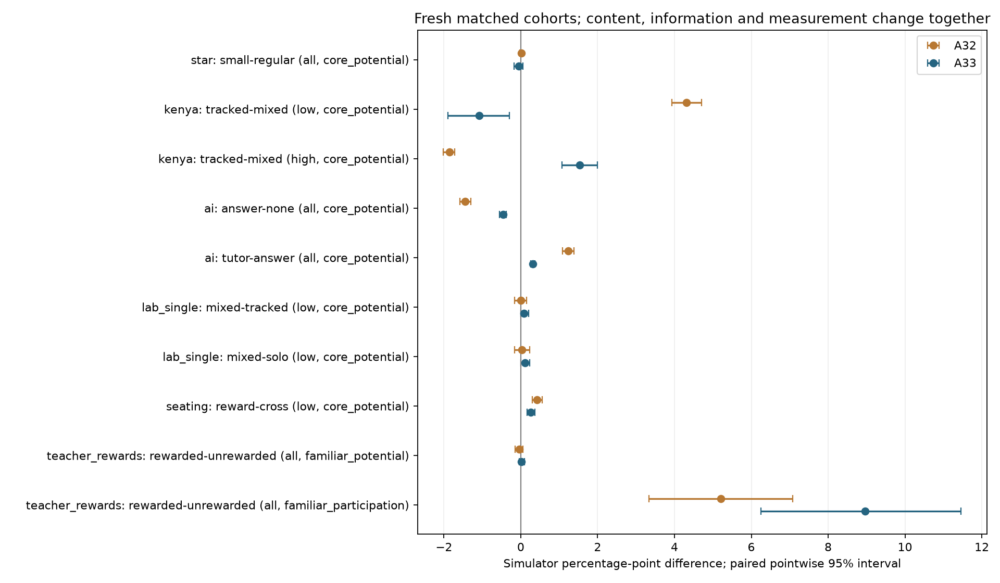

# E23 A33 promising mechanisms and study trends

**Implemented the optional A33 curriculum, observed teacher forecasts, group preparation and shared reasoning; completed 1,908 classrooms with every live/reloaded raw audit passed, 152,748 saved-file hashes checked and 679 tests passing.** All sources/settings, both development cohorts and sixteen fresh confirmation cohorts were frozen before outcomes. No parameters were fitted or changed between pools. Human calibration remains deferred.

A33 retains activity-linked effortful learning, scarce teacher/helper time and the exact A32 fallback. Initial domain means are preserved by the component projection. The new observed skill pretests, targeting and tagged measurement are additional assumptions; the combined comparison cannot identify one isolated mechanism. Numerical rates/costs are hypotheses, not field estimates.

## Fresh study comparisons

Treatment-minus-control differences are simulator percentage points with pointwise paired 95% intervals across sixteen whole schools/cohorts. They describe simulation randomness, not uncertainty about human realism. The last column preserves the paper-direction assessment; near-zero expectations are not proven by a nonsignificant result.

| Case / group / treatment minus control / outcome | A32 fresh reference | Full A33 | Assessment |
|---|---:|---:|---|
| [Krueger / STAR](https://www.nber.org/papers/w6051) / all / small−regular / core_potential | +0.009 [-0.028, +0.044] | -0.056 [-0.177, +0.055] | Uncertain |
| [Duflo, Dupas and Kremer](https://www.aeaweb.org/articles?id=10.1257/aer.101.5.1739) / low / tracked−mixed / core_potential | +4.311 [+3.929, +4.702] | -1.086 [-1.895, -0.300] | Opposite supported |
| [Duflo, Dupas and Kremer](https://www.aeaweb.org/articles?id=10.1257/aer.101.5.1739) / high / tracked−mixed / core_potential | -1.863 [-2.014, -1.716] | +1.528 [+1.076, +1.992] | Positive supported |
| [Bastani and colleagues](https://www.pnas.org/doi/10.1073/pnas.2422633122) / all / answer−none / core_potential | -1.444 [-1.583, -1.302] | -0.462 [-0.549, -0.372] | Negative supported |
| [Bastani and colleagues](https://www.pnas.org/doi/10.1073/pnas.2422633122) / all / tutor−answer / core_potential | +1.236 [+1.090, +1.382] | +0.316 [+0.264, +0.372] | Positive supported |
| [Bastani and colleagues](https://www.pnas.org/doi/10.1073/pnas.2422633122) / all / tutor−none / core_potential | -0.208 [-0.316, -0.101] | -0.146 [-0.205, -0.087] | Negative difference; paper little-change pattern conditional |
| [Kimbrough, McGee and Shigeoka](https://www.crepe.e.u-tokyo.ac.jp/events/20190325_shigeoka.pdf) / low / mixed−tracked / core_potential | +0.000 [-0.156, +0.156] | +0.078 [+0.000, +0.208] | Uncertain |
| [Kimbrough, McGee and Shigeoka](https://www.crepe.e.u-tokyo.ac.jp/events/20190325_shigeoka.pdf) / low / mixed−solo / core_potential | +0.026 [-0.156, +0.234] | +0.104 [+0.000, +0.234] | Uncertain |
| [Earlier repeated-practice probe](https://www.crepe.e.u-tokyo.ac.jp/events/20190325_shigeoka.pdf) / low / mixed−tracked / core_potential | +0.807 [+0.234, +1.406] | +0.313 [+0.104, +0.573] | Positive supported |
| [Earlier repeated-practice probe](https://www.crepe.e.u-tokyo.ac.jp/events/20190325_shigeoka.pdf) / low / mixed−solo / core_potential | +1.823 [+1.302, +2.370] | +0.469 [+0.182, +0.781] | Positive supported |
| [Wu, Zhang and Wang](https://www.aeaweb.org/content/file?id=15848) / low / cross−random / core_potential | -0.059 [-0.273, +0.104] | -0.026 [-0.117, +0.052] | Uncertain; not evidence of a human null |
| [Wu, Zhang and Wang](https://www.aeaweb.org/content/file?id=15848) / low / reward−cross / core_potential | +0.417 [+0.299, +0.553] | +0.260 [+0.169, +0.371] | Positive supported |
| [Wu, Zhang and Wang](https://www.aeaweb.org/content/file?id=15848) / high / reward−cross / core_potential | +0.176 [+0.111, +0.241] | +0.072 [+0.026, +0.124] | Positive difference; paper little-change pattern conditional |
| [Glewwe, Ilias and Kremer](https://www.aeaweb.org/articles?id=10.1257/app.2.3.205) / all / rewarded−unrewarded / familiar_potential | -0.038 [-0.153, +0.059] | +0.010 [-0.045, +0.101] | Uncertain |
| [Glewwe, Ilias and Kremer](https://www.aeaweb.org/articles?id=10.1257/app.2.3.205) / all / rewarded−unrewarded / unrelated_potential | +0.000 [+0.000, +0.000] | +0.000 [+0.000, +0.000] | Uncertain; not evidence of a human null |
| [Glewwe, Ilias and Kremer](https://www.aeaweb.org/articles?id=10.1257/app.2.3.205) / all / rewarded−unrewarded / familiar_participation | +5.208 [+3.333, +7.083] | +8.958 [+6.250, +11.458] | Positive supported |
| [Booij, Leuven and Oosterbeek — partial probe](https://leuven.economists.nl/pdf/ability_final.pdf) / focal / high−low / core_potential | -0.104 [-0.243, +0.049] | -0.056 [-0.160, +0.042] | Partial composition probe |

## Family adjusted primary intervals

Bonferroni intervals cover the fourteen default A33 primary contrasts. Repeated practice, partial composition and the India-inspired probe are secondary. Do not pick a sensitivity as the primary result after seeing signs.

| Case / group / contrast / outcome | Family adjusted 95% interval |
|---|---:|
| star / all / small−regular / core_potential | [-0.236, +0.100] |
| kenya / low / tracked−mixed / core_potential | [-2.302, +0.039] |
| kenya / high / tracked−mixed / core_potential | [+0.866, +2.210] |
| ai / all / answer−none / core_potential | [-0.587, -0.323] |
| ai / all / tutor−answer / core_potential | [+0.240, +0.399] |
| ai / all / tutor−none / core_potential | [-0.229, -0.056] |
| lab_single / low / mixed−tracked / core_potential | [+0.000, +0.260] |
| lab_single / low / mixed−solo / core_potential | [+0.000, +0.312] |
| seating / low / cross−random / core_potential | [-0.156, +0.087] |
| seating / low / reward−cross / core_potential | [+0.137, +0.436] |
| seating / high / reward−cross / core_potential | [+0.013, +0.150] |
| teacher_rewards / all / rewarded−unrewarded / familiar_potential | [-0.059, +0.167] |
| teacher_rewards / all / rewarded−unrewarded / unrelated_potential | [+0.000, +0.000] |
| teacher_rewards / all / rewarded−unrewarded / familiar_participation | [+5.000, +12.500] |

## All prespecified variants and sensitivities

| Case / profile / variant / group / contrast / outcome | Fresh difference [95%] | Assessment |
|---|---:|---|
| star / default / A32 / all / small−regular / core_potential | +0.009 [-0.028, +0.044] | Uncertain |
| star / default / A33 / all / small−regular / core_potential | -0.056 [-0.177, +0.055] | Uncertain |
| kenya / default / A32 / low / tracked−mixed / core_potential | +4.311 [+3.929, +4.702] | Positive supported |
| kenya / default / A33 / low / tracked−mixed / core_potential | -1.086 [-1.895, -0.300] | Opposite supported |
| kenya / default / curriculum_only / low / tracked−mixed / core_potential | -1.086 [-1.895, -0.300] | Opposite supported |
| kenya / default / fixed_curriculum / low / tracked−mixed / core_potential | +0.000 [+0.000, +0.000] | Uncertain |
| kenya / default / old_accuracy / low / tracked−mixed / core_potential | -1.084 [-1.870, -0.315] | Opposite supported |
| kenya / default / A32 / high / tracked−mixed / core_potential | -1.863 [-2.014, -1.716] | Opposite supported |
| kenya / default / A33 / high / tracked−mixed / core_potential | +1.528 [+1.076, +1.992] | Positive supported |
| kenya / default / curriculum_only / high / tracked−mixed / core_potential | +1.528 [+1.076, +1.992] | Positive supported |
| kenya / default / fixed_curriculum / high / tracked−mixed / core_potential | +0.000 [+0.000, +0.000] | Uncertain |
| kenya / default / old_accuracy / high / tracked−mixed / core_potential | +1.066 [+0.610, +1.550] | Positive supported |
| ai / default / A32 / all / answer−none / core_potential | -1.444 [-1.583, -1.302] | Negative supported |
| ai / default / A33 / all / answer−none / core_potential | -0.462 [-0.549, -0.372] | Negative supported |
| ai / default / A32 / all / tutor−answer / core_potential | +1.236 [+1.090, +1.382] | Positive supported |
| ai / default / A33 / all / tutor−answer / core_potential | +0.316 [+0.264, +0.372] | Positive supported |
| ai / default / A32 / all / tutor−none / core_potential | -0.208 [-0.316, -0.101] | Negative difference; paper little-change pattern conditional |
| ai / default / A33 / all / tutor−none / core_potential | -0.146 [-0.205, -0.087] | Negative difference; paper little-change pattern conditional |
| lab_single / default / A32 / low / mixed−tracked / core_potential | +0.000 [-0.156, +0.156] | Uncertain |
| lab_single / default / A33 / low / mixed−tracked / core_potential | +0.078 [+0.000, +0.208] | Uncertain |
| lab_single / default / no_reasoning / low / mixed−tracked / core_potential | +0.052 [+0.000, +0.130] | Uncertain |
| lab_single / default / A32 / low / mixed−solo / core_potential | +0.026 [-0.156, +0.234] | Uncertain |
| lab_single / default / A33 / low / mixed−solo / core_potential | +0.104 [+0.000, +0.234] | Uncertain |
| lab_single / default / no_reasoning / low / mixed−solo / core_potential | +0.078 [+0.000, +0.156] | Uncertain |
| lab_repeated / default / A32 / low / mixed−tracked / core_potential | +0.807 [+0.234, +1.406] | Positive supported |
| lab_repeated / default / A33 / low / mixed−tracked / core_potential | +0.313 [+0.104, +0.573] | Positive supported |
| lab_repeated / default / A32 / low / mixed−solo / core_potential | +1.823 [+1.302, +2.370] | Positive supported |
| lab_repeated / default / A33 / low / mixed−solo / core_potential | +0.469 [+0.182, +0.781] | Positive supported |
| seating / default / A32 / low / cross−random / core_potential | -0.059 [-0.273, +0.104] | Uncertain; not evidence of a human null |
| seating / default / A33 / low / cross−random / core_potential | -0.026 [-0.117, +0.052] | Uncertain; not evidence of a human null |
| seating / default / no_reasoning / low / cross−random / core_potential | -0.026 [-0.117, +0.052] | Uncertain; not evidence of a human null |
| seating / default / A32 / low / reward−cross / core_potential | +0.417 [+0.299, +0.553] | Positive supported |
| seating / default / A33 / low / reward−cross / core_potential | +0.260 [+0.169, +0.371] | Positive supported |
| seating / default / no_reasoning / low / reward−cross / core_potential | +0.195 [+0.130, +0.267] | Positive supported |
| seating / default / A32 / high / reward−cross / core_potential | +0.176 [+0.111, +0.241] | Positive difference; paper little-change pattern conditional |
| seating / default / A33 / high / reward−cross / core_potential | +0.072 [+0.026, +0.124] | Positive difference; paper little-change pattern conditional |
| seating / default / no_reasoning / high / reward−cross / core_potential | +0.059 [+0.020, +0.104] | Positive difference; paper little-change pattern conditional |
| teacher_rewards / default / A32 / all / rewarded−unrewarded / familiar_potential | -0.038 [-0.153, +0.059] | Uncertain |
| teacher_rewards / default / A33 / all / rewarded−unrewarded / familiar_potential | +0.010 [-0.045, +0.101] | Uncertain |
| teacher_rewards / default / forecast_group / all / rewarded−unrewarded / familiar_potential | -0.056 [-0.167, +0.056] | Uncertain |
| teacher_rewards / default / forecast_only / all / rewarded−unrewarded / familiar_potential | -0.056 [-0.167, +0.056] | Uncertain |
| teacher_rewards / low_access / A32 / all / rewarded−unrewarded / familiar_potential | -0.122 [-0.174, -0.073] | Opposite supported |
| teacher_rewards / low_access / A33 / all / rewarded−unrewarded / familiar_potential | +18.455 [+17.250, +19.701] | Positive supported |
| teacher_rewards / low_access / forecast_group / all / rewarded−unrewarded / familiar_potential | +14.819 [+14.299, +15.361] | Positive supported |
| teacher_rewards / low_access / forecast_only / all / rewarded−unrewarded / familiar_potential | -0.125 [-0.257, +0.014] | Uncertain |
| teacher_rewards / default / A32 / all / rewarded−unrewarded / unrelated_potential | +0.000 [+0.000, +0.000] | Uncertain; not evidence of a human null |
| teacher_rewards / default / A33 / all / rewarded−unrewarded / unrelated_potential | +0.000 [+0.000, +0.000] | Uncertain; not evidence of a human null |
| teacher_rewards / default / forecast_group / all / rewarded−unrewarded / unrelated_potential | +0.000 [+0.000, +0.000] | Uncertain; not evidence of a human null |
| teacher_rewards / default / forecast_only / all / rewarded−unrewarded / unrelated_potential | +0.000 [+0.000, +0.000] | Uncertain; not evidence of a human null |
| teacher_rewards / low_access / A32 / all / rewarded−unrewarded / unrelated_potential | +0.000 [+0.000, +0.000] | Uncertain; not evidence of a human null |
| teacher_rewards / low_access / A33 / all / rewarded−unrewarded / unrelated_potential | +0.000 [+0.000, +0.000] | Uncertain; not evidence of a human null |
| teacher_rewards / low_access / forecast_group / all / rewarded−unrewarded / unrelated_potential | +0.000 [+0.000, +0.000] | Uncertain; not evidence of a human null |
| teacher_rewards / low_access / forecast_only / all / rewarded−unrewarded / unrelated_potential | +0.000 [+0.000, +0.000] | Uncertain; not evidence of a human null |
| teacher_rewards / default / A32 / all / rewarded−unrewarded / familiar_participation | +5.208 [+3.333, +7.083] | Positive supported |
| teacher_rewards / default / A33 / all / rewarded−unrewarded / familiar_participation | +8.958 [+6.250, +11.458] | Positive supported |
| teacher_rewards / default / forecast_group / all / rewarded−unrewarded / familiar_participation | +15.208 [+13.750, +16.667] | Positive supported |
| teacher_rewards / default / forecast_only / all / rewarded−unrewarded / familiar_participation | +15.208 [+13.750, +16.667] | Positive supported |
| teacher_rewards / low_access / A32 / all / rewarded−unrewarded / familiar_participation | -0.208 [-0.625, +0.000] | Uncertain |
| teacher_rewards / low_access / A33 / all / rewarded−unrewarded / familiar_participation | +7.708 [+5.000, +10.625] | Positive supported |
| teacher_rewards / low_access / forecast_group / all / rewarded−unrewarded / familiar_participation | +2.083 [+1.042, +3.125] | Positive supported |
| teacher_rewards / low_access / forecast_only / all / rewarded−unrewarded / familiar_participation | +5.833 [+3.958, +7.917] | Positive supported |
| composition / default / A32 / focal / high−low / core_potential | -0.104 [-0.243, +0.049] | Partial composition probe |
| composition / default / A33 / focal / high−low / core_potential | -0.056 [-0.160, +0.042] | Partial composition probe |
| composition / default / no_reasoning / focal / high−low / core_potential | -0.056 [-0.160, +0.042] | Partial composition probe |
| india_probe / zero_transfer / A32 / all / rewarded−unrewarded / familiar_potential | +0.288 [+0.229, +0.354] | Positive supported |
| india_probe / zero_transfer / A33 / all / rewarded−unrewarded / familiar_potential | +1.042 [+0.892, +1.222] | Positive supported |
| india_probe / concept_transfer / A32 / all / rewarded−unrewarded / familiar_potential | +0.288 [+0.229, +0.354] | Positive supported |
| india_probe / concept_transfer / A33 / all / rewarded−unrewarded / familiar_potential | +1.042 [+0.892, +1.222] | Positive supported |
| india_probe / zero_transfer / A32 / all / rewarded−unrewarded / unrelated_potential | +0.000 [+0.000, +0.000] | Uncertain |
| india_probe / zero_transfer / A33 / all / rewarded−unrewarded / unrelated_potential | +0.000 [+0.000, +0.000] | Uncertain |
| india_probe / concept_transfer / A32 / all / rewarded−unrewarded / unrelated_potential | +0.059 [+0.028, +0.094] | Positive supported |
| india_probe / concept_transfer / A33 / all / rewarded−unrewarded / unrelated_potential | +0.219 [+0.156, +0.292] | Positive supported |
| india_probe / zero_transfer / A32 / all / rewarded−unrewarded / knowledge_gain | +0.138 [+0.121, +0.153] | Positive supported |
| india_probe / zero_transfer / A33 / all / rewarded−unrewarded / knowledge_gain | +0.621 [+0.587, +0.657] | Positive supported |
| india_probe / concept_transfer / A32 / all / rewarded−unrewarded / knowledge_gain | +0.164 [+0.145, +0.183] | Positive supported |
| india_probe / concept_transfer / A33 / all / rewarded−unrewarded / knowledge_gain | +0.746 [+0.707, +0.787] | Positive supported |

## Paired changes to intervention effects

These subtract within-model study contrasts in the same cohorts. Differences versus A32 include changed information/content/measurement. Old-accuracy and no-reasoning controls isolate those stated switches; zero fixed-curriculum tracking is an encoded assignment control.

| Case / profile / group / outcome / reference variant | A33 contrast minus reference contrast [95%] |
|---|---:|
| star / default / all / small−regular / core_potential / A32 | -0.064 [-0.198, +0.054] |
| kenya / default / low / tracked−mixed / core_potential / A32 | -5.397 [-6.416, -4.385] |
| kenya / default / low / tracked−mixed / core_potential / curriculum_only | +0.000 [+0.000, +0.000] |
| kenya / default / low / tracked−mixed / core_potential / old_accuracy | -0.002 [-0.119, +0.112] |
| kenya / default / low / tracked−mixed / core_potential / fixed_curriculum | -1.086 [-1.895, -0.300] |
| kenya / default / high / tracked−mixed / core_potential / A32 | +3.390 [+2.875, +3.909] |
| kenya / default / high / tracked−mixed / core_potential / curriculum_only | +0.000 [+0.000, +0.000] |
| kenya / default / high / tracked−mixed / core_potential / old_accuracy | +0.461 [+0.223, +0.756] |
| kenya / default / high / tracked−mixed / core_potential / fixed_curriculum | +1.528 [+1.076, +1.992] |
| ai / default / all / answer−none / core_potential / A32 | +0.983 [+0.847, +1.122] |
| ai / default / all / tutor−answer / core_potential / A32 | -0.920 [-1.063, -0.778] |
| ai / default / all / tutor−none / core_potential / A32 | +0.062 [-0.028, +0.156] |
| lab_single / default / low / mixed−tracked / core_potential / A32 | +0.078 [-0.104, +0.260] |
| lab_single / default / low / mixed−tracked / core_potential / no_reasoning | +0.026 [+0.000, +0.078] |
| lab_single / default / low / mixed−solo / core_potential / A32 | +0.078 [-0.156, +0.286] |
| lab_single / default / low / mixed−solo / core_potential / no_reasoning | +0.026 [+0.000, +0.078] |
| lab_repeated / default / low / mixed−tracked / core_potential / A32 | -0.495 [-1.224, +0.234] |
| lab_repeated / default / low / mixed−solo / core_potential / A32 | -1.354 [-1.901, -0.781] |
| seating / default / low / cross−random / core_potential / A32 | +0.033 [-0.111, +0.195] |
| seating / default / low / cross−random / core_potential / no_reasoning | +0.000 [+0.000, +0.000] |
| seating / default / low / reward−cross / core_potential / A32 | -0.156 [-0.267, -0.046] |
| seating / default / low / reward−cross / core_potential / no_reasoning | +0.065 [+0.013, +0.130] |
| seating / default / high / reward−cross / core_potential / A32 | -0.104 [-0.182, -0.033] |
| seating / default / high / reward−cross / core_potential / no_reasoning | +0.013 [+0.000, +0.033] |
| teacher_rewards / default / all / rewarded−unrewarded / familiar_potential / A32 | +0.049 [-0.076, +0.191] |
| teacher_rewards / default / all / rewarded−unrewarded / familiar_potential / forecast_only | +0.066 [-0.080, +0.222] |
| teacher_rewards / default / all / rewarded−unrewarded / familiar_potential / forecast_group | +0.066 [-0.080, +0.222] |
| teacher_rewards / low_access / all / rewarded−unrewarded / familiar_potential / A32 | +18.576 [+17.368, +19.833] |
| teacher_rewards / low_access / all / rewarded−unrewarded / familiar_potential / forecast_only | +18.580 [+17.330, +19.889] |
| teacher_rewards / low_access / all / rewarded−unrewarded / familiar_potential / forecast_group | +3.635 [+2.649, +4.632] |
| teacher_rewards / default / all / rewarded−unrewarded / unrelated_potential / A32 | +0.000 [+0.000, +0.000] |
| teacher_rewards / default / all / rewarded−unrewarded / unrelated_potential / forecast_only | +0.000 [+0.000, +0.000] |
| teacher_rewards / default / all / rewarded−unrewarded / unrelated_potential / forecast_group | +0.000 [+0.000, +0.000] |
| teacher_rewards / low_access / all / rewarded−unrewarded / unrelated_potential / A32 | +0.000 [+0.000, +0.000] |
| teacher_rewards / low_access / all / rewarded−unrewarded / unrelated_potential / forecast_only | +0.000 [+0.000, +0.000] |
| teacher_rewards / low_access / all / rewarded−unrewarded / unrelated_potential / forecast_group | +0.000 [+0.000, +0.000] |
| teacher_rewards / default / all / rewarded−unrewarded / familiar_participation / A32 | +3.750 [+1.042, +6.458] |
| teacher_rewards / default / all / rewarded−unrewarded / familiar_participation / forecast_only | -6.250 [-9.167, -3.542] |
| teacher_rewards / default / all / rewarded−unrewarded / familiar_participation / forecast_group | -6.250 [-9.167, -3.542] |
| teacher_rewards / low_access / all / rewarded−unrewarded / familiar_participation / A32 | +7.917 [+5.208, +10.833] |
| teacher_rewards / low_access / all / rewarded−unrewarded / familiar_participation / forecast_only | +1.875 [+0.000, +3.750] |
| teacher_rewards / low_access / all / rewarded−unrewarded / familiar_participation / forecast_group | +5.625 [+2.917, +8.542] |
| composition / default / focal / high−low / core_potential / A32 | +0.049 [-0.097, +0.194] |
| composition / default / focal / high−low / core_potential / no_reasoning | +0.000 [+0.000, +0.000] |
| india_probe / zero_transfer / all / rewarded−unrewarded / familiar_potential / A32 | +0.753 [+0.601, +0.941] |
| india_probe / concept_transfer / all / rewarded−unrewarded / familiar_potential / A32 | +0.753 [+0.601, +0.941] |
| india_probe / zero_transfer / all / rewarded−unrewarded / unrelated_potential / A32 | +0.000 [+0.000, +0.000] |
| india_probe / concept_transfer / all / rewarded−unrewarded / unrelated_potential / A32 | +0.160 [+0.080, +0.243] |
| india_probe / zero_transfer / all / rewarded−unrewarded / knowledge_gain / A32 | +0.484 [+0.446, +0.522] |
| india_probe / concept_transfer / all / rewarded−unrewarded / knowledge_gain / A32 | +0.581 [+0.539, +0.624] |

## Learning and observed activities

Knowledge gain is the mean over all components/domains. Teacher/helper gain credits in older metrics concern the active component and should not be compared as if already averaged across components. Teacher counts/time are per class/block; sessions are per student/block.

| Case / profile / arm / group / variant | Mean K gain | Peer sessions | Contract sessions | Guidance | Individual or group coaching | Group coaching | Followup | Teacher ticks | Advanced lessons share | Constructed items/student/block |
|---|---:|---:|---:|---:|---:|---:|---:|---:|---:|---:|
| ai / default / answer / all / A32 | 4.300 | 0.000 | 0.000 | 0.000 | 0.000 | 0.000 | 0.000 | 4.000 | Unavailable | 0.000 |
| ai / default / answer / all / A33 | 1.114 | 0.000 | 0.000 | 0.000 | 0.000 | 0.000 | 0.000 | 4.000 | 0.250 | 0.000 |
| ai / default / none / all / A32 | 5.736 | 0.000 | 0.000 | 0.000 | 0.000 | 0.000 | 0.000 | 4.000 | Unavailable | 0.000 |
| ai / default / none / all / A33 | 1.522 | 0.000 | 0.000 | 0.000 | 0.000 | 0.000 | 0.000 | 4.000 | 0.250 | 0.000 |
| ai / default / tutor / all / A32 | 5.416 | 0.000 | 0.000 | 0.000 | 0.000 | 0.000 | 0.000 | 4.000 | Unavailable | 0.000 |
| ai / default / tutor / all / A33 | 1.414 | 0.000 | 0.000 | 0.000 | 0.000 | 0.000 | 0.000 | 4.000 | 0.250 | 0.000 |
| composition / default / high / focal / A32 | 11.527 | 0.281 | 0.000 | 0.000 | 0.000 | 0.000 | 0.000 | 0.000 | Unavailable | 0.000 |
| composition / default / high / focal / A33 | 2.923 | 0.290 | 0.000 | 0.000 | 0.000 | 0.000 | 0.000 | 0.000 | 0.300 | 0.000 |
| composition / default / high / focal / no_reasoning | 2.923 | 0.290 | 0.000 | 0.000 | 0.000 | 0.000 | 0.000 | 0.000 | 0.300 | 0.000 |
| composition / default / low / focal / A32 | 11.596 | 0.261 | 0.000 | 0.000 | 0.000 | 0.000 | 0.000 | 0.000 | Unavailable | 0.000 |
| composition / default / low / focal / A33 | 2.957 | 0.265 | 0.000 | 0.000 | 0.000 | 0.000 | 0.000 | 0.000 | 0.300 | 0.000 |
| composition / default / low / focal / no_reasoning | 2.957 | 0.265 | 0.000 | 0.000 | 0.000 | 0.000 | 0.000 | 0.000 | 0.300 | 0.000 |
| india_probe / concept_transfer / rewarded / all / A32 | 9.799 | 0.000 | 0.000 | 0.047 | 1.000 | 0.000 | 0.000 | 7.047 | Unavailable | 0.000 |
| india_probe / concept_transfer / rewarded / all / A33 | 4.017 | 0.000 | 0.000 | 0.000 | 1.000 | 1.000 | 0.000 | 7.000 | 0.000 | 0.000 |
| india_probe / concept_transfer / unrewarded / all / A32 | 9.635 | 0.000 | 0.000 | 0.000 | 0.000 | 0.000 | 0.000 | 4.000 | Unavailable | 0.000 |
| india_probe / concept_transfer / unrewarded / all / A33 | 3.272 | 0.000 | 0.000 | 0.000 | 0.000 | 0.000 | 0.000 | 4.000 | 0.000 | 0.000 |
| india_probe / zero_transfer / rewarded / all / A32 | 8.350 | 0.000 | 0.000 | 0.047 | 1.000 | 0.000 | 0.000 | 7.047 | Unavailable | 0.000 |
| india_probe / zero_transfer / rewarded / all / A33 | 3.418 | 0.000 | 0.000 | 0.000 | 1.000 | 1.000 | 0.000 | 7.000 | 0.000 | 0.000 |
| india_probe / zero_transfer / unrewarded / all / A32 | 8.212 | 0.000 | 0.000 | 0.000 | 0.000 | 0.000 | 0.000 | 4.000 | Unavailable | 0.000 |
| india_probe / zero_transfer / unrewarded / all / A33 | 2.797 | 0.000 | 0.000 | 0.000 | 0.000 | 0.000 | 0.000 | 4.000 | 0.000 | 0.000 |
| kenya / default / mixed / all / A32 | 22.217 | 0.000 | 0.000 | 0.000 | 0.000 | 0.000 | 0.000 | 4.000 | Unavailable | 0.000 |
| kenya / default / mixed / all / A33 | 6.846 | 0.000 | 0.000 | 0.000 | 0.000 | 0.000 | 0.000 | 4.000 | 0.000 | 0.000 |
| kenya / default / mixed / all / curriculum_only | 6.846 | 0.000 | 0.000 | 0.000 | 0.000 | 0.000 | 0.000 | 4.000 | 0.000 | 0.000 |
| kenya / default / mixed / all / fixed_curriculum | 4.773 | 0.000 | 0.000 | 0.000 | 0.000 | 0.000 | 0.000 | 4.000 | 0.000 | 0.000 |
| kenya / default / mixed / all / old_accuracy | 6.639 | 0.000 | 0.000 | 0.000 | 0.000 | 0.000 | 0.000 | 4.000 | 0.000 | 0.000 |
| kenya / default / mixed / high / A32 | 18.185 | 0.000 | 0.000 | 0.000 | 0.000 | 0.000 | 0.000 | 4.000 | Unavailable | 0.000 |
| kenya / default / mixed / high / A33 | 5.740 | 0.000 | 0.000 | 0.000 | 0.000 | 0.000 | 0.000 | 4.000 | 0.000 | 0.000 |
| kenya / default / mixed / high / curriculum_only | 5.740 | 0.000 | 0.000 | 0.000 | 0.000 | 0.000 | 0.000 | 4.000 | 0.000 | 0.000 |
| kenya / default / mixed / high / fixed_curriculum | 2.368 | 0.000 | 0.000 | 0.000 | 0.000 | 0.000 | 0.000 | 4.000 | 0.000 | 0.000 |
| kenya / default / mixed / high / old_accuracy | 5.685 | 0.000 | 0.000 | 0.000 | 0.000 | 0.000 | 0.000 | 4.000 | 0.000 | 0.000 |
| kenya / default / mixed / low / A32 | 26.248 | 0.000 | 0.000 | 0.000 | 0.000 | 0.000 | 0.000 | 4.000 | Unavailable | 0.000 |
| kenya / default / mixed / low / A33 | 7.953 | 0.000 | 0.000 | 0.000 | 0.000 | 0.000 | 0.000 | 4.000 | 0.000 | 0.000 |
| kenya / default / mixed / low / curriculum_only | 7.953 | 0.000 | 0.000 | 0.000 | 0.000 | 0.000 | 0.000 | 4.000 | 0.000 | 0.000 |
| kenya / default / mixed / low / fixed_curriculum | 7.178 | 0.000 | 0.000 | 0.000 | 0.000 | 0.000 | 0.000 | 4.000 | 0.000 | 0.000 |
| kenya / default / mixed / low / old_accuracy | 7.594 | 0.000 | 0.000 | 0.000 | 0.000 | 0.000 | 0.000 | 4.000 | 0.000 | 0.000 |
| kenya / default / tracked / all / A32 | 23.523 | 0.000 | 0.000 | 0.000 | 0.000 | 0.000 | 0.000 | 4.000 | Unavailable | 0.000 |
| kenya / default / tracked / all / A33 | 7.288 | 0.000 | 0.000 | 0.000 | 0.000 | 0.000 | 0.000 | 4.000 | 0.078 | 0.000 |
| kenya / default / tracked / all / curriculum_only | 7.288 | 0.000 | 0.000 | 0.000 | 0.000 | 0.000 | 0.000 | 4.000 | 0.078 | 0.000 |
| kenya / default / tracked / all / fixed_curriculum | 4.773 | 0.000 | 0.000 | 0.000 | 0.000 | 0.000 | 0.000 | 4.000 | 0.000 | 0.000 |
| kenya / default / tracked / all / old_accuracy | 6.857 | 0.000 | 0.000 | 0.000 | 0.000 | 0.000 | 0.000 | 4.000 | 0.062 | 0.000 |
| kenya / default / tracked / high / A32 | 16.457 | 0.000 | 0.000 | 0.000 | 0.000 | 0.000 | 0.000 | 4.000 | Unavailable | 0.000 |
| kenya / default / tracked / high / A33 | 7.399 | 0.000 | 0.000 | 0.000 | 0.000 | 0.000 | 0.000 | 4.000 | 0.156 | 0.000 |
| kenya / default / tracked / high / curriculum_only | 7.399 | 0.000 | 0.000 | 0.000 | 0.000 | 0.000 | 0.000 | 4.000 | 0.156 | 0.000 |
| kenya / default / tracked / high / fixed_curriculum | 2.368 | 0.000 | 0.000 | 0.000 | 0.000 | 0.000 | 0.000 | 4.000 | 0.000 | 0.000 |
| kenya / default / tracked / high / old_accuracy | 6.831 | 0.000 | 0.000 | 0.000 | 0.000 | 0.000 | 0.000 | 4.000 | 0.125 | 0.000 |
| kenya / default / tracked / low / A32 | 30.589 | 0.000 | 0.000 | 0.000 | 0.000 | 0.000 | 0.000 | 4.000 | Unavailable | 0.000 |
| kenya / default / tracked / low / A33 | 7.178 | 0.000 | 0.000 | 0.000 | 0.000 | 0.000 | 0.000 | 4.000 | 0.000 | 0.000 |
| kenya / default / tracked / low / curriculum_only | 7.178 | 0.000 | 0.000 | 0.000 | 0.000 | 0.000 | 0.000 | 4.000 | 0.000 | 0.000 |
| kenya / default / tracked / low / fixed_curriculum | 7.178 | 0.000 | 0.000 | 0.000 | 0.000 | 0.000 | 0.000 | 4.000 | 0.000 | 0.000 |
| kenya / default / tracked / low / old_accuracy | 6.884 | 0.000 | 0.000 | 0.000 | 0.000 | 0.000 | 0.000 | 4.000 | 0.000 | 0.000 |
| lab_repeated / default / mixed / all / A32 | 3.000 | 1.000 | 0.000 | 0.000 | 0.000 | 0.000 | 0.000 | 0.000 | Unavailable | 0.000 |
| lab_repeated / default / mixed / all / A33 | 0.976 | 1.000 | 0.000 | 0.000 | 0.000 | 0.000 | 0.000 | 0.000 | 0.300 | 0.111 |
| lab_repeated / default / mixed / high / A32 | 2.087 | 1.000 | 0.000 | 0.000 | 0.000 | 0.000 | 0.000 | 0.000 | Unavailable | 0.000 |
| lab_repeated / default / mixed / high / A33 | 0.724 | 1.000 | 0.000 | 0.000 | 0.000 | 0.000 | 0.000 | 0.000 | 0.300 | 0.098 |
| lab_repeated / default / mixed / low / A32 | 3.914 | 1.000 | 0.000 | 0.000 | 0.000 | 0.000 | 0.000 | 0.000 | Unavailable | 0.000 |
| lab_repeated / default / mixed / low / A33 | 1.229 | 1.000 | 0.000 | 0.000 | 0.000 | 0.000 | 0.000 | 0.000 | 0.300 | 0.123 |
| lab_repeated / default / solo / all / A32 | 1.713 | 0.000 | 0.000 | 0.000 | 0.000 | 0.000 | 0.000 | 0.000 | Unavailable | 0.000 |
| lab_repeated / default / solo / all / A33 | 0.506 | 0.000 | 0.000 | 0.000 | 0.000 | 0.000 | 0.000 | 0.000 | 0.300 | 0.000 |
| lab_repeated / default / solo / high / A32 | 1.244 | 0.000 | 0.000 | 0.000 | 0.000 | 0.000 | 0.000 | 0.000 | Unavailable | 0.000 |
| lab_repeated / default / solo / high / A33 | 0.415 | 0.000 | 0.000 | 0.000 | 0.000 | 0.000 | 0.000 | 0.000 | 0.300 | 0.000 |
| lab_repeated / default / solo / low / A32 | 2.182 | 0.000 | 0.000 | 0.000 | 0.000 | 0.000 | 0.000 | 0.000 | Unavailable | 0.000 |
| lab_repeated / default / solo / low / A33 | 0.597 | 0.000 | 0.000 | 0.000 | 0.000 | 0.000 | 0.000 | 0.000 | 0.300 | 0.000 |
| lab_repeated / default / tracked / all / A32 | 2.841 | 1.000 | 0.000 | 0.000 | 0.000 | 0.000 | 0.000 | 0.000 | Unavailable | 0.000 |
| lab_repeated / default / tracked / all / A33 | 0.949 | 1.000 | 0.000 | 0.000 | 0.000 | 0.000 | 0.000 | 0.000 | 0.300 | 0.171 |
| lab_repeated / default / tracked / high / A32 | 2.701 | 1.000 | 0.000 | 0.000 | 0.000 | 0.000 | 0.000 | 0.000 | Unavailable | 0.000 |
| lab_repeated / default / tracked / high / A33 | 0.939 | 1.000 | 0.000 | 0.000 | 0.000 | 0.000 | 0.000 | 0.000 | 0.300 | 0.093 |
| lab_repeated / default / tracked / low / A32 | 2.982 | 1.000 | 0.000 | 0.000 | 0.000 | 0.000 | 0.000 | 0.000 | Unavailable | 0.000 |
| lab_repeated / default / tracked / low / A33 | 0.959 | 1.000 | 0.000 | 0.000 | 0.000 | 0.000 | 0.000 | 0.000 | 0.300 | 0.248 |
| lab_single / default / mixed / all / A32 | 0.142 | 0.195 | 0.000 | 0.000 | 0.000 | 0.000 | 0.000 | 0.000 | Unavailable | 0.000 |
| lab_single / default / mixed / all / A33 | 0.027 | 0.195 | 0.000 | 0.000 | 0.000 | 0.000 | 0.000 | 0.000 | 0.000 | 0.000 |
| lab_single / default / mixed / all / no_reasoning | 0.024 | 0.195 | 0.000 | 0.000 | 0.000 | 0.000 | 0.000 | 0.000 | 0.000 | 0.000 |
| lab_single / default / mixed / high / A32 | 0.137 | 0.234 | 0.000 | 0.000 | 0.000 | 0.000 | 0.000 | 0.000 | Unavailable | 0.000 |
| lab_single / default / mixed / high / A33 | 0.000 | 0.234 | 0.000 | 0.000 | 0.000 | 0.000 | 0.000 | 0.000 | 0.000 | 0.000 |
| lab_single / default / mixed / high / no_reasoning | 0.000 | 0.234 | 0.000 | 0.000 | 0.000 | 0.000 | 0.000 | 0.000 | 0.000 | 0.000 |
| lab_single / default / mixed / low / A32 | 0.147 | 0.156 | 0.000 | 0.000 | 0.000 | 0.000 | 0.000 | 0.000 | Unavailable | 0.000 |
| lab_single / default / mixed / low / A33 | 0.055 | 0.156 | 0.000 | 0.000 | 0.000 | 0.000 | 0.000 | 0.000 | 0.000 | 0.000 |
| lab_single / default / mixed / low / no_reasoning | 0.048 | 0.156 | 0.000 | 0.000 | 0.000 | 0.000 | 0.000 | 0.000 | 0.000 | 0.000 |
| lab_single / default / solo / all / A32 | 0.101 | 0.000 | 0.000 | 0.000 | 0.000 | 0.000 | 0.000 | 0.000 | Unavailable | 0.000 |
| lab_single / default / solo / all / A33 | 0.022 | 0.000 | 0.000 | 0.000 | 0.000 | 0.000 | 0.000 | 0.000 | 0.000 | 0.000 |
| lab_single / default / solo / all / no_reasoning | 0.022 | 0.000 | 0.000 | 0.000 | 0.000 | 0.000 | 0.000 | 0.000 | 0.000 | 0.000 |
| lab_single / default / solo / high / A32 | 0.084 | 0.000 | 0.000 | 0.000 | 0.000 | 0.000 | 0.000 | 0.000 | Unavailable | 0.000 |
| lab_single / default / solo / high / A33 | 0.000 | 0.000 | 0.000 | 0.000 | 0.000 | 0.000 | 0.000 | 0.000 | 0.000 | 0.000 |
| lab_single / default / solo / high / no_reasoning | 0.000 | 0.000 | 0.000 | 0.000 | 0.000 | 0.000 | 0.000 | 0.000 | 0.000 | 0.000 |
| lab_single / default / solo / low / A32 | 0.119 | 0.000 | 0.000 | 0.000 | 0.000 | 0.000 | 0.000 | 0.000 | Unavailable | 0.000 |
| lab_single / default / solo / low / A33 | 0.045 | 0.000 | 0.000 | 0.000 | 0.000 | 0.000 | 0.000 | 0.000 | 0.000 | 0.000 |
| lab_single / default / solo / low / no_reasoning | 0.045 | 0.000 | 0.000 | 0.000 | 0.000 | 0.000 | 0.000 | 0.000 | 0.000 | 0.000 |
| lab_single / default / tracked / all / A32 | 0.118 | 0.156 | 0.000 | 0.000 | 0.000 | 0.000 | 0.000 | 0.000 | Unavailable | 0.000 |
| lab_single / default / tracked / all / A33 | 0.020 | 0.156 | 0.000 | 0.000 | 0.000 | 0.000 | 0.000 | 0.000 | 0.000 | 0.055 |
| lab_single / default / tracked / all / no_reasoning | 0.016 | 0.156 | 0.000 | 0.000 | 0.000 | 0.000 | 0.000 | 0.000 | 0.000 | 0.000 |
| lab_single / default / tracked / high / A32 | 0.137 | 0.188 | 0.000 | 0.000 | 0.000 | 0.000 | 0.000 | 0.000 | Unavailable | 0.000 |
| lab_single / default / tracked / high / A33 | 0.000 | 0.188 | 0.000 | 0.000 | 0.000 | 0.000 | 0.000 | 0.000 | 0.000 | 0.000 |
| lab_single / default / tracked / high / no_reasoning | 0.000 | 0.188 | 0.000 | 0.000 | 0.000 | 0.000 | 0.000 | 0.000 | 0.000 | 0.000 |
| lab_single / default / tracked / low / A32 | 0.099 | 0.125 | 0.000 | 0.000 | 0.000 | 0.000 | 0.000 | 0.000 | Unavailable | 0.000 |
| lab_single / default / tracked / low / A33 | 0.041 | 0.125 | 0.000 | 0.000 | 0.000 | 0.000 | 0.000 | 0.000 | 0.000 | 0.109 |
| lab_single / default / tracked / low / no_reasoning | 0.032 | 0.125 | 0.000 | 0.000 | 0.000 | 0.000 | 0.000 | 0.000 | 0.000 | 0.000 |
| seating / default / cross / all / A32 | 17.182 | 0.127 | 0.000 | 0.000 | 0.000 | 0.000 | 0.000 | 4.000 | Unavailable | 0.000 |
| seating / default / cross / all / A33 | 5.591 | 0.127 | 0.000 | 0.000 | 0.000 | 0.000 | 0.000 | 4.000 | 0.000 | 0.000 |
| seating / default / cross / all / no_reasoning | 5.591 | 0.127 | 0.000 | 0.000 | 0.000 | 0.000 | 0.000 | 4.000 | 0.000 | 0.000 |
| seating / default / cross / high / A32 | 11.229 | 0.115 | 0.000 | 0.000 | 0.000 | 0.000 | 0.000 | 4.000 | Unavailable | 0.000 |
| seating / default / cross / high / A33 | 3.928 | 0.115 | 0.000 | 0.000 | 0.000 | 0.000 | 0.000 | 4.000 | 0.000 | 0.000 |
| seating / default / cross / high / no_reasoning | 3.928 | 0.115 | 0.000 | 0.000 | 0.000 | 0.000 | 0.000 | 4.000 | 0.000 | 0.000 |
| seating / default / cross / low / A32 | 23.135 | 0.138 | 0.000 | 0.000 | 0.000 | 0.000 | 0.000 | 4.000 | Unavailable | 0.000 |
| seating / default / cross / low / A33 | 7.255 | 0.139 | 0.000 | 0.000 | 0.000 | 0.000 | 0.000 | 4.000 | 0.000 | 0.000 |
| seating / default / cross / low / no_reasoning | 7.255 | 0.139 | 0.000 | 0.000 | 0.000 | 0.000 | 0.000 | 4.000 | 0.000 | 0.000 |
| seating / default / random / all / A32 | 17.178 | 0.129 | 0.000 | 0.000 | 0.000 | 0.000 | 0.000 | 4.000 | Unavailable | 0.000 |
| seating / default / random / all / A33 | 5.588 | 0.129 | 0.000 | 0.000 | 0.000 | 0.000 | 0.000 | 4.000 | 0.000 | 0.000 |
| seating / default / random / all / no_reasoning | 5.588 | 0.129 | 0.000 | 0.000 | 0.000 | 0.000 | 0.000 | 4.000 | 0.000 | 0.000 |
| seating / default / random / high / A32 | 11.196 | 0.121 | 0.000 | 0.000 | 0.000 | 0.000 | 0.000 | 4.000 | Unavailable | 0.000 |
| seating / default / random / high / A33 | 3.912 | 0.121 | 0.000 | 0.000 | 0.000 | 0.000 | 0.000 | 4.000 | 0.000 | 0.000 |
| seating / default / random / high / no_reasoning | 3.912 | 0.121 | 0.000 | 0.000 | 0.000 | 0.000 | 0.000 | 4.000 | 0.000 | 0.000 |
| seating / default / random / low / A32 | 23.161 | 0.136 | 0.000 | 0.000 | 0.000 | 0.000 | 0.000 | 4.000 | Unavailable | 0.000 |
| seating / default / random / low / A33 | 7.264 | 0.137 | 0.000 | 0.000 | 0.000 | 0.000 | 0.000 | 4.000 | 0.000 | 0.000 |
| seating / default / random / low / no_reasoning | 7.264 | 0.137 | 0.000 | 0.000 | 0.000 | 0.000 | 0.000 | 4.000 | 0.000 | 0.000 |
| seating / default / reward / all / A32 | 17.449 | 0.129 | 0.005 | 0.000 | 0.000 | 0.000 | 0.000 | 4.000 | Unavailable | 0.000 |
| seating / default / reward / all / A33 | 5.743 | 0.133 | 0.009 | 0.000 | 0.000 | 0.000 | 0.000 | 4.000 | 0.000 | 0.019 |
| seating / default / reward / all / no_reasoning | 5.717 | 0.134 | 0.009 | 0.000 | 0.000 | 0.000 | 0.000 | 4.000 | 0.000 | 0.000 |
| seating / default / reward / high / A32 | 11.351 | 0.104 | 0.000 | 0.000 | 0.000 | 0.000 | 0.000 | 4.000 | Unavailable | 0.000 |
| seating / default / reward / high / A33 | 4.000 | 0.101 | 0.000 | 0.000 | 0.000 | 0.000 | 0.000 | 4.000 | 0.000 | 0.000 |
| seating / default / reward / high / no_reasoning | 3.989 | 0.103 | 0.000 | 0.000 | 0.000 | 0.000 | 0.000 | 4.000 | 0.000 | 0.000 |
| seating / default / reward / low / A32 | 23.546 | 0.154 | 0.011 | 0.000 | 0.000 | 0.000 | 0.000 | 4.000 | Unavailable | 0.000 |
| seating / default / reward / low / A33 | 7.487 | 0.165 | 0.017 | 0.000 | 0.000 | 0.000 | 0.000 | 4.000 | 0.000 | 0.038 |
| seating / default / reward / low / no_reasoning | 7.444 | 0.165 | 0.017 | 0.000 | 0.000 | 0.000 | 0.000 | 4.000 | 0.000 | 0.000 |
| star / default / regular / all / A32 | 17.697 | 0.000 | 0.000 | 0.000 | 0.000 | 0.000 | 0.000 | 4.000 | Unavailable | 0.000 |
| star / default / regular / all / A33 | 5.832 | 0.000 | 0.000 | 0.000 | 0.000 | 0.000 | 0.000 | 4.000 | 0.000 | 0.000 |
| star / default / small / all / A32 | 17.708 | 0.000 | 0.000 | 0.000 | 0.000 | 0.000 | 0.000 | 4.000 | Unavailable | 0.000 |
| star / default / small / all / A33 | 5.813 | 0.000 | 0.000 | 0.000 | 0.000 | 0.000 | 0.000 | 4.000 | 0.000 | 0.000 |
| teacher_rewards / default / rewarded / all / A32 | 8.272 | 0.000 | 0.000 | 0.000 | 0.000 | 0.000 | 4.000 | 8.000 | Unavailable | 0.000 |
| teacher_rewards / default / rewarded / all / A33 | 2.556 | 0.000 | 0.000 | 0.000 | 0.000 | 0.000 | 4.000 | 8.000 | 0.000 | 0.000 |
| teacher_rewards / default / rewarded / all / forecast_group | 8.277 | 0.000 | 0.000 | 0.000 | 0.000 | 0.000 | 4.000 | 8.000 | Unavailable | 0.000 |
| teacher_rewards / default / rewarded / all / forecast_only | 8.277 | 0.000 | 0.000 | 0.000 | 0.000 | 0.000 | 4.000 | 8.000 | Unavailable | 0.000 |
| teacher_rewards / default / unrewarded / all / A32 | 8.299 | 0.000 | 0.000 | 0.000 | 0.000 | 0.000 | 0.000 | 4.000 | Unavailable | 0.000 |
| teacher_rewards / default / unrewarded / all / A33 | 2.561 | 0.000 | 0.000 | 0.000 | 0.000 | 0.000 | 0.000 | 4.000 | 0.000 | 0.000 |
| teacher_rewards / default / unrewarded / all / forecast_group | 8.299 | 0.000 | 0.000 | 0.000 | 0.000 | 0.000 | 0.000 | 4.000 | Unavailable | 0.000 |
| teacher_rewards / default / unrewarded / all / forecast_only | 8.299 | 0.000 | 0.000 | 0.000 | 0.000 | 0.000 | 0.000 | 4.000 | Unavailable | 0.000 |
| teacher_rewards / low_access / rewarded / all / A32 | 8.114 | 0.000 | 0.000 | 0.000 | 0.000 | 0.000 | 4.000 | 8.000 | Unavailable | 0.000 |
| teacher_rewards / low_access / rewarded / all / A33 | 2.847 | 0.000 | 0.000 | 0.000 | 0.917 | 0.917 | 1.250 | 8.000 | 0.000 | 0.000 |
| teacher_rewards / low_access / rewarded / all / forecast_group | 8.238 | 0.000 | 0.000 | 0.000 | 1.000 | 1.000 | 0.833 | 7.833 | Unavailable | 0.000 |
| teacher_rewards / low_access / rewarded / all / forecast_only | 8.114 | 0.000 | 0.000 | 0.000 | 0.000 | 0.000 | 3.703 | 7.703 | Unavailable | 0.000 |
| teacher_rewards / low_access / unrewarded / all / A32 | 8.147 | 0.000 | 0.000 | 0.000 | 0.000 | 0.000 | 0.000 | 4.000 | Unavailable | 0.000 |
| teacher_rewards / low_access / unrewarded / all / A33 | 2.778 | 0.000 | 0.000 | 0.000 | 0.000 | 0.000 | 0.000 | 4.000 | 0.000 | 0.000 |
| teacher_rewards / low_access / unrewarded / all / forecast_group | 8.147 | 0.000 | 0.000 | 0.000 | 0.000 | 0.000 | 0.000 | 4.000 | Unavailable | 0.000 |
| teacher_rewards / low_access / unrewarded / all / forecast_only | 8.147 | 0.000 | 0.000 | 0.000 | 0.000 | 0.000 | 0.000 | 4.000 | Unavailable | 0.000 |

## Development cohort outcomes retained

Two development cohorts are too few for strong inference. These outcomes were not used for tuning or selection; fresh results use the same settings.

| Case / group / contrast / outcome | A33 development mean difference |
|---|---:|
| star / all / small−regular / core_potential | -0.035 |
| kenya / low / tracked−mixed / core_potential | +1.389 |
| kenya / high / tracked−mixed / core_potential | +1.984 |
| ai / all / answer−none / core_potential | -0.528 |
| ai / all / tutor−answer / core_potential | +0.333 |
| ai / all / tutor−none / core_potential | -0.194 |
| lab_single / low / mixed−tracked / core_potential | +0.000 |
| lab_single / low / mixed−solo / core_potential | +0.000 |
| lab_repeated / low / mixed−tracked / core_potential | +0.000 |
| lab_repeated / low / mixed−solo / core_potential | +0.833 |
| seating / low / cross−random / core_potential | +0.104 |
| seating / low / reward−cross / core_potential | +0.104 |
| seating / high / reward−cross / core_potential | +0.052 |
| teacher_rewards / all / rewarded−unrewarded / familiar_potential | -0.583 |
| teacher_rewards / all / rewarded−unrewarded / unrelated_potential | +0.000 |
| teacher_rewards / all / rewarded−unrewarded / familiar_participation | +23.333 |
| composition / focal / high−low / core_potential | -0.056 |

## Interpretation boundaries

Tracking now changes the skill that is taught, not just the scalar difficulty. Inspect skill choices and prerequisite processing along with both starting groups. The three-level representation, threshold .7 and pretests are uncalibrated; matching a direction would support consistency under those assumptions, not identify human mechanisms.

Teacher forecasts use released outcomes and expected format exposure, not hidden competence or actual private attention. Group coaching pays delivery plus feedback time; no prep/feedback overhead becomes a learning dose. The planner is still greedy and can rationally favor followup when participation barriers dominate. The .35/from-knowledge profile tests a different baseline; it does not replace the .6/constant-confidence default. Unrelated potential-score restrictions under zero transfer remain encoded. Global access help can raise unrelated participation without teaching that topic.

Shared reasoning can construct valid answers from complementary fragments, but does not schedule more voluntary interactions or reproduce Sudoku/audio dialogue/public-rank incentives. Scheduled repeated blocks remain a benchmark. Component saturation limits helper gains on mastered material; any exact ceiling is an initialization identity, not an independently reproduced human null.

AI harm/mitigation and earlier peer results must be judged against the fresh paired A32 baseline. New component measurement and curriculum exposure can alter magnitudes; no extra AI penalty or learning-rate increase was introduced. Private student confidence/benefit beliefs remain pooled across skills, a limitation for adaptive self-study.

The [Indian incentive study](https://econweb.ucsd.edu/~kamurali/papers/Published%20Articles/Publisher%20Formatted%20Versions/Teacher%20Performance%20Pay%20%28JPE%202011%29.pdf) motivates a contrasting concept/transfer probe. Its shared-skill spillover coefficient .15 is declared, not estimated; positive unrelated improvement through that rule is not independent validation. The full field contract, multiple teachers and subject timetable remain outside this simplified probe.

The composition test is still only a fixed-low-focal peer-mean comparison, not the paper's full own-ability by peer-mean by spread design or dropout analysis. Static graph boundaries remain unchanged. A full cross-study replication claim is not justified solely by these comparisons.

## Reproducibility

Design lock: `runs/E23-promising-mechanisms-r1/design-lock.json`. The development/confirmation folders contain all declared cohorts, raw classrooms, per-file hashes, effects, effect changes, unavailable contrasts and source manifests. Tests: 679 passed. Every 1,908 live/reloaded reconstruction passed. No engine/source/setting was changed after the design lock. All frozen earlier sources/report evidence verified.

Done: implementation, functional acceptance, both frozen pools, raw audits and all-condition analysis. Waiting: no required input. Next: assess unresolved mechanisms with a separately declared design; preserve these successes and failures.
