# Classroom Swarm: model, method and results (V1 → V2, Experiments E1–E4)

*Project report, 2026-09-18. Repository `AI Student classroom Socio graph multiagent simulation`, latest commit before this report `6bd7acd`. Every number below comes from the committed experiment reports in `docs/experiments/` or from `docs/report/figures/figure_data.json`, which `scripts/make_report_figures.py` generates from the raw outputs.*

> **Scope note (2026-09-20):** this report describes E1–E4 under A1–A19. A20 subsequently added optional frozen exogenous contact weights for partner/request selection. Generated reference graphs still use weight 1 on every edge, so A20 does not alter these historical results. A21 subsequently added V3 as a separate generative model with no copying-prevalence term, local source beliefs, learned targeting, endogenous sharing, unassigned heterogeneity and optional action-symmetric social learning. The later preregistered V3 experiments are reported separately in [[docs/experiments/E5-results]] and [[docs/experiments/E6-results]] and do not alter the E1–E4 results here.

## Summary
- **Question.** Can repeated local interactions among students *spontaneously* produce copying cascades, multi-hop answer paths, broker roles, persistent behaviour and a gap between homework grades and real knowledge, without any of these being written into the rules?
- **V1** (the blueprint as specified): at the reference parameters, **nothing emerged.** Copying stayed near its seeded 10%, cascades were about two students, no emergent brokers, no grade–knowledge gap (E1). A lever screen showed copying level is set almost entirely by the initial copying tendency, and that copying grows only when every plausible pro-copying lever is pushed at once (E2, E2b).
- **Diagnosis.** V1's peer signal measures "neighbours who *asked me* for answers", not "friends who *copy*". It averages 0.018, so peer influence has almost nothing to act on.
- **V2** (amendment A19: peer exposure = share of neighbours who chose to copy): copying **spreads by contagion and has a sharp tipping point** at peer-influence strength **β\* = 4.34 [4.31, 4.37]** (E3, E4). Below it copying stays low; above it nearly every classroom flips to near-universal copying. Copying then defeats itself (copy success collapses to about 0.15, since nobody is left to copy from), and knowledge falls by up to 0.2.
- **Robustness.** The tipping point barely moves across three network topologies and two routing depths. Confidence feedback damps it slightly; exam feedback doesn't.
- **Never observed:** a grade–knowledge gap. When copying fails, students answer from their own knowledge, so grades fall *with* knowledge.
- **Caveat.** The threshold is about 3× the top of the blueprint's plausible range for β_P (0–1.5), which was itself an unfitted guess. Whether real classrooms sit above or below it is an empirical question this model can't answer.

---

## 1. The model

### 1.1 Emergence contract
The model imposes only micro-mechanisms: students learn, choose strategies stochastically, learn strategy values from their own rewards, and can pass answers **only along social ties**. It does **not** impose cheating hubs, routes, communities, thresholds, global pressure or a trend. The cheating-flow network is an *output*, never a state variable.

### 1.2 Agents and state
Each of N = 30 students carries seven numbers:

| State | Meaning | Start |
|---|---|---|
| K | knowledge = P(correct on a standard item) | K₀ = 0.5 |
| C | confidence (subjective expected performance) | K₀ |
| E | effort multiplier (≥ 1) | 1 |
| α | learning efficiency | 0.0584 |
| Q_S, Q_D, Q_C | learned value of each strategy | q₀ = K₀ − κ = 0.35 |

Plus a one-homework measurement **X**, the peer exposure: V1 = share of neighbours who asked me; V2 = share of neighbours who chose C.

### 1.3 Strategies and one homework
Each homework, every student picks **S** (independent), **D** (discuss with a random neighbour) or **C** (seek a copied answer) by softmax over utilities:

- U_S = Q_S + β_C (C − 0.5)
- U_D = Q_D
- U_C = b_C + Q_C + β_P X, with b_C = ln(2p_C⁰ / (1 − p_C⁰)) setting the initial copying tendency p_C⁰ = 0.10

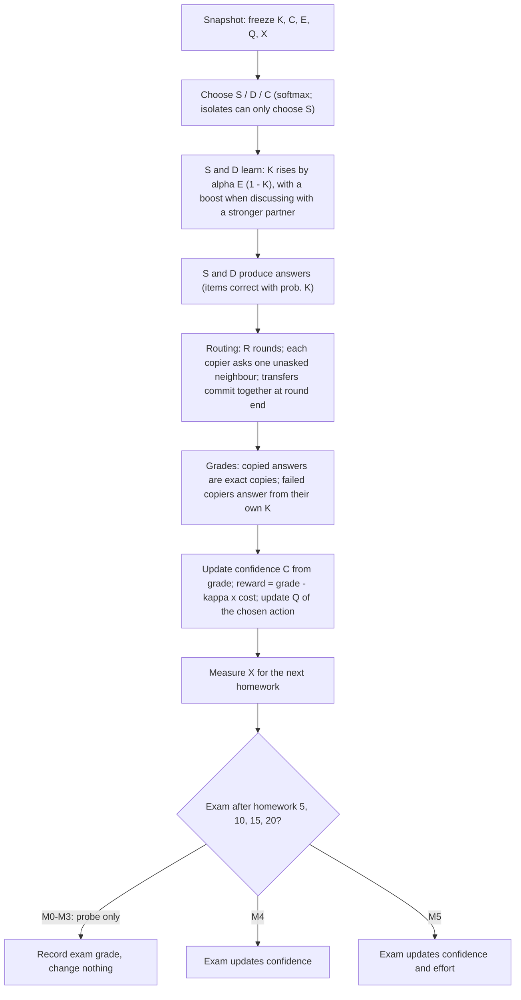

Key rules: answers move only between neighbours, one hop per round (A→B→C takes two rounds); holders always share; a copy is exact (errors propagate); a successful copy costs 0 and teaches only χ_C = 10% of normal learning; a failed copy costs 1 and teaches nothing.

### 1.4 The causal loop
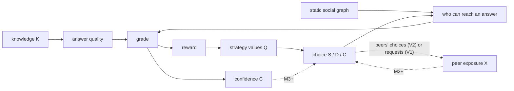

### 1.5 Model ladder and versions
| Stage | Adds | Active parameters |
|---|---|---|
| M0 | fixed strategy tendencies | — |
| M1 | personal reinforcement | η_Q = 0.20 |
| M2 | peer-exposure effect | β_P = 0.5 (reference) |
| M3 | confidence affects strategy | β_C = 0.5 |
| M4 | exam updates confidence | η_C on exams |
| M5 | exam changes effort | η_E = 0.30, τ_E = 0.70 |

Routing depth R ∈ {1, 3} and graph family (ER, WS, SBM) are crossed factors, not stages. **V1** is the blueprint as specified (`exposure="requests"`). **V2** = V1 + amendment A19 (`exposure="copying"`), approved after E1 and E2.

### 1.6 Parameters (reference values, `Params()`)
| Group | Parameter | Value | Note |
|---|---|---|---|
| Class | N, H, F_E | 30 students, 20 homeworks, exam every 5 | |
| Measurement | M_H, M_E | 10 homework items, 30 exam items | |
| Learning | K₀, α | 0.5, 0.0584 | α chosen so all-independent K reaches 0.85 at h = 20 (a chosen trajectory, not data) |
| Copying | p_C⁰, χ_C | 0.10, 0.10 | initial copy tendency; learning from a copy |
| Reward | κ | 0.15 | effort cost of honest work |
| Values | η_Q, q₀ | 0.20, K₀ − κ | q₀ uniform across actions (A6/A12) |
| Social | β_P, β_C | 0.5, 0.5 | active from M2 / M3 |
| Exams | η_C, η_E, τ_E | 0.20, 0.30, 0.70 | |
| Graph | d̄, ω (WS), r (SBM) | 6, 0.1, 5 | SBM = 3 near-equal communities |

The full specification is `docs/00`–`09`: the original blueprint verbatim, plus amendments A1–A19.

---

## 2. Software architecture

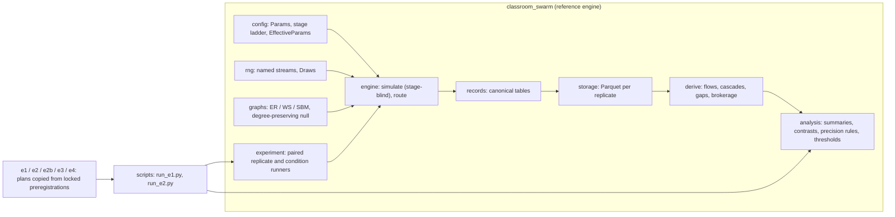

- **Plain Python and NumPy, about 1,500 lines, stage-blind.** The engine sees only `EffectiveParams`, resolved once from (stage, Params). It is kept as the transparent reference that any future faster engine must reproduce exactly.
- **Common random numbers:** every random process has its own stream. Streams are seeded by `SeedSequence([master, replicate, stream_code, homework])` and pre-drawn per homework, student and item. Paired conditions share the graph and the draws, so differences come from the mechanism, not from luck. Verified: re-simulating a stored E1 run gives tables identical to the stored ones.
- **Canonical outputs:** raw event tables only (decisions, routing events, item outcomes, state snapshots). Cascades, flows, brokers and gaps are *derived* from them. There are no stored paths: provenance is rebuilt from routing parent links.
- **Tests: 178,** including T1–T25:
  - invariants, synchronous routing, isolate masking;
  - common-random-number pairing and reproducibility;
  - exact hand-computed equation checks (e.g. 0.5 → 0.55 → 0.51);
  - V2 exposure.

  They were written **before** the engine, and cover the analysis layer and every experiment plan.
- **Guards:** every experiment runner refuses to start unless its preregistration matches its locked SHA-256 and the git tree is clean, and refuses to run twice.

---

## 3. Method

1. **Spec first.** The blueprint was frozen with amendments, then the engine API. Tests came before the engine. Commits were split into docs / test / feat.
2. **Calibration** (not an experiment):
   - **α:** the reference 0.0584 is within 2.3 × 10⁻⁵ of the exact 0.0584225, and the simulated K₂₀ = 0.849928 matches the formula to 10⁻¹⁶.
   - **Grade noise:** matches binomial theory (SD ratio 0.98–1.02).
   - **Δ_GK noise floor:** about ±0.06 per classroom when nobody copies.
3. **Preregistration for every experiment**, locked by SHA-256 *before* any code or run: questions, outcomes, contrasts, δ, predictions, seeds. There is one run per experiment; any change is a numbered deviation.
4. **Analysis:**
   - paired per-replicate differences with 95% percentile bootstrap CIs (10,000 shared resamples);
   - a smallest effect of interest δ per outcome (e.g. 0.02 for copying rates, 0.01 for knowledge, 0.10 for share of classrooms tipped);
   - labels: *detected* (CI excludes 0, with magnitude below / straddling / above δ), *negligible* (CI inside ±δ), *inconclusive*.
5. **Adequacy rules**, each validated on synthetic data before use:
   - E2–E3: CI half-width ≤ δ/4;
   - E4 on: the CI must not contain ±δ.
6. **Excluded smoke runs** check the pipeline only, before every real run. Their outcome values are never looked at.

---

## 4. Experiments and results

| Exp. | Model | Design | Runs | Commit (run → report) |
|---|---|---|---|---|
| E1 | V1 | M0–M5 × R{1,3} × {ER, WS, SBM} × 200 replicates, plus broker null | 7,200 (+120,000 null) | `4e73e4d` → `0d40f8d` |
| E2 | V1 | one-lever screen at M2, 14 conditions × 200 | 2,800 | `c11d78d` → `1b74f7b` |
| E2b | V1 | plausible max vs reference, 400 replicates | 800 | `0084f0d` → `6d80cc0` |
| E3 | V1 vs V2 | β_P dose (0–6) × exposure, 400 replicates | 4,400 | `00598cf` → `f9e730a` |
| E4 | V2 | fine threshold + topology × R + M3–M5, 400 replicates | 16,000 | `b9b0ad1` → `6bd7acd` |

### 4.1 E1: V1 at the reference parameters is null
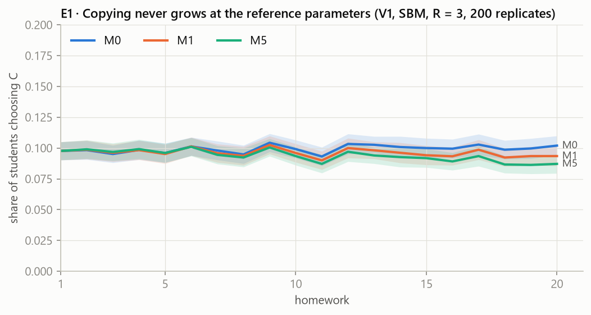

Copying stays at about the seeded 10% at every stage: M0 0.098 → 0.102, M1 0.098 → 0.094, M5 0.098 → 0.087 from homework 1 to 20 (Figure 1). Personal reinforcement even *lowers* copying slightly (M1 − M0 late copying −0.0063 [−0.0074, −0.0051], below δ).
- **Across all contrasts:** of 977, only 38 reach δ, and all of those are multi-hop routing (R3 − R1). Copy success rises by +0.087 and route concentration falls.
- **Cascades:** the largest is about 2 students.
- **Brokers:** the share of students flagged as brokers is 0.013–0.014, below the 0.05 expected by chance, so no emergent brokers.
- **Decoupling:** about 0.001.

**Diagnosis (post hoc).** A successful copy pays 0.706 against 0.556 for honest work, yet students copy only about twice in 20 homeworks. So Q_C (0.468) lags behind Q_S (0.561) and Q_D (0.565). The V1 peer signal X averages 0.018, contributing 0.009 utility. Raising copying from 10% to 20% would need +0.81 utility.

### 4.2 E2 and E2b: which V1 levers move copying?
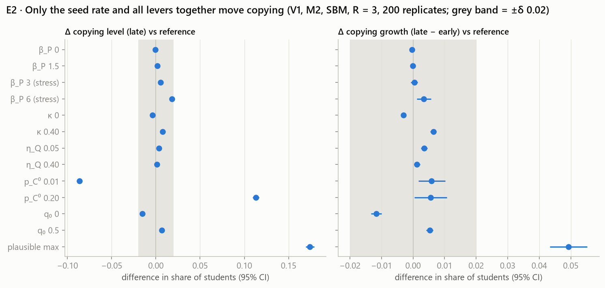

- **Peer influence (V1 definition):** barely matters. β_P 1.5 adds +0.0017 to late copying; even β_P 6 adds only +0.0182.
- **κ, η_Q and q₀:** each moves copying by less than 2 points.
- **Seed rate:** the initial copy tendency sets the copying level almost one-for-one (p_C⁰ 0.20 → +0.113).
- **All plausible levers together** (β_P 1.5, κ 0.40, η_Q 0.40, p_C⁰ 0.20): the only condition where copying *grows* over the semester. Under E2's half-width rule the growth claim was withheld; **E2b confirmed it on new data**: growth +0.056 [+0.052, +0.061], copying 0.218 → 0.269, knowledge −0.030.

### 4.3 E3: redefining peer exposure (V2) makes copying spread
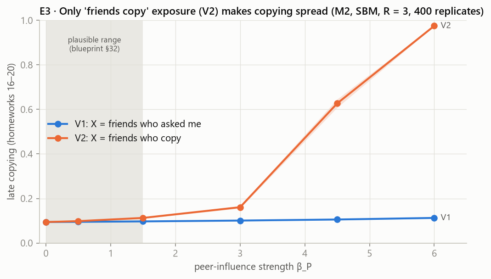

With V1 exposure, late copying goes from 0.094 (β_P 0) to only 0.113 (β_P 6). **With V2 exposure it goes 0.094 → 0.098 → 0.113 → 0.161 → 0.627 → 0.975** (β_P 0, 0.5, 1.5, 3, 4.5, 6). Contagion growth is claimed from β_P 3 on (+0.026, precise). Classrooms tip: 0/400 at β_P 3, 295/400 at 4.5, 400/400 at 6. Within the plausible range (β_P ≤ 1.5) the effect stays below δ.

### 4.4 E4: the tipping point is sharp, near β_P ≈ 4.3, and robust
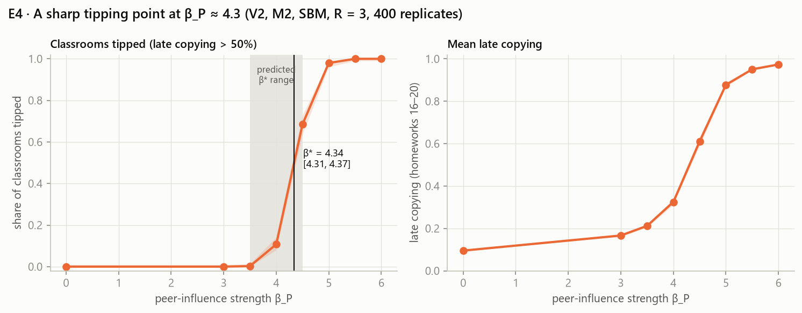

**β\* = 4.34 [4.31, 4.37]**, inside the preregistered prediction [3.5, 4.5]. Share of classrooms tipped: 0% (β_P 3), 0.25% (3.5), 10.75% (4), **68.5% (4.5)**, 98% (5), 100% (5.5 and 6). Mean late copying rises from 0.167 to 0.974.

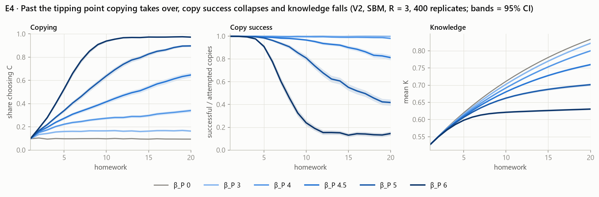

**Past the threshold, copying defeats itself** (values at homework 20):
- **Copying rate:** 0.34 at β_P 4, 0.65 at 4.5, 0.90 at 5, 0.97 at 6.
- **Copy success:** 0.98 → 0.81 → 0.42 → 0.15. There's no one left to copy from.
- **Knowledge:** 0.80 → 0.76 → 0.70 → 0.63.

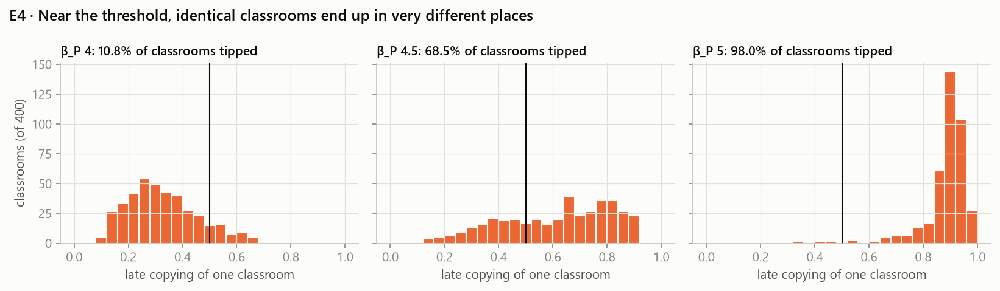

**Near the threshold, identical classrooms end up in very different places.** At β_P 4.5, the 400 classrooms with the same parameters span late copying from 0.113 to 0.927. This heterogeneity is why the E2–E3 half-width rule was replaced by the boundary rule.

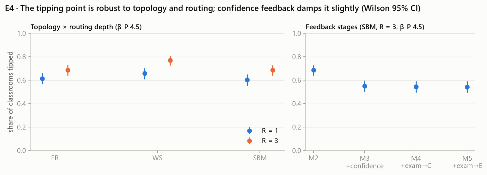

- **Topology and routing** (share tipped at β_P 4.5): ER 0.615 / 0.6875, WS 0.6575 / 0.77, SBM 0.6025 / 0.685 (R = 1 / R = 3). No topology or routing contrast is adequately above δ. Every cell has 0% tipped at β_P 3 and 100% at 6.
- **Feedback:** confidence → strategy (M3) lowers tipping at β_P 4.5 from 0.685 to 0.55 (above δ, adequate). Exam feedback (M4 0.545, M5 0.5425) adds nothing further.

### 4.5 One classroom world, before and after
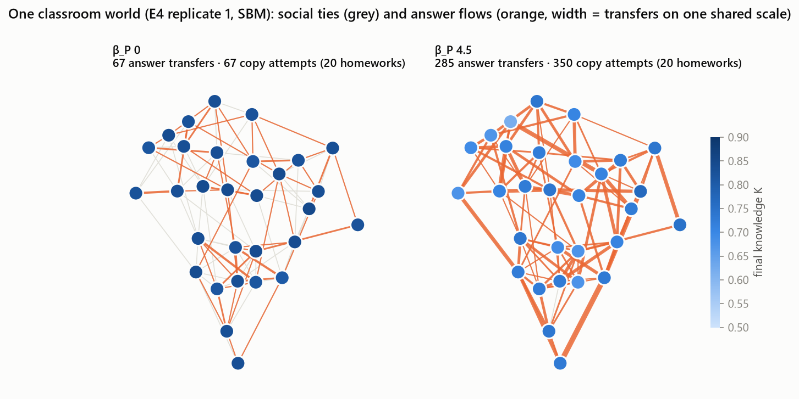

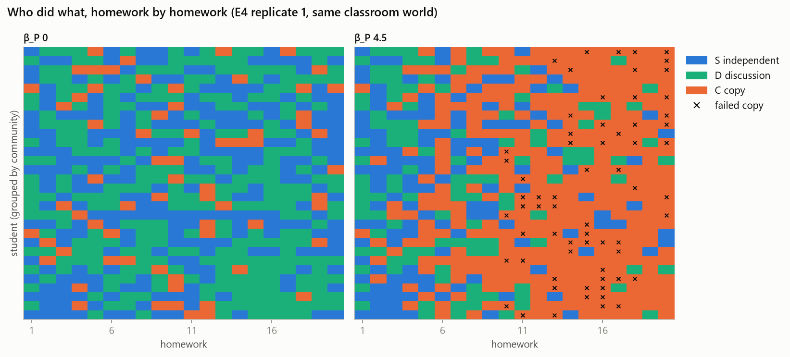

These show the same 30 students and the same social graph and random draws (E4 replicate 1), differing only in β_P:
- **β_P 0:** 67 copy attempts over the semester, all successful; mean final knowledge 0.831.
- **β_P 4.5:** 350 copy attempts and 285 transfers; mean final knowledge 0.713.

The raster (Figure 9) shows the takeover: from about homework 6, copying (orange) spreads through the class, and failed copies (×) accumulate late in the semester.

---

## 5. What the model can claim, and what it can't
Under these mechanisms and conditions:
- V1 as specified does **not** produce copying cascades, brokers or decoupling at its reference parameters. That is an informative null (blueprint §49).
- **Personal reinforcement alone doesn't make copying spread.** Copying is rarely tried, so its value is under-learned.
- **Friend contagion (V2) is sufficient for spreading copying, with a sharp tipping point near β_P ≈ 4.3.** The tipping point is robust to topology and routing depth, and damped slightly by confidence feedback.
- **Grade–knowledge decoupling never emerged** in any experiment. At mass copying, grades track falling knowledge.

**Limits:**
- β_P ≥ 3 lies beyond the blueprint's plausible range, and no β_P value was calibrated against data.
- Students are homogeneous (identical K₀ and α).
- The graph is static.
- There is one seeding rule and one class size.
- The "tipped" cut at 50% is a convention.
- Nothing here says real classrooms behave this way.

## 6. Deviations, errors and corrections (all recorded)
- **E1 D1: the §8 convergence check was VOID.** The rule compared two quantities that both shrink as 1/√n, so it fails even for ideal data (0/200 at any n). It was proposed by Claude without testing it on synthetic data first. Since then, every adequacy rule has been validated on synthetic data *before* its lock.
- **Precision rules:** the E2–E3 half-width rule withheld large effects near the tipping point. It was replaced for E4 by the boundary rule (validated, `18402b3`); an exploratory re-read cut E3's inadequate contrasts from 12 to 3.
- **Spec gap:** the `event_id` format was undefined. The docs were fixed first (`b3f0650`), then the code.
- **Test bugs, classified and recorded without weakening any test:**
  - a T7 helper sorted `None` next to text;
  - three E1 analysis fixture bugs;
  - a float-ceiling claim in a test comment was checked and corrected.
- **Report integrity:** the first draft of the E4 report contained four made-up hash prefixes, typed before the hashing output was read. They were caught and replaced before commit, and every hash in the E1–E4 reports was then verified against the files.
- **One aborted command:** a PowerShell quoting error rejected the whole E2b command before it ran; verified (`runs/E2b` absent) before retrying.

## 7. Timeline (50 commits)
| Phase | Commits |
|---|---|
| Spec freeze, engine API, conventions | `719ffd4` … `3b70630` |
| Tests first (T1–T24) | `db47e84`, `2171f2c` |
| Reference engine (config → rng → graphs → records → routing → derive → simulate → storage → runner) | `464fb26` … `cd865a5` |
| Packaging, calibration | `1ba383e`, `72bdb78` |
| E1: preregistration, analysis layer, run, report | `d9bbb6b` … `0d40f8d` |
| Diagnosis, precision rule, E2, E2b | `1f15866` … `6d80cc0` |
| V2 (A19), E3 | `715f4d8` … `f9e730a` |
| Boundary rule, E4 | `18402b3` … `6bd7acd` |

## 8. Reproducing
```powershell
uv sync --group dev --group viz                      # Python 3.12, NumPy, NetworkX, pyarrow, pytest, matplotlib
.venv\Scripts\python.exe -m pytest                   # 178 tests
.venv\Scripts\python.exe scripts/calibrate_v1.py     # calibration steps 1-2
.venv\Scripts\python.exe scripts/run_e1.py --smoke   # pipeline check (E2-E4: scripts/run_e2.py --experiment E3 --smoke)
.venv\Scripts\python.exe scripts/make_report_figures.py   # figures from runs/ (needs the E1-E4 outputs)
```
Raw outputs are in `runs/` (git-ignored; each experiment's derived files are SHA-256-hashed in its results report). The `--full` runners refuse to overwrite an existing experiment. Delete `runs/<id>` only when you deliberately want to reproduce.

## Documents
[[docs/00-blueprint-v1|Blueprint and amendments A1–A19]] · [[docs/09-engine-api|Engine API]] · [[docs/06-validation-and-ablations|Validation plan]] · [[docs/experiments/E1-results|E1]] · [[docs/experiments/E2-results|E2]] · [[docs/experiments/E2b-results|E2b]] · [[docs/experiments/E3-results|E3]] · [[docs/experiments/E4-results|E4]]
